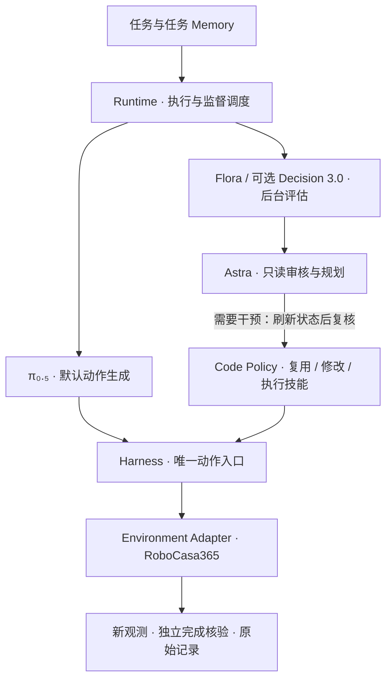

# agent_vla

面向机器人任务的 VLA 监督、程序恢复与纠错数据收集框架。
π₀.₅ 默认生成连续动作；Flora 或 Decision 3.0 提供进展证据；Astra 负责审核、规划和 Code Policy 开发。
所有动作统一经过 Harness，代码、任务经验和执行证据分别版本化。

这是研究代码。当前重点是 **RoboCasa365 原子任务**；所用 OmniSF checkpoint 针对 atomic 任务训练。
本仓库不分发模型权重、仿真资源、登录凭据或原始 RGB-D 轨迹。

## 当前架构



监督在后台运行；普通审核不暂停 VLA。实际接管时撤销旧动作权限、清理待执行 Chunk 并读取当前状态。
Code Policy 接管完整的已分配子任务，完成验证后才交还控制。

最近 OpenDrawer 实验采用 **Flora 每 50 控制步评估 + 按需 Astra 审核**，Astra 为 `high`；
Decision 3.0 五类判别仍是可选后端。Flora 评分、Astra 判断和程序自报成功均不替代原生 `task_success`。
正在讨论的“Astra 生成、迭代任务判断程序”尚未接入自动执行链路。

## 从哪里看代码

| 内容 | 入口 |
|---|---|
| 执行与监督循环、控制权 | [runtime.py](src/vla_agent/runtime.py)、[supervision.py](src/vla_agent/supervision.py)、[harness.py](src/vla_agent/harness.py) |
| Astra 工具调用、预算与服务限流 | [codex_planner.py](src/vla_agent/codex_planner.py)、[toolkit.py](src/vla_agent/toolkit.py)、[planner_service.py](src/vla_agent/planner_service.py) |
| 恢复工作区、程序执行与技能依赖 | [workspace.py](src/vla_agent/workspace.py)、[recovery.py](src/vla_agent/recovery.py)、[skill_packages.py](src/vla_agent/skill_packages.py) |
| Working / Task / Episodic Memory | [memory.py](src/vla_agent/memory.py)、[task_memory.py](src/vla_agent/task_memory.py)、[experience.py](src/vla_agent/experience.py) |
| Flora / Decision 与几何感知 | [flora.py](src/vla_agent/flora.py)、[decision.py](src/vla_agent/decision.py)、[perception.py](src/vla_agent/perception.py) |
| 环境与 VLA 连接 | [adapters](src/vla_agent/adapters) |
| 实验、审计和视频 | [scripts](scripts)、[visualization.py](src/vla_agent/visualization.py) |
| 当前架构与文档导航 | [当前架构](docs/current-architecture.md)、[文档索引](docs/README.md) |

`configs/` 中已有真实实验配置保留原机器绝对路径，便于追溯；迁移机器从
[可移植配置模板](configs/examples/open_drawer.yaml) 开始，将占位路径改成实际绝对路径。
配置读取器不会自动展开 `${VAR}`；运行命令应显式传入配置和输出目录。

## 运行不依赖模型的示例

以下以本项目路径 `/home/junwue/code/vla_agent` 为例；在其他机器上请整体替换为实际克隆目录。
需要 Python 3.11 或更新版本。不要把仿真、π₀.₅、Flora 的依赖安装到同一个环境。

```bash
python3.11 -m venv /home/junwue/code/vla_agent/.venv
/home/junwue/code/vla_agent/.venv/bin/python -m pip install -e '/home/junwue/code/vla_agent[dev]'
cd /home/junwue/code/vla_agent
/home/junwue/code/vla_agent/.venv/bin/vla-agent run --config /home/junwue/code/vla_agent/configs/demo.yaml --output /home/junwue/code/vla_agent/runs/demo-github-001
/home/junwue/code/vla_agent/.venv/bin/vla-agent inspect /home/junwue/code/vla_agent/runs/demo-github-001
```

输出目录必须尚不存在。Demo 使用 mock 环境和 mock 模型，只验证软件闭环，不代表机器人任务成功率。
`demo_exploration.yaml` 另演示失败反馈、代码修订和再次验证。
Demo 配置中的相对技能路径依赖上述工作目录；真实任务提交建议全部使用绝对路径。

完整测试还需要固定版本的 OpenPI client（π₀.₅ 通信测试使用），无需加载模型：

```bash
/home/junwue/code/vla_agent/.venv/bin/python -m pip install 'openpi-client @ git+https://github.com/robocasa-benchmark/openpi.git@5a6beda9ff99da30b4e1b59320f6a32971d7c397#subdirectory=packages/openpi-client'
/home/junwue/code/vla_agent/.venv/bin/python -m pytest /home/junwue/code/vla_agent/tests -q
```

## 接入真实任务

需要分别准备 RoboCasa365/robosuite 仿真环境、OmniSF π₀.₅ 推理环境与 atomic 权重、
Flora 服务，以及能够访问配置中 reasoning 模型的 Codex 登录环境。
模型标识、服务可用性及模型访问权限取决于部署环境；更换后应重新验证，不能宣称完全复现原实验。

从 [OpenDrawer 模板](configs/examples/open_drawer.yaml) 复制到本地配置并填写全部绝对路径。
模板使用只读初始 Memory；要开展积累实验，应为每条 Episode 复制独立可写 Memory，并记录快照。
启动方法、所需资源与本机历史版本见 [部署说明](docs/deployment.md)。
`serve_from_config.py` 可分别启动 `vla`、`flora` 和可选 `decision`；每次显式指定 `--config`。

## 已有实验结果

OpenDrawer seeds 0–19，同一 atomic checkpoint、配对初始状态、固定初始 Memory，750 步原生预算、
最多 1500 步扩展预算。表中时间为所有 Episode 的平均墙钟时间，包含失败和服务等待。

| 版本 | 750 步成功 | 1500 步内最终成功 | 平均耗时 |
|---|---:|---:|---:|
| 纯 VLA | 12/20 | 12/20 | 6.54 分钟 |
| Agent R1 | 12/20 | 13/20 | 6.99 分钟 |
| Agent R2 | 11/20 | 13/20 | 8.21 分钟 |
| Agent R3 | 12/20 | 14/20 | 8.14 分钟 |

R3 的两条新增成功都发生在扩展预算阶段；没有证据表明原生 750 步预算内成功率提高。
R2 两条零动作服务失败保留在统计中。R4 另做五条针对性复测，1/5 成功，不能与其他版本拼接为新的 20-seed 成绩。
这些是已见 seeds 的开发实验，不是未见测试集上的泛化结论。

[实验结果与限制](docs/experiments/open-drawer.md) · [80 条逐 Episode 指标](docs/experiments/opendrawer-seeds0-19.csv)。
原始轨迹与视频保存在本机 `runs/`，不随 Git 仓库上传。

## 技能与经验

[根技能目录](skills/INDEX.md) 保留历史代码及原有版本哈希；发布准备时有 3 个模板和 162 个候选版本，
这些候选没有被自动晋升为跨布局验证通过的技能。已归档的旧恢复稿不参与默认检索。

[OpenDrawer 示例](examples/open_drawer/README.md) 单独提供配对实验的初始 Memory、固定依赖技能，以及 R4 两个候选修订。
成功和失败候选均保留，状态和验证范围见对应说明。快照中的原始路径用于证据追溯，不代表仓库包含原始轨迹。

通用几何和控制模块按固定版本复用；换场景先重新测量参数，逻辑变化才新增代码版本。
完整子任务成功需独立核验，单次成功不自动进入 VLA 正向训练集。

## 发布范围与来源

仓库包含代码、测试、示例、精简实验指标和第三方来源说明。
虚拟环境、`runs/`、本机可写 `memory/`、checkpoint、模型权重及凭据由 `.gitignore` 排除。
历史文档可能引用未公开的本机数据；当前入口以本页和 [当前架构](docs/current-architecture.md) 为准。

[第三方来源与归属](THIRD_PARTY_NOTICES.md) · [发布与维护说明](docs/github-publication.md)。
当前尚未为本项目选择项目级 LICENSE；保留的第三方 LICENSE/NOTICE 不代表本项目整体采用同一许可。
