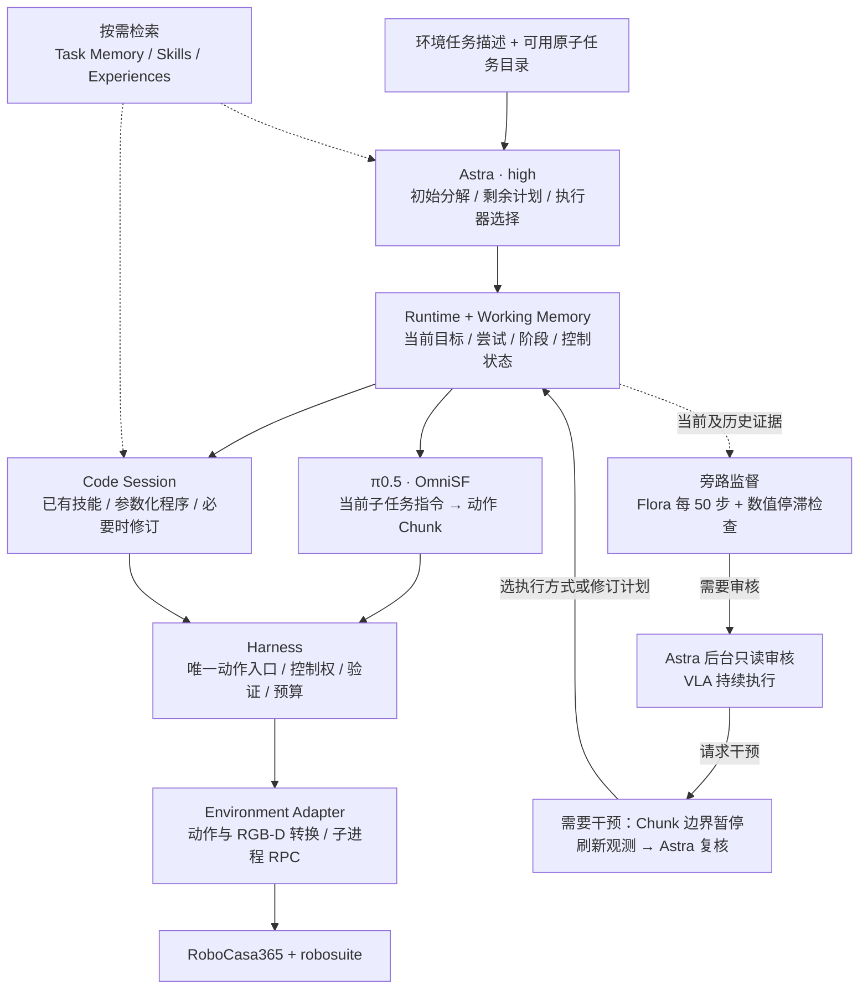

# Agent 架构、执行耗时与调用冗余审计

日期：2026-11-02。范围：当前 WaffleReheat 可执行子任务架构，以及已结束的 `waffle-subtasks-20261102` seed 0–4。正在进行的 quota retry 不混入这组统计。

后续同日更新：本文建议中的分层代码读取、短检索索引、统一编辑与写入自动检查现已实现，见 [代码工具更新](code-tools-v2.md)。本文统计及“本次实际修改”指审计时的冻结实验与当次工作，不包含新工具的端到端实验。

**当前主要瓶颈是暂停执行期间反复调用 Astra 修改、配置和检查恢复程序。保持 high 合理，但这组实验本来就是 high，不能把切换档位当成这组实验的加速措施。**

## 1. 本次实际修改与证据边界

- `PlannerConfig.reasoning_effort` 默认值由 `low` 改为 `high`。
- `configs/` 中 6 个仍写着 `xhigh` 的模板统一改为 `high`：`robocasa`、`atomic_low_calls`、`suite15`、`close_toaster_dev`、`close_toaster_explore`、`close_toaster_d3_legacy`。其中 legacy 指 D3 监督后端，不表示新的运行仍使用旧推理档位。
- `waffle_subtasks`、`composite_memory`、`close_toaster_reuse` 原来已是 `high`，保持现值；README 中的旧 `xhigh` 描述已修正。
- 新增只读日志审计脚本 `scripts/audit_agent_runtime.py`，输出逐 turn CSV 和完整 JSON。
- 本文第 6 节是后续改造建议，**尚未改动工具协议、执行状态机或监督触发规则**。

已结束五个 episode 的 29 次 `codex_thread` 返回均为 `gpt-6-astra:high`。当前 retry seed 1 在审计时已创建的 4 个线程也均为 high。调用端在 `thread/start` 检查返回的模型与 effort，不一致即报错；每次 `turn/start` 也传入同一 effort。

当前通过登录后的 `codex app-server --stdio` 调用 Astra。配置中的 Responses endpoint 不代表本次走了直接 HTTP Responses 分支。`high` 是 Astra 支持的档位；官方将它用于复杂规划和代码调试，但没有承诺固定响应时间。[模型档位](https://developers.openai.com/api/docs/models/gpt-6-astra)，[推理档位说明](https://developers.openai.com/api/docs/guides/reasoning)。

当前 retry 使用原实验冻结源码 `runs/waffle-subtasks-20261102/profiles/v1/src` 和独立运行 YAML。本次工作目录的默认值、模板与文档修改不改变冻结实验，也没有重启正在执行的 episode。

## 2. 现在真正运行的架构



图中回到下一次观测的路径用文字说明：环境观测持续进入 Working Memory 和 Recorder；VLA 下一次推理、Flora 历史视频窗口、Astra 快照与程序几何查询都从这些证据读取。后台审核返回 continue 时，VLA 保持原有控制权。Code 内部的修订暂停不交还 VLA。

### 实际组件设置

| 组件 | 本次运行设置 | 权限与边界 |
|---|---|---|
| Astra | `gpt-6-astra`，high，Codex app-server；每 12 个 turn 重建线程 | 负责子任务组合、干预审核、执行器选择与程序开发；一个 turn 可以包含多次模型推理和工具往返 |
| VLA | 本地 π0.5 / OmniSF atomic checkpoint `59999`，quantile normalization；WebSocket 8010 | 输入当前原子子任务指令、最新 3 视角 RGB 和机器人状态；目前没有主任务与子任务字符串拼接 |
| Chunk 执行 | 模型返回 50 步，实际每轮执行前 5 步后重新推理 | 调用开销不是每个控制步都发生；语言在新 Chunk 推理边界生效 |
| 监督模型 | `decision.kind: flora`，本地 Flora Outcome，HTTP 8030 | 每 50 个 VLA 执行步评分，窗口最多 200 步；2 视角，采样历史帧；不是 D3 的“5 帧 × 3 视角” |
| 监督路由 | 高分 ≥4；连续 2 次低分 ≤2；分数下降 ≥2；连续 3 次同分 | 请求 Astra 审核，不自动切换或判定成功；已有 pending 合并和 150 步评分审核冷却 |
| 数值停滞 | 10 步、至少 2 秒的窗口，EEF 平移小于 1 cm；4 秒冷却 | 独立请求后台审核；小位移不等于失败，不直接接管 |
| 子任务完成 | 当前 Waffle 可用仿真原生局部验证器 | 检查布尔完成条件；属于验证器辅助评测，不是纯视觉完成判断 |
| Code Policy | 按完整局部子任务持有执行器分配，多个版本共用工作区 | 可以分阶段检查；只有固定局部目标验证通过，才交由 Astra 选择下一执行器 |
| 直接动作修正 | `local/eef/edit` 未列入本配置允许干预项 | 当前由 VLA 或 Code Policy 经 Harness 执行动作；宿主仍保留兼容实现 |
| Memory | 历史索引 10,000 字符；Working Memory 索引 14,000 字符；按需展开 | 字符上限不是 token 上限，也不覆盖整个线程、所有契约和显式工具返回 |

本次四个注册目标为：打开微波炉 → 把装有 waffle 的碗放入 → 关闭已装载的微波炉 → 启动。它们由 Astra 从目录选入计划；最终成功仍以环境 `task_success` 为准。实际五个 episode 只执行到了开门和装碗，不能把列出的四个目标当成已经完成的轨迹。

运行预算：Episode 无墙钟超时，最多 8100 控制步；单程序 600 步 / 360 秒；每个 Code 子任务最多 32 次尝试、6000 步、10800 秒；Astra 最多 200 turns，单 turn 工具预算 48。取消 Episode 限时没有取消这些局部预算。

### 一次代码恢复如何发生

1. 后台审核提出干预；在适当边界暂停 VLA，废弃旧 Chunk，刷新观测并复核。
2. Astra 查找技能，选择参数，必要时导入到 Recovery Workspace 修改模块。
3. 宿主检查契约、接口、参数与版本，冻结依赖；隔离 worker 运行程序。
4. 程序经工具接口读取 RGB-D、grounding、几何信息，并通过 Harness 控制。工具参数错误返回结构化反馈；旧版本观测/控制回复不能覆盖当前状态。
5. 程序返回后，独立验证固定局部目标。成功则记录证据，交给 Astra 选择下一执行器；未通过则进入 `revise_code`，仍保持 Code 所有权。

目前第 5 步把很多“预期的中间检查点”和真正的异常一起送回 Astra。整个子任务留在 Code 中这点已实现，但整个子任务能独立跑完的程序能力仍不足。

## 3. 五个 episode 的真实时间

统计来自 `result.json`、原始事件时间戳以及原有 `analysis/*.json`。0/5 达成原生整任务成功，其中 seed 1、2 因调用额度中断；其余 3 个正常停止但失败。因此这些是**运行至结束或中断的时间，不是成功完成用时**。五个环境共享模型服务并发运行，累计 episode 时间不能当成批次墙钟时间。

| seed | Episode 分钟 | Astra turns | Code 程序尝试 | 暂停期间 Astra 分钟 | 结束情况 |
|---:|---:|---:|---:|---:|---|
| 0 | 67.95 | 41 | 32 | 51.96 | 策略停止，未成功 |
| 1 | 128.95 | 72 | 49 | 92.22 | 额度中断，未观测到成功 |
| 2 | 127.92 | 69 | 44 | 100.87 | 额度中断，未观测到成功 |
| 3 | 104.94 | 62 | 43 | 81.76 | 策略停止，未成功 |
| 4 | 93.25 | 64 | 42 | 62.98 | 策略停止，未成功 |
| 平均 | **104.60** | **61.6** | **42.0** | **77.96** | — |

批次墙钟约 132.06 分钟；五个 episode 时间之和约 523.01 分钟。

| 互不重复的主链路归因 | 每 episode 平均分钟 | 总时间占比 | 计时内容 |
|---|---:|---:|---|
| 暂停期间 Astra turn | **77.96** | **74.53%** | 启动规划、暂停复核、代码修订、下一执行器选择；包括 turn 内工具往返 |
| VLA 动作实际执行 | 12.29 | 11.75% | 环境 step、观测返回等命令执行路径 |
| Code 程序执行 | 11.92 | 11.39% | 整个程序运行，包含程序内动作、观测和几何计算 |
| VLA 推理 | 0.46 | 0.44% | 客户端记录的 2005 次已完成推理 |
| 其他及未归因 | 1.97 | 1.88% | 启停、调度、部分日志开销和无完整结束事件的等待等 |

后台审核和 Flora 与动作执行重叠，**不再叠加进上表**。暂停期间 Astra 的 74.53% 不是纯 GPU 计算比例，也不是纯 reasoning token 耗时。

### Astra 的时间到底花在哪里

| intent | 发起次数 | 有结束事件的样本 | 平均秒 | 中位秒 | P90 秒 | 结束 turn 总分钟 |
|---|---:|---:|---:|---:|---:|---:|
| `initialize_plan` 初始规划 | 5 | 5 | 14.69 | 14.68 | 16.22 | 1.22 |
| `review_running` 后台审核 | 65 | 64 | 22.33 | 18.03 | 36.12 | 23.82，主要与执行重叠 |
| `confirm_intervention` 暂停后复核/准备 | 25 | 25 | 82.27 | 48.28 | 169.19 | 34.28 |
| `revise_code` 恢复程序修订/配置 | **202** | **200** | **104.45** | **89.57** | **170.39** | **348.16** |
| `select_next_executor` | 7 | 7 | 38.05 | 14.60 | 82.26 | 4.44 |
| `review_execution` 其他暂停处理 | 4 | 4 | 25.48 | 20.34 | 42.62 | 1.70 |

202 个修订 turn 占全部 308 个 turn 的 65.6%；有结束记录的修订占暂停 Astra 时间的 **89.3%**。缺失结束事件的 1 个后台审核、2 个修订不填零、不计入延迟均值。次数是 Codex turn，不等于底层模型 HTTP 请求数，也不等于修改代码的版本数。

代码修订 turn 平均约 10.22 秒到第一次宿主工具调用；宿主工具自身累计运行平均只有 0.83 秒，剩余约 103.62 秒包括模型多轮推理/生成、工具返回后的再次推理、服务与网络等待。现有日志不能进一步把这 103.62 秒准确拆成 prefill、decode、排队和网络。

### 本地模型与控制延迟

| 路径 | 样本/平均延迟 | 解释 |
|---|---|---|
| π0.5 推理 | 2005 次，**0.0695 秒/次**；中位 0.0598，P90 0.1046 | 每次返回一个动作序列；不是每个环境 step 的总耗时 |
| Flora 服务计时 | 205 个成功评分，**1.062 秒/次** | 服务返回的计时，不是 Agent 收到结果的全部等待 |
| Flora 客户端总评分 | 同 205 个评分，**2.322 秒/次**；P90 2.857 | 包含视频准备、传输/等待等额外路径 |
| 周期 Flora | 194 个成功评分，平均 2.211 秒 | 全部发起请求共 208 次，未得到成功评分的请求不并入该延迟统计 |
| Astra 主动 Flora tool | 11 个成功评分，平均 4.267 秒 | 与周期监督的片段长度、准备过程和排队不同 |
| 环境动作路径 | 各 episode 平均 **0.324–0.404 秒/步** | 包含仿真与观测返回；不能仅凭这个数归因于 RPC |
| Code 程序 | 210 次尝试，平均 **17.02 秒/次** | 是程序尝试，不是完成整个子任务的平均时间 |

环境按 20 Hz 控制时间推进，每步对应 0.05 秒仿真时间；本次每步墙钟约为它的 6.5–8.1 倍。这是第二层性能问题，需进一步拆分物理仿真、OSMesa 渲染、RGB-D 打包和落盘后再选优化方案。

## 4. 代码入口与职责

以下链接均指工作目录源码；历史实验复现应使用冻结副本及各 episode YAML。

| 模块 | 主入口 | 负责什么 / 当前瓶颈 |
|---|---|---|
| 配置与组装 | [config.py](../src/vla_agent/config.py)、[cli.py](../src/vla_agent/cli.py)、[waffle_subtasks.yaml](../configs/waffle_subtasks.yaml) | 模型、服务、预算和组件；D3 字段仍存在，但当前 `kind: flora` |
| 主循环 | [runtime.py](../src/vla_agent/runtime.py) 的 `handle/loop` | Chunk、事件、暂停、复核、分支执行；部分策略退出再进入外层 Astra |
| 后台审核 | [supervision.py](../src/vla_agent/supervision.py) 的 `RunningReviewer` | 冻结证据、只读权限、过期回复校验、Chunk 边界接管 |
| Astra 调用 | [codex_planner.py](../src/vla_agent/codex_planner.py)、[codex_transport.py](../src/vla_agent/codex_transport.py) | 线程、动态工具、多轮调用、high 校验、token 记录；工具往返次数和上下文增长 |
| Flora 监督 | [flora_supervision.py](../src/vla_agent/flora_supervision.py)、[flora.py](../src/vla_agent/flora.py) | 周期窗口与评分路由；高分、未完成与失误的语义需校准 |
| VLA 接口 | [adapters/pi05.py](../src/vla_agent/adapters/pi05.py)、[serve_pi05.py](../scripts/serve_pi05.py) | 最新观测和原子语言 → 本地推理；目前延迟占比很小 |
| Code 子任务会话 | [code_session.py](../src/vla_agent/code_session.py) | 保持整个局部目标、代码版本、预算；中间检查点频繁回到 `revise_code` |
| 程序执行 | [recovery.py](../src/vla_agent/recovery.py)、[recovery_worker.py](../src/vla_agent/recovery_worker.py) | 隔离程序、工具 RPC、执行与独立完成验证 |
| 工具层 | [toolkit.py](../src/vla_agent/toolkit.py) 的 `package_view/call` | 参数校验与派发；指定模块仍重复返回大段元数据 |
| 代码与技能 | [workspace.py](../src/vla_agent/workspace.py)、[skill_packages.py](../src/vla_agent/skill_packages.py)、[skills.py](../src/vla_agent/skills.py) | 固定版本、依赖组合、契约与回归证据；候选多、成熟直接复用少 |
| Memory | [memory.py](../src/vla_agent/memory.py)、[working_context.py](../src/vla_agent/working_context.py)、[memory_context.py](../src/vla_agent/memory_context.py)、[task_memory.py](../src/vla_agent/task_memory.py)、[experience.py](../src/vla_agent/experience.py) | 当前状态、任务卡、历史证据索引；显式读工具可再次扩大上下文 |
| Harness | [harness.py](../src/vla_agent/harness.py) | 唯一动作 lease、队列失效、停止与完成核验；不是模型推理服务 |
| 仿真适配 | [adapters/robocasa.py](../src/vla_agent/adapters/robocasa.py)、[robocasa_worker.py](../src/vla_agent/adapters/robocasa_worker.py) | 独立仿真 Python，通过 stdin/stdout 逐行 JSON 请求响应；动作结果不确定时不盲目重放 |
| 原子任务与条件 | [subtask_catalog.py](../src/vla_agent/adapters/subtask_catalog.py) | 语言模板、前置条件、局部完成；当前条件主要在入口/边界检查 |
| 观测/几何/控制 | [grounding.py](../src/vla_agent/grounding.py)、[geometry_fitting.py](../src/vla_agent/geometry_fitting.py)、[control.py](../src/vla_agent/control.py) | 视觉区域、带尺度深度、坐标转换和控制接口；反复手动重选目标增加 Astra 往返 |
| 数据与回放 | [data.py](../src/vla_agent/data.py)、[visualization.py](../src/vla_agent/visualization.py) | 原始日志、命令与测量分离、视频和候选数据；落盘耗时还未单独归因 |

## 5. 哪些调用存在重复，哪些不能直接删除

### 5.1 已证实的重复数据

五个 episode 有 2681 次宿主工具结果，总计约 3216 万字符（不含图片，也不等于输入 tokens）。其中：

| 工具 | 调用数 | 平均返回字符 | 累计字符 | 问题 |
|---|---:|---:|---:|---|
| `read_program` | 398 | 40,241 | 16,015,910 | 395 次已指定 path，仍带完整 SKILL 文档、契约、参数模式及入口代码；占全部工具结果字符约一半 |
| `read_skill` | 102 | 26,742 | 2,727,640 左右 | 接口信息与实现代码尚未充分分离 |
| `read_recovery_trace` | 201 | 11,644 | 2,340,000 左右 | 多次读取长测量历史，诊断只需其中一段时仍较大 |
| `search_skills` | 44 | 45,120 | 1,985,000 左右 | 搜索结果不够像轻量索引 |
| `list_skill_versions` | 17 | 75,261 | 1,279,444 | 最大单次 185,459 字符，列版本不应反复返回全部契约细节 |

根因可直接定位到 `toolkit.py:package_view`：过滤 `package_files` 后，原元数据仍整包保留；指定 path 只是再增加所选文件。这是工具响应协议问题，继续压缩提示词不能解决。

### 5.2 中间检查点被当成一次重新推理

202 次 `revise_code` 前，至少 23 条程序反馈文字含 `checkpoint`。其中既有预期对齐/开门弧线检查点，也有需要重新观测或修复姿态的检查点，**不能据此说 23 次全部可以删除**。

具体例子：seed 1 step 1015 的反馈为开门弧线 checkpoint，接着 Astra 花 81.39 秒修订；seed 4 step 3191 达到 clearance checkpoint 后，再花 145.49 秒测量、准备下一次执行。通常程序本身只有十几秒，却在阶段间进入一分钟以上的模型往返。

应由程序处理可计算的测量更新、有限参数搜索和已知下一阶段；不确定性超出支持范围、真正进展不足或计划前提变化，才请求 Astra。不能用“继续程序”绕过独立核验，也不能把局部 checkpoint 改名为整子任务成功。

### 5.3 后台审核 → 暂停复核：有开销，但有职责

65 次后台审核中，62 次被采纳：37 次 continue，25 次请求干预；另有 2 次过期丢弃、1 次取消。触发来源为 Flora 39 次、数值停滞 25 次、过期重新核对 1 次。

25 次请求干预对应 25 次 `confirm_intervention`，平均 82.27 秒。复核最终选择 12 次 code、7 次 refine、4 次 replan、1 次 continue、1 次 switch。复核中包含技能查找和代码准备，不能都算作“重复回答是否干预”。

后台审核期间机器人仍在运动，暂停后的新观测不可省。可优化为短确认与复用既有诊断，或由后台准备受条件约束的候选方案；宿主仍须检查新鲜度、前置条件和控制权。62 次有效审核中 continue 占多数，不代表审核没有价值，也不能据此计算误报率。

已有 125 条 `review_coalesced` 记录，说明系统已经在合并 pending 或冷却中的请求。后续应根据“同一语义目标 + 同一异常 + 是否出现新证据”去重，而非只继续拉长时间冷却。

### 5.4 其他重复路径

- `revise_code` 提出非 code 策略后，当前 `code_session.py` 记录 `recovery_strategy_change`，再由外层重新调用 Astra。本组只出现 1 次，所以存在改造价值，但不是首要耗时来源。
- 代码完成后 7 次 `select_next_executor` 平均 38.05 秒，中位 14.60 秒，少数长调用拉高均值。选择下一执行器本来就是 Astra 的职责；可预先批准条件式下一步，而非无条件取消该审核。
- `record_note` 调用了 214 次。返回本身只有几十字符，但每次由模型组织笔记、发工具、再继续推理；可合并到最终结构化结果，同时由 Recorder 自动保存事实。
- `check_program` 156 次与大量版本修改相关，是必要的契约/代码检查，不能为了减少调用数删除。可以让一次 patch 工具自动完成同样的检查，并返回小型差异和诊断，减少模型串行发工具。
- 原始五个 episode 有 17 次导入已有技能、0 次直接技能调用；新增 149 个候选版本不等于新增 149 个成熟能力。当前 retry 已有直接调用记录，但尚不能由此断言整任务成功率或速度提高。

## 6. 建议修改顺序

| 顺序 | 改造 | 具体位置 | 验收方式 |
|---|---|---|---|
| P0 | 工具结果按字段/模块返回；轻量搜索与版本分页 | `package_view`、`skills.search/versions`、`read_recovery_trace` | 同一个模块读取不再携带全份文档；旧契约可按引用读取；比较真实返回字符和 turn 延迟 |
| P0 | Actor 只读技能接口，Optimizer 按需读实现 | `planner_tools`、`codex_planner`、技能目录 | 调用已验证技能不必读源码；出现问题才进入修订模式；Astra 仍负责两种角色 |
| P1 | 明确程序的“可继续/需新感知/需推理修订/完整完成”状态 | `CodeSession`、`RecoveryRunner`、程序契约 | 已知检查点在同一 Code 所有权下继续；所有步数/时间预算累计；任务完成仍独立核验 |
| P1 | 把反复 grounding、闭环对齐、参数重算写成可复用函数 | `grounding`、几何工具、任务技能包 | 支持可靠重观测和失效退出；用多个布局验证，避免存固定世界坐标 |
| P1 | 修复子任务交接：稳定完成、释放与撤离、持续前置条件 | 原子契约、`runtime`、技能程序 | 开门完成后装碗过程中不能默默丢失可用开口；异常回到缺失前提；不只加长预算 |
| P2 | 审核复用诊断；工具结果与笔记一次提交 | `supervision`、`runtime.handle`、`codex_planner` | 新鲜观测复核仍在；同一事实不反复长篇解释；过期方案不能执行 |
| P2 | 语义任务级失败摘要与证据去重 | `memory`、`task_memory`、监督路由 | 计划版本变化不把同一已失败目标当成完全无历史的首次尝试 |
| P3 | 仿真逐步性能剖析 | adapter/worker、渲染、Recorder | 分别记录 step、render、编码、传输、落盘；有证据后再优化渲染或通信 |

建议先落地 P0，再做程序续跑与交接；用相同 seed、初态、模型权重、预算和冻结 Memory 做对照，同时报告成功率、暂停秒数、修订 turn 数及直接技能复用。不同版本/预算/历史经验一起变化的总时间差不能证明某一项优化有效。

当前失败也限制了速度：已出现多次开门通过后，在装碗阶段开门条件再次为 false；装碗程序还受目标对应、混合深度表面、接触和抓取稳定性影响。把同一个不稳定循环跑得更快，并不能解决长程任务成功率。入口状态和交接契约需要与调用压缩一起修。

“D3 仅负责 DONE/NOT_DONE/UNCERTAIN”“主任务与原子语言拼接”等仍是待评测设计，见 [上次设计分析](hexashell-review-20261102.md)，没有在本次冻结实验中启用。

## 7. 可复核的产物

- [本次审计 JSON](../runs/waffle-subtasks-20261102/agent-runtime-audit.json)：每个 turn 的用途、时间、工具、事件位置、前一个程序反馈，以及聚合统计。
- [逐 turn CSV](../runs/waffle-subtasks-20261102/astra-turns.csv)：308 条发起记录，可按 intent、seed、时间排序。
- [原实验汇总](../runs/waffle-subtasks-20261102/findings.md)、[失败诊断](../runs/waffle-subtasks-20261102/interpretation.md)、[回放入口](../runs/waffle-subtasks-20261102/report/index.html)。
- [审计脚本](../scripts/audit_agent_runtime.py)：只读原始日志，新增派生报告；不调用模型、不执行机器人动作。

复算命令：

```bash
cd /home/junwue/code/vla_agent
.venv/bin/python scripts/audit_agent_runtime.py runs/waffle-subtasks-20261102
```

输入 token 累计 252,659,070、输出 1,050,542，记录按线程累计值去重后求和；这不是唯一文本长度。当前没有完整 cached input 拆分和实际账单，不据此伪造美元成本。Memory、文件读取、模型排队与网络的独立时间尚未完整埋点，不能用总 turn 时间替代它们各自的延迟。

本次验证：`tests/test_codex.py` 与 `tests/test_runtime.py` 共 33 项通过；新增审计脚本与配置文件 Ruff 检查通过；308 turns、2681 次工具调用、210 次代码尝试及时间总和与原报告一致；模型配置解析、文档链接、运行中实验冻结源码和初始 Memory 哈希检查通过。此验证不包含尚未实现的性能优化，也没有据此宣称端到端加速。
