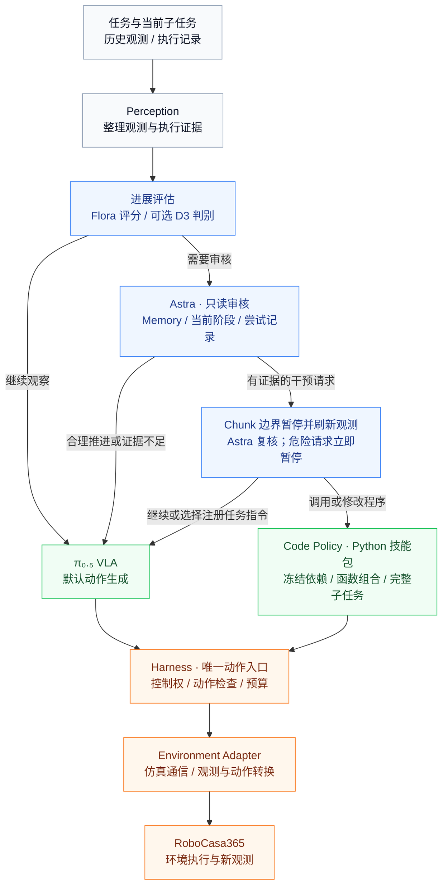

# 系统架构与第一版实现

2026-11-05 性能诊断：增加独立于模型输入的 `action_performance`，拆分仿真、观测快照、通信剩余项及存盘。
Codex 图像工具改用 `view_observation_image`，避免与内置工具重名；宿主内部历史 API 仍兼容。
观测 NPZ 支持配置无损压缩等级，默认保持 6；等级 1 保留为独立实验配置，真实重放尚未证实提速。
固定初始 Memory 的 OpenDrawer 新 seeds 10–19 测试、速度瓶颈和验证边界见
[新 seed 实验报告](../runs/opendrawer-fresh10-20261105/findings.md)。

本版先完成可运行的监督、接管、恢复和数据闭环。实际模型和仿真通过独立进程或服务接入，轻量 Agent 环境不导入 RoboCasa、JAX 或 Decision 模型。

2026-11-02 运行审计：默认与可复用模型配置统一使用 Astra `high`；最新 Waffle 五个 episode 实际已经使用此档位。当前生效的组件、代码入口、逐类调用延迟、Memory/工具返回瓶颈及后续改造顺序见 [Agent 架构与执行耗时审计](agent-runtime-audit-20261102.md)。后台审核与 Flora 和动作并行，不能把各模块计时直接相加。

同日工具更新：技能读取分为接口、契约、源码和证据视图；`edit_program` 统一批量修改入口，写入自动检查固定依赖。新运行使用此协议；上述已完成实验的计时仍对应旧工具。实现、兼容边界和历史响应体积对照见 [代码工具与技能复用](code-tools-v2.md)。

2026-11-03 受预算测试：支持 Episode 累计 `planner.max_total_tokens`，保留 `max_calls` 和单 turn 工具限制；线程重建、重新规划均不重置累计用量。token 异步上报，最后在途请求可能越过阈值，不能视为服务端精确计费上限。相同有效 instruction 的 `refine` 归为 `continue`，不增加语言版本或重置尝试记录；已发生的确认暂停不能因此撤销。实验快照与逐轨迹结果见 [有预算的任务对照](../runs/bounded-comparison-20261103/results.md)。

同批微波炉复测补充了停滞审核语义：当阶段需要物体变化、多次观测显示目标与夹爪关系不变、实测运动和动作命令都接近静止，且没有合理的保持/稳定前置条件时，可以判为阶段停滞，申请刷新观测后的有预算恢复。无需先证明空抓或观察到剧烈滑脱；具体物理原因仍是待验证假设。它是 Astra 的证据判断，不是固定步数强制接管。复测中介入更早，但完整任务成功率尚无改善证据。

2026-10-30 更新：CloseToasterOvenDoor 两个默认开发配置现使用 **Flora 每 50 执行步异步评分 → 按评分请求 Astra 审核**。D3 保留为可选后端和历史对照。Flora 评分期间 VLA 继续；Astra 审核也不阻止新的 Flora 评分。具体规则、预算和慢服务处理见 [Flora 监督](flora-supervision.md)，历史实验与全部程序见 [十轮详细报告](close-toaster-ten-rounds-detailed.md)。下文五类判别与 D3 输入描述适用于兼容后端，不代表新 Flora 路由的模型输出。

## 运行主流程

**VLA 默认执行，Decision 筛查，Astra 统一审核与规划，所有动作经过 Harness。** 下图自上而下展示一次监督检查后的主要处理路径；周期与事件触发由 Runtime 调度。

快速循环持续运行：**新观测 → VLA → Harness → Environment Adapter → 新观测**。默认 `nonblocking_review: true`：Decision 和 Astra 的后台只读审核均不作为 Action Chunk 的前置步骤。非 KEEP 进入后台 Astra 后，VLA 继续执行；后台读取观测、记笔记、返回 continue 不更换控制权、不清队列，也不额外调用 VLA。

真实配置还包含一次启动规划：读取环境的任务描述 → Astra 制定初始计划 → VLA 开始执行。该启动步骤不依赖 Decision 先发现异常；关闭监督的纯 VLA 基线跳过它。

环境返回的新观测供下一轮执行、监督和完成验证使用，反馈回路在这里用文字表达，避免跨越整张图的回线。Astra 也可补充观察或停止；这些分支以及默认关闭的直接局部动作，不展开到主图。

## Code Policy 的交还边界

2026-11-02：WaffleReheat 的可选 `native_subtask_checks` 配置安装原子指令目录和只读局部验证器。
Astra 用 `replan` 选择可执行子任务；任务目录提供能力与前置条件，不固定计划或执行器。
VLA 在新 Chunk 边界接收当前原子指令。局部完成在 Chunk 边界触发 Astra 审核，核验后推进。
Code Policy 完成当前已安装的局部子任务后释放分配，由 Astra 决定下一子任务的执行器；
原生 `task_success` 始终是整任务最终判据。此配置的局部完成条件来自仿真状态，属于验证器辅助评测，
不会向策略提供物体坐标，但不能称为纯视觉子任务判断。详见 [可执行子任务更新](executable-subtasks.md)。

子任务执行器分配独立于物理动作 lease。`code` 分配跨多个程序版本保持；Astra 修订期间 VLA 仍暂停。
阶段完成只更新证据。完整子任务通过固定核验后，才由 Astra 为下一个子任务选择 VLA 或 Code Policy。
未完成且预算耗尽时重规划或停止，不能用 continue/refine、局部 RECOVERED 或改名来提前交还。
详细实现、默认配置和未完成边界见 [框架更新](framework-v2.md)。

Code Policy 采用 RAX 的技能包方式：Astra 检索已有程序，传入当前观测得到的参数；
需要修订时只修改对应模块。`main(ctx, **params)` 通过 Python import 组合 `uses` 中固定版本的技能，
感知、控制和参数分别存放。执行前冻结整个依赖集合，全部模块共享同一个 ctx、Harness 控制权和预算。
`{ok, measured, why}` 提供程序反馈，完整子任务仍由原生核验决定；包内阶段完成不交还 VLA。
实现与验证见 [RAX Code Policy 接入](rax-code-policy.md)。

## 共享上下文与执行证据

以下模块贯穿运行过程，单独列出其读写关系。

| 支持模块 | 保存什么 | 谁使用或更新 |
|---|---|---|
| Working Memory | 当前计划、有效语言、指令目录、尝试 ID/次数/状态、已记录问题、近期审核与干预 | Astra 依据首次尝试/重试及阶段证据决策；Runtime 校验后更新 |
| Task Memory | 精确任务范围内的阶段指南、条件到技能建议、失败教训与证据引用 | Episode 启动时固定版本；Astra 读取并提出候选，离线整合后供后续 Episode 使用 |
| Flora Outcome 工具 | 当前尝试或当前阶段视频的模型评分、可选解释、快照绑定和输入证据 | Astra 按需调用；只读审核期间不暂停 VLA，不代替完成验证器 |
| Episodic Memory / Skills | 版本化程序、适用条件、历史尝试与验证证据 | Astra 按需检索；恢复结果由运行时记录，候选技能由离线流程评测 |
| Recovery Workspace | 程序版本、修改假设、差异、阶段检查和失败反馈 | Astra 开发与修改，Code Policy 执行冻结版本 |
| Recorder / Export | 原始观测、命令与实测轨迹、判断、验证、模型用量 | 各模块写入事件与证据，离线导出 Decision 窗口和 VLA 动作候选 |

历史 Memory 默认以抽取式索引注入 Astra：`historical_memory_chars: 10000` 限制自动携带的历史字段字符数，
相关规则、技能和证据通过读取工具展开。索引保留身份、结果与引用，不代替完整前置条件。
完整日志及当前执行状态保持原样；显式工具读取、当前代码工作区和本 Episode 的反馈不在此上限内。
具体边界和离线对照见 [Memory 压缩](memory-compaction.md)。

Waffle 新配置另启用 `working_memory_mode: summary`：当前笔记、评分、审核、恢复测量保留短索引，
完整快照按哈希归档并通过 `read_context` 分页展开。最新程序契约保留，旧版本只显示身份索引。
每 12 个 Codex turn 从当前权威状态重建线程，避免旧工具输出一直累积；版本化工作区不重置。

## 职责与接口边界

1. **Astra 负责顶层推理。** 子任务组合、剩余计划修订和恢复策略选择归 Astra。Decision 的 REFINE / SWITCH / REPLAN / ESCALATE 只提供参考，不自动触发暂停或改写语言。先依据 Memory 判断当前阶段与进展，需要实际干预才接管；完成状态变更仍需独立验证。
2. **Runtime 负责调度。** 管理 Episode、监督时机、异步回复有效性、干预流程和预算。Codex 模型交互放在 `codex_planner.py`，备选 Responses 交互放在 `planner.py`；工具参数校验和结果读取放在 `toolkit.py`。
3. **Harness 负责动作执行权限。** VLA 和 Code Policy 共用一个动作入口，接管时撤销旧控制权并清理旧 Chunk。模型服务只返回推理结果，不能直接推进环境。
4. **Adapter 负责环境差异。** 模拟器导入、通信、原生观测/动作转换和可用验证条件放在适配层；上层依据统一契约工作。
5. **Memory 保存可检索状态，Recorder 保存完整证据。** 运行上下文按需读取，原始数组与全量日志独立归档。事实、模型假设和验证结果分别记录。

真实配置启用 `initial_planning`，Astra 在首个动作前规划，并可在介入后重写剩余计划。未启用局部验证器的 RoboCasa 配置仍只提供 `task_success`，细分阶段只作为信念记录。WaffleReheat 和 PrepareCoffee 可选配置提供已安装的局部目标与检查；未知验证条件仍被拒绝。PrepareCoffee 当前目录包含柜到台面、台面到咖啡机、启动三个原子目标，其中台面中转是为了匹配原子语言而增加的策略选择，并非原任务的必要条件；效果需通过实验判断。Flora 的评分不替代完成验证器。

## 代码分工

| 模块 | 职责 |
|---|---|
| `contracts.py`, `config.py` | 观测、动作、回复绑定、五类判断、干预及配置契约 |
| `runtime.py` | 执行与异步监督调度、预算、干预路由、恢复交还 |
| `supervision.py` | 冻结只读审核、单个后台 Astra 请求、回复有效性和取消；不持有动作权限 |
| `code_session.py` | 整个子任务的 code 执行器分配、跨版本预算、完成后请求选择后续执行器 |
| `phases.py`, `grounding.py` | 观测绑定的阶段假设、视觉区域选择与几何查询 |
| `experience.py`, `policy_candidates.py` | 成功/失败长期经验、有限策略候选；不自动晋级 |
| `task_memory.py` | 按机器人/环境/任务名隔离的版本化指南、证据校验与提炼候选；不直接控制动作 |
| `memory_context.py` | 有长度上限的历史经验/任务规则索引；保留完整存储，通过工具按需展开 |
| `working_context.py`, `adapters/subtask_catalog.py` | 当前上下文按需展开；可选原子任务契约与仿真布尔完成检查 |
| `sandbox.py`, `worker_isolation.py` | 生成程序的 OS 约束；隔离不可用时拒绝执行 |
| `harness.py` | 控制权 epoch、Chunk 队列、动作检查、执行回执和验证 |
| `toolkit.py` | Astra 工具 schema、参数校验、证据读取、程序开发和干预提交预检 |
| `control.py` | Code Policy 使用的实测 OSC 控制；可选实验中的局部动作与渐进前缀修正 |
| `perception.py` | 仅历史观测窗口、图像摘要、带尺度和可信度检查的局部几何 |
| `decision.py`, `decision_criteria.py` | 多时刻三视角概率接口、五类可观测判据；超时、低置信 KEEP、无效输出转 ESCALATE |
| `supervision_rules.py` | 多秒低运动证据与复核触发；不拥有失败判定、暂停或执行器切换权限 |
| `flora.py`, `scripts/serve_flora.py` | 当前尝试的视频采样、本地 Outcome 推理、缓存与调用预算；无动作权限 |
| `codex_planner.py`, `codex_transport.py` | 复用 Codex 登录、Episode 会话、动态工具循环、超时清理和用量统计 |
| `planner.py` | 备选 Astra Responses API 工具循环与共享规划提示词 |
| `recovery.py`, `recovery_worker.py` | 保存代码版本、启动程序、工具代理、反馈与资源预算 |
| `skill_packages.py` | RAX 技能包契约、文件哈希、固定版本依赖解析、完整执行快照 |
| `workspace.py`, `stages.py` | 恢复开发工作区、不可变版本与差异、阶段前置/完成验证和失败定位 |
| `memory.py`, `skills.py` | 当前计划与语言、近期历史、参数化技能快照与适用性契约 |
| `data.py` | 原始数组与 JSONL、成功证据关联、候选导出和分组汇总 |
| `adapters/pi05.py` | 官方 WebSocket 编解码、三视角输入及显式动作排列转换 |
| `adapters/robocasa*.py` | 已接 cjy 仿真解释器、真实任务语言、单步回执和机器人控制器 |
| `adapters/mock.py` | 可复现的软件集成夹具，不能用于报告机器人任务成功率 |

## Decision 的含义

| 输出 | 给 Astra 的参考 | 调度行为 |
|---|---|---|
| KEEP | 当前证据支持继续 | 继续 VLA |
| REFINE | 当前指导可能需要调整 | 后台只读 Astra 审核 |
| SWITCH | 当前子任务可能完成 | 后台审核；实际切换仍需独立验证，不记作失败 |
| REPLAN | 剩余计划可能不适用 | 后台只读 Astra 审核 |
| ESCALATE | 证据不足、输出异常或需深入判断 | 后台只读 Astra 审核 |

这些是诊断标签，不直接绑定恢复方式。比如 REFINE 可以最终执行代码恢复；ESCALATE 可以在补充判断后继续 VLA。Decision 3.0 的机器人适用性、置信度阈值和多图历史延迟尚需实测。

Decision 默认读取主视角 `left`（`robot0_agentview_left`）的 5 个历史时刻：在当前最多 32 个观测的
窗口内均匀取样、按时间排序，并包含最新观测；启动时历史不足则只使用已有时刻，不复制凑数。
`decision.primary_camera` 可切换主相机，设为 `null` 时恢复多视角输入；`decision.window_frames`
控制时刻数。相机缺失按 ESCALATE 交 Astra 审核，不默默替换相机或认定执行失败。
帧数增加改善了时间采样，但不等于覆盖更长时间，也不能消除主视角遮挡。

Astra 的窗口单独使用 `planner.window_frames`（默认 3 个时刻、各相机），并可通过感知工具查看
额外视角。VLA、原始日志和 Code Policy 保留完整多相机观测。Decision 默认使用三位小数的
当前状态、当前尝试的运动统计和三步样本；完整数值历史留在日志，通过工具读取。
上下文契约、同图对照与测试条件见 [Decision 数值历史精简](decision-context.md)。

## 执行顺序与一致性

1. VLA 默认持有控制权，只执行当前 Chunk 中配置允许的前几步。
2. Decision 按周期或事件检查历史窗口，非 KEEP 启动一次后台 Astra 审核。审核期间不重复发起 Decision/Astra 请求，不追加未来观测。旧的 `max_unreviewed_steps` 等待只用于显式设置 `nonblocking_review: false` 的阻塞消融。
3. Astra 使用冻结的 Memory 与观测，输出 `submit_review`：`continue` 或 `request_intervention`。前者不影响动作执行；后者必须给出具体问题/完成状态、当前阶段及带步数的观察证据。“第一次还没抓住”和周期检查本身不是失败证据。
4. 普通干预请求等待当前 Chunk 执行结束；危险请求立即处理。到达边界后 Runtime 重新核对 Episode、子任务/语言版本、控制权 epoch、attempt ID、观测步数及时间。过期审核丢弃，不更改状态；超时或无效审核记录失败，不变成自动恢复。有效请求才由 Harness 暂停并更换控制权。推理期间到达的普通请求也不丢弃已采样 Chunk。
5. Astra 从暂停后的最新状态进行二次确认，可以撤销旧怀疑并返回 continue；此时新建 VLA 控制租约，从正常推理边界继续。实际需要干预时，选择注册任务指令/计划或 Code Policy，随后才更新尝试记录。第一次尝试没有绝对豁免，明确失败仍可介入。
6. 程序返回成功后仍由验证器检查。语言修改只在新 Chunk 推理边界生效；恢复后建立新的尝试 ID，递增尝试次数。验证通过的子任务切换为新子任务建立第一次尝试。

首次尝试保护通过完整 Memory 和只读审核实现，不以固定执行步数强制认定失败。全局执行时间、步数、模型调用预算以及异常停止仍有效。`max_reviews` 限制审核次数；模型调用预算包含只读审核与暂停复核；预算耗尽按预算停止，不能伪造 KEEP。

旧 Chunk 在实际接管后不能恢复执行。控制命令执行结果不确定时停止，不重发。Episode 结束先停止 Harness/环境，再取消未完成审核，避免等待模型清理阻塞停止。

## Refine 与 VLA 语言边界

VLA 只接收当前有效任务指令，不接收主任务、Memory 和失败解释的拼接。`refine` 只能通过 `instruction_id` 选择注册指令，或提交完全一致的注册文本；不能生成逐步夹爪/位姿教程、条件分支或重试叙述。`replan` 也只能组合注册指令及其原有完成判据，不能用计划修改绕过此限制。

指令目录在 Episode 初始化时由 `task.subtasks` 和显式配置的 `task.language_catalog` 冻结建立。环境提供任务语言时，原生整体任务指令自动注册。目录来自任务配置，不由 Astra 临时声明“训练过”。当前 RoboCasa 只有 `task_success`，细分规划保留在笔记，不伪造可验证子任务。

对当前复合任务配置，这意味着 VLA 始终使用原生整任务指令，Code Policy 接管的也是整个剩余复合任务。
`set_phase_plan` 不会自动安装原子语言或完成验证器；不能将阶段信念更新描述为已经实现可执行子任务切换。

Memory 的 `attempt` 包含当前尝试 ID、次数、起始步、状态和上次问题；`attempts` 保存先前尝试，`reviews` 保存近期审核。问题判断标注为 Astra 的 assessment，不能混作独立物理验证；Code Policy 内部修订次数与 VLA 的尝试次数分开。

## 数据与验证边界

完整日志保留正常执行、失败、语言干预、局部修正和代码探索。原始 RGB/深度/实测状态保存为数组；命令、动作来源、语言版本、阶段记录、假设和验证结果分别保存。

动作候选按成功的具体 attempt 关联，后续一次恢复成功不会把之前失败的尝试一起标为正样本。导出结果不是即用训练集，仍需筛选并转换至目标 VLA 的频率、坐标系和动作表示。Decision 导出保留在线输入和预测，事后标签单独留空待标注；KEEP 也抽样审核。

技能库在 Episode 开始时建立快照。跨 Episode 积累模式只增加候选程序和运行证据；通过重复执行、不同布局和回归评测后，才应由离线流程标为 verified。当前没有自动晋级或模型训练流程。

技能、程序版本与运行记录分离：语义名称标识“操作 + 起始状态”，不可变版本保存源码和契约，
每次调用只追加参数与结果。参数重试不新建源码；逻辑修订沿用原技能名。
检索按技能去重，`list_skill_versions` 展开不同适用条件；旧现场修订稿保留在显式归档检索中。
目录中的技能类别名、版本的存储 ID、Python 包名分别保存。目录可以把不同实现归入同一个操作类别，
但直接执行、导入工作区及后续修改都保留原包名和固定依赖；类别改名不会改写 Python 模块路径。
当前整理出的 4 类关门操作及其真实覆盖范围见 [操作目录](../skills/INDEX.md)。

## 下一步接入顺序

1. 仿真、OmniSF π₀.₅、Decision 3.0 与 Codex/Astra 已接通，见 [部署说明](deployment.md)。先完成原子任务基线，再选定 Composite-Seen/Unseen 任务清单。
2. 检查完整 Episode 中的动作分布、限幅比例和耗时；当前短流程检查不能证明完整任务效果。
3. 用标注历史窗口校准 Decision 介入阈值、漏判/误判和监督预算。当前阈值可能频繁触发 Astra，尚未达到成本目标。
4. 补充复合任务子任务完成验证器。检查深度、相机时刻/位姿、坐标变换后，再启用几何恢复；当前没有 IK/路径规划实现。
5. 固定任务与初始条件，比较纯 VLA、语言监督、动作/代码恢复和技能复用。固定技能库与允许积累的评测分别报告。

以上接入不会要求改变 Harness 的动作入口、Decision 的五类契约或 Episode 数据格式。

## HarnessVLA / RPent 的参考边界

[HarnessVLA 论文 v5，第 2 节](https://arxiv.org/html/2607.08448v5#S2) 将规划、工具执行、新观测和反馈组织为闭环。[RPent 的架构说明](https://rpent.readthedocs.io/en/latest/rst_source/development/architecture.html) 则明确区分 Planner、Toolkit、环境/模型服务及其生命周期。这里主要借鉴职责划分和接口组织。

| 可借鉴的组织方式 | 本项目的对应位置 |
|---|---|
| 规划器通过统一工具接口获取结果 | `planner.py` + `toolkit.py`，参数契约放在 `contracts.py` |
| 模型推理与环境运行独立部署 | π₀.₅ / Decision 服务 + `adapters/`，环境依赖留在独立解释器 |
| 调用结束后读取执行证据，再决定下一步 | `runtime.py` + `harness.py`，恢复阶段由 `stages.py` 验证 |
| 经验检索与完整轨迹记录有各自边界 | `memory.py` / `skills.py` 与 `data.py` |

论文中的 harness 指整套运行框架；本项目的 `Harness` 类专指唯一动作执行入口，整体框架由 Runtime、Planner、Toolkit、Memory 和 Harness 共同组成。后续扩展环境或工具时，优先沿这些接口增加实现，避免将模型请求、仿真细节和技能逻辑集中到 Runtime。

本项目保留 VLA 默认执行、Decision 按需触发 Astra、Code Policy 进行程序恢复的路线。HarnessVLA 将 VLA 作为局部接触操作原语并与固定解析原语组合；是否采用这种调度方式，需要单独实验，不因参考其代码组织而改变当前执行策略。

架构参考：[RLinf/RPent](https://github.com/RLinf/RPent/tree/a744bd5f128ebef3cb8c6736cf7cd98adff681f1)，提交 `a744bd5f128ebef3cb8c6736cf7cd98adff681f1`。具体接口见 [Core Interfaces](https://rpent.readthedocs.io/en/latest/rst_source/development/interfaces.html)。Codex 调用方式参考本机 `gpt_as_policy` 的 app-server transport，并按本机 0.164.0 协议校验。
