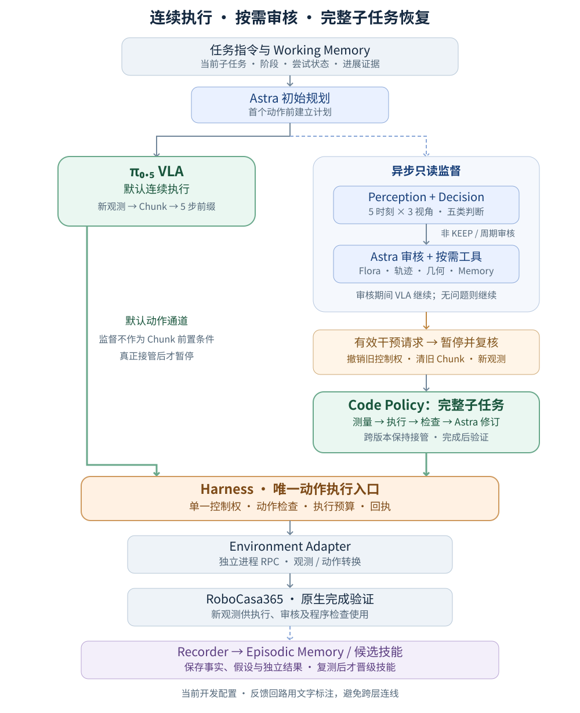
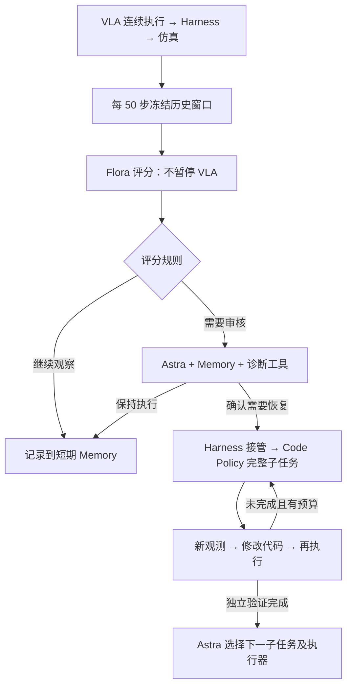

# CloseToasterOvenDoor：十轮实验、改进过程与操作代码详细报告

> 范围：正式编号第 1—10 轮，加第 0 轮基础设施故障，共 18 条 Episode 记录。轮号是实验配置编号，部分实验并行，不能理解为每轮都在上一轮结束后学习。正文一至九节说明历史 D3 系统；十节说明 2026-10-30 新增的 Flora 50 步监督，后者尚无新的真实机器人任务成功率结果。十一至十五节为逐运行、逐程序与逐工具审计。


本次更新对应 `runs/toaster-iteration-20261029` 的多轮开发记录，以及各 Episode manifest 中冻结的历史配置。实验集中在 CloseToasterOvenDoor，用于验证监督、代码探索和经验积累的完整链路；尚未进入多任务正式评测。

目前已经得到两次由 RoboCasa 原生成功判据确认的 Code Policy 恢复：一次在总计 1341 步完成，另一次在 1436 步完成。后者在接管前与固定采样的纯 VLA 对照完全一致，而纯 VLA 延长至 2000 步仍未成功。这支持“程序探索可以恢复部分 VLA 卡住的执行状态”，但尚不能证明原生 450 步预算下的成功率超过此前的 48%。

## 一、前十轮实际运行的系统如何工作

系统保留 VLA 默认执行、Decision 筛查、Astra 顶层推理、Code Policy 程序恢复的分工。核心更新是将连续执行和监督审核解耦，并把 Code Policy 的责任范围明确为完整子任务。



### 1. 连续执行循环

环境产生新观测后，π₀.₅ 根据当前有效任务指令生成 Action Chunk，Harness 执行配置允许的前缀，再获取新观测。本轮每次执行 5 步前缀。所有实际动作都经过 Harness，由 Environment Adapter 转换并发送给仿真环境。

首次执行前，Astra 读取原生任务描述并建立计划。进入执行后，Decision 和 Astra 的只读审核不作为每个 Chunk 的前置步骤。观察、查看轨迹和记笔记本身不撤销 VLA 控制权、不清理 Chunk，也不额外要求 VLA 重新推理。

### 2. 异步监督循环

Perception 整理历史 RGB-D、实测状态和动作证据。Decision 根据周期或事件进行检查，保持以下五类输出。

| 输出 | 含义 | 运行时行为 |
|---|---|---|
| KEEP | 当前证据支持继续执行 | VLA 继续 |
| REFINE | 当前指导可能需要调整 | 交给 Astra 只读审核 |
| SWITCH | 当前子任务可能完成 | 交给 Astra 审核；切换前独立验证，不计为失败 |
| REPLAN | 剩余计划可能不再适用 | 交给 Astra 只读审核 |
| ESCALATE | 证据不足、输出异常或需要进一步判断 | 交给 Astra 只读审核 |

非 KEEP 不直接暂停机器人，也不与某种恢复方式绑定。Astra 结合当前阶段、首次尝试或重试状态、历史问题和物体进展证据判断：是合理探索、暂时看不清，还是确实需要干预。Decision 超时或输出无效按 ESCALATE 处理，但不会因此自动接管动作。

前十轮开发配置另外每 150 步触发一次 Astra 周期审核，用于发现 Decision 未触发的问题。已有 Astra 审核挂起时，不再并发发起新的 Decision 或 Astra 请求。这能控制请求重叠，但也会使实际 Decision 采样间隔变长，需要单独评估。

只有有效、仍然适用的 Astra 干预请求，才由 Harness 暂停 VLA、撤销旧控制权、清理未执行 Chunk，并获取最新观测。随后 Astra 在暂停状态下再次确认，避免根据过期图像干预已经变化的场景。若旧问题已经消失，可以继续 VLA。

回复绑定 Episode、子任务和语言版本、尝试 ID、控制权版本以及观测时刻。过期回复不能改变执行状态；同一任务仍有持续问题时，重新采集快照进行只读复核。低运动规则只提供证据和触发审核，不根据固定步数直接认定失败或切换 Code Policy。

### 3. 完整子任务的代码探索循环

Astra 决定使用 Code Policy 后，系统将当前完整子任务分配给代码执行器。Astra 在工作区检索、生成或修改程序；执行器运行冻结的程序版本，通过工具读取新观测、完成几何计算、分段执行动作并检查结果。

每次失败分别保存观察事实、原因假设、拟议修改和验证结果。下一版从当前实际状态出发，不假设环境回到了上一版的起点。代码可以反复修改，VLA 在版本之间保持暂停。

局部阶段完成或程序自报 RECOVERED 不代表可以立即交还 VLA。只有完整子任务通过独立完成判据后，Astra 才为后续子任务选择执行器；未完成但预算耗尽时，需要重新决策或停止。本轮两次成功恢复均只发生一次 VLA 到代码执行器的接管。

### 4. 模块边界

| 模块 | 当前职责与边界 |
|---|---|
| Runtime | 调度快速执行和监督请求，管理 Episode、回复时效、干预与预算 |
| Perception / Decision | 组织历史观测并给出五类参考判断；不拥有动作控制权 |
| Astra / Toolkit | 初始规划、阶段诊断、审核与工具选择；承担 Code Agent 的生成和修订工作 |
| Code Policy / Workspace | 保存不可变程序版本，执行感知、控制和检查逻辑；跨版本承担完整子任务 |
| Harness | 唯一动作入口，检查控制权、动作范围、预算和执行回执；拒绝旧控制权下的动作 |
| Environment Adapter | 隔离仿真依赖，转换图像、深度、机器人状态和动作，提供原生完成验证 |
| Memory / Skills | 保存当前任务状态和跨 Episode 的可检索经验、候选程序及证据 |
| Recorder | 保存完整原始观测、命令与实测轨迹、模型判断、工具调用、代码版本和独立验证 |

通信按用途分开：π₀.₅ 使用 WebSocket，Decision 和 Flora 使用本地 HTTP，Astra 经 Codex app-server 调用工具，仿真运行在独立 Python 进程中，通过单步 RPC 交互。动作由 VLA 或程序生成，Harness 授权执行，Adapter 推进物理环境。

## 二、相对早期方案的主要变化

### 1. 从频繁暂停检查，改为只读审核后再决定接管

第一次尝试优先保持连续执行。Astra 根据 Memory 和多个时刻的进展判断是否介入，而不是把“还没抓住”“经过一段时间”直接当成失败。首次尝试也不是绝对豁免：有明确的持续无效接触或错误执行证据，仍可以恢复。

新增的 stalled_progress 是 Astra 内部审核状态，要求多个不同观测时刻支持物体进展停滞；它不是第六个 Decision 类别。

### 2. 区分可执行子任务和诊断阶段

子任务规划仍由 Astra 负责，但必须尊重实际可用的验证器。当前 RoboCasa 接口只提供整体 task_success，因此 CloseToasterOvenDoor 保留一个可执行子任务，内部可以记录“接近—建立接触—抬门—压合—验证”等诊断阶段。

这些阶段帮助 Astra 定位代码应该修改哪里，不会伪装成已经有独立完成验证的子任务。复合任务后续需要补充真实子任务验证器，再支持可靠的细粒度切换。

### 3. 收紧 REFINE，保持 VLA 的语言分布

VLA 只接收当前有效任务指令，不拼接主任务、Memory、失败解释和精细动作教程。REFINE 只能选择预先注册的任务指令；REPLAN 也不能通过改写计划绕过这一边界。

本次成功轨迹中的有效语言始终是 `Close the toaster oven door.`。恢复收益来自代码执行及其反复测量、修订，没有证据表明收益来自更细的自然语言指导。

### 4. 增加视觉历史，精简重复数值

前十轮实验中 Decision 和 Astra 都使用最多 5 个历史时刻、每个时刻 left / right / wrist 三视角，即最多 15 张图。Decision 采用多时间尺度采样：距当前约 10、5、2、0.5、0 秒；历史不足时只使用已经发生的观测。

Astra 的数值历史摘要从最多 30 行均匀选取 6 行，并保留三位小数。三个检查样本的 memory 文本从约 2.3–2.4 万字符降到 0.55–0.71 万字符。这里统计的是字符，不是 token；图像没有删减，原始记录和当前控制几何保持精度，可通过工具按需读取。

### 5. 增强深度、grounding 和机器人几何工具

程序可以根据 RGB 中的目标区域读取带物理尺度的深度，转换到机器人控制坐标系，计算相对位置，再在执行后重新测量。缺失、遮挡、混合深度和跨视角不一致需要保留为不确定性，不能直接生成高置信度动作。

本轮发现，机器人末端坐标轴不等于直觉中的夹爪张合轴。现在 Adapter 从机器人运动学计算并提供 jaw_separation_axis_eef，本机 Panda 控制坐标系下约为 [-1, 0, 0]。该接口经过零动作真实初始化检查，不读取目标物真值；它是在相关成功运行启动后补入的，不能把已有成功归因于这个新增接口。

当前工具包括观测与轨迹读取、图像查看、grounding、几何查询、Flora 评估、经验检索、程序编写与检查、执行反馈等。IK 和路径规划能力尚未实现。

### 6. 短期状态、长期经验和技能证据分开保存

Working Memory 保存当前任务的计划、有效语言、尝试状态、阶段证据、审核结果、代码版本和控制来源。Episodic Memory 保存跨 Episode 的问题现象、方法、结果与适用条件，供 Astra 判断类似问题值得调用哪些工具。

技能库保存代码及其前置条件、版本和实际运行证据。所有执行过的程序，包括失败程序，都会留下候选记录。单次成功只增加成功证据，不自动晋级为 verified；候选需要显式检索，同等文本匹配时才用成功运行证据辅助排序。

Episode 开始时冻结技能快照，避免运行中隐式改变可用技能。当前的持续改进发生在程序、参数、检索和经验库层面，没有训练 Code Agent、Decision 或 VLA，也没有让 Astra 在线任意修改 Harness、验证器和执行边界。

## 三、实验设置与比较口径

| 项目 | 本轮设置 |
|---|---|
| 任务 / 机器人 | CloseToasterOvenDoor；atomic_seen / target；PandaOmron |
| VLA | OmniSF π₀.₅，checkpoint 59999，quantile normalization；模型权重未修改 |
| 动作执行 | 20 Hz 仿真控制时间，每轮执行 5 步 Chunk 前缀 |
| Decision | 本地 vllm-sr/d3-flash；五类输出；周期 50 步并结合事件触发 |
| Astra | gpt-6-astra / xhigh，经 Codex；只读审核与代码生成、修订 |
| Flora | 本地 nvidia/Flora-Rewarder，实验使用 int8 变体，按需给出轨迹评价及理由 |
| 原生预算 | 450 步；保留纯 VLA 原生预算试验 |
| 开发预算 | 关闭原生 horizon 和 Episode 墙钟限时；总步数按轮次为 2000 或 4000 |
| 代码预算 | 单程序最多 200 步 / 180 秒；会话最多 12 次执行、2400 步 / 5400 秒；最多保存 64 个源码版本 |
| 剩余限时 | 模型请求、RPC、单程序及代码会话仍有 deadline，并非完全无界运行 |

第 1—7 轮使用服务原有共享采样流，相同场景 seed 不保证相同 VLA 轨迹；不能把跨轮差异直接归因于 Agent。第 6、7 轮还包含失败动作前缀的物理重放，是开发复现工况。

第 8—10 轮增加请求级固定采样，使用 scene seed 0、policy seed 42。真实 A/B/A 检查确认，同一采样 seed 输出完全一致，不同 seed 的动作最大差异约 0.273。仿真源码和 checkpoint 均未修改。

## 四、逐轮结果与修改

| 轮次 | 设置或修改 | 实际结果 | 解释 |
|---|---|---|---|
| 0 | 接入取消原生 horizon | 三条记录均在 0 步启动失败 | ignore_done 重复传参；修复本进程实例配置，不计策略试验 |
| 1 | 纯 VLA，原生 450 步，seed 0/1/7 | seed 0 失败；seed 1、7 在 278、216 步成功 | 原生预算开发基线 |
| 2 | 扩展预算、异步审核、增加恢复预算 | seed 0 在 585 步成功，全部由 VLA 执行 | 无代码动作，不能记为 Code Policy 恢复收益 |
| 3 | 纯 VLA，2000 步 | seed 0 到 2000 步仍失败 | 采样流与第 2 轮不同，不构成严格配对 |
| 4 | 原生预算，补充 seed 2/3/4 | 在 330、207、307 步成功 | 第 1、4 轮合计 5/6，只是小规模开发样本 |
| 5 | Flora int8、数值摘要压缩、调整审核时效、多版代码 | seed 2 在 231 步由 VLA 成功；seed 0 在 1341 步成功，其中 1025 VLA + 316 Code | seed 0 执行 10 个代码版本，17 Astra turns、1 次 Flora；约 48.8 分钟 |
| 6 | 重放失败前 800 步，加入 stalled_progress 审核 | 1715 步接管，执行 5 版、230 个代码动作；1945 步仍未完成 | 随后 Astra serverOverloaded，属于恢复未完成加服务故障 |
| 7 | 过期审核重新取证，明确程序预算和测量笔记 | 1169 步暂停，首版程序写出但未执行 | Codex turn 超过 600 秒；旧日志误记为总墙钟限时，已修复分类 |
| 8 | 固定采样，纯 VLA，450 步 | scene 0 / policy 42 失败 | 与第 9 轮前 450 步状态一致 |
| 9 | 同一固定采样，完整 Agent，预设上限 4000 步 | 1436 步成功：650 VLA + 786 Code | 13 版源码、12 次执行，18 Astra turns、2 次 Flora；约 92.2 分钟 |
| 10 | 同一固定采样，纯 VLA，2000 步 | 到 2000 步仍失败，约 804 秒 | 与第 9 轮接管前的动作和状态逐步一致 |

共保留 18 条 Episode 记录，其中包含第 0 轮 3 条启动失败；生成 30 个源码版本，实际执行 27 次。27 份执行候选和 6 份 Episode 经验已保存到项目长期目录，目前 verified 技能仍为 0。

第 9、10 轮对照额外核对了接管前全部 650 条控制命令、651 个实测状态，以及每 5 步采样的三视角 RGB，差异均为 0。这使接管前状态具有明确可比性。但 Agent 预设上限为 4000 步，基线为 2000 步，尚不是预设预算完全一致的正式评测；Agent 在共同的前 2000 步范围内成功，也不等于在原生 450 步下成功。

## 五、代码探索实际学到了什么

### 案例 A：接近闭合状态下，十版程序完成最后压合

第 5 轮 seed 0 在第 1025 步移交 Code Policy。早期版本尝试改变接触、撤回重定位和从中央接近，多次因目标遮挡、混合深度或参考点不可靠而停止。后续版本调整观测区域、接触高度和推进方式，最终在第 10 版的 6 个动作后通过原生 task_success。

| 版本 | 执行步数 | 修改和反馈 |
|---|---:|---|
| v1 | 35 | 改变夹爪接触并短程推进，未产生稳定物体进展 |
| v2 | 15 | 放开撤回，目标外观变化超过跟踪边界 |
| v3 | 150 | 撤回、重新定向和接近，目标跟踪失败 |
| v4–v5 | 8、26 | 改选可见把手区域，仍遇到遮挡和混合深度 |
| v6–v7 | 8、2 | 短程压合并调整参考点，右侧参考仍不可靠 |
| v8 | 16 | 使用无遮挡炉顶参考，手部高度超出接触范围 |
| v9 | 50 | 向外清空、降低接触高度，下降被阻挡 |
| v10 | 6 | 根据当前接触跳过已完成步骤，短程压合成功 |

最后一版依赖前九版留下的状态，并含有起始步数和图像区域限制。它是“在该状态下有效的恢复片段”，还不是能从任意初始布局调用的完整关门技能。

### 案例 B：从固定失败轨迹接管，纠正接触几何后完成任务

第 9 轮在第 650 步接管。初版闭合夹爪后抬升，末端移动约 4.3 cm，门边缘没有随之上升，说明末端运动不能作为成功抓取证据。后续探索经历接近受阻、横向漂移、指尖跟踪失效、门边缘跟踪跳变和多视角角度不一致。

第 6 版重新张开手指进行观测，发现此前对夹爪张合方向的假设有误；后续修订接近姿态，并持续检查门本身的运动。第 9 版源码因候选区域有效深度不足，在执行前就被修改；因此总计 13 个源码版本、12 次实际执行。最终第 13 版通过清开手指接触并按当前观测压合，在 110 个动作后完成任务。

两次代码修订发生模型超时，恢复规划后继续同一个代码子任务，没有在中间交还 VLA。该运行开始时的技能快照没有包含后来第 5 轮得到的成功程序，所以这不是成功技能复用的消融证据。

## 六、实验发现与当前瓶颈

### 1. 延长 VLA 执行有时已经足够，干预收益必须单独识别

第 2 轮在 585 步由 VLA 自行成功，说明部分原生预算失败可能只是没有在期限内完成。监督不能把所有长轨迹都解释为缺少技能。需要分别衡量延长预算、监督判断、代码恢复和经验复用各自的贡献。

### 2. 最主要的恢复困难在接触和可测几何

两条成功恢复中，很多版本停在目标遮挡、混合深度、接触不成立、夹爪干涉或参考点不稳定。增加文字描述无法直接解决这些问题。更有价值的是提供可信的机器人几何、按当前观测重算目标、在接触前后检查物体实际运动，并为遮挡保留重新观测路径。

### 3. Decision、Flora 和完成验证器承担不同角色

Decision 决定是否值得进入更强的审核；Flora 给出轨迹评价和解释线索；环境验证器决定任务是否完成。Flora 曾在任务仍未通过原生验证时给出较高评分，其理由也可能包含图像尚不能证实的抓取推断。因此评分和文字原因只能作为待核验意见。

补充的 12 个历史窗口测试得到 8 KEEP、2 ESCALATE、2 SWITCH，平均约 0.45 秒。但终止窗口包含环境终止信息，且没有独立人工标注，不能当作视觉判断准确率或漏判率。

第 5 轮成功运行中，Decision 在观测步 50、100、257、444 的四次输出均为 KEEP；实际问题由周期 Astra 审核发现。这验证了审核与恢复链路，没有证明 Decision 已经可靠发现失败，也不能把它未看到的第 1025 步状态算作漏判。

单张 H100 上，BF16 Flora CPU 卸载并与其他服务共存时，两个离线请求超过 60 秒；int8 变体的两个带理由评估约为 13.45、10.27 秒。这只是特定负载下的小样本，尚未验证量化后的质量等价性或稳定延迟。

### 4. 已有恢复能力，但调用和时间成本仍然高

第 5 轮成功运行的 17 Astra turns 包含 1 次初始化、6 次只读审核、10 次代码规划或修订；第 9 轮为 18 turns。一次 turn 可以包含多个模型和工具请求，不能直接当作 API 请求次数。

第 9 轮超时后重建了 Codex 会话，旧版 token 字段可能只保留最后一个会话，不能用于计算整轮费用。当前实现已改为按 thread 累计并记录用量，旧结果保留原始值并注明限制。

20 Hz 是仿真控制时间，不是当前墙钟运行速度。OSMesa 下纯 VLA 的 2000 步约耗时 804 秒；部分实验还共享模型服务，因此不能据此报告独立推理延迟，也尚未验证真实机器人 20 Hz 下的监督时效。

### 5. 保存成功代码不等于已经形成可复用技能

代码探索证明了局部恢复的可行性，但成功程序仍依赖当时布局、观测区域和前序探索留下的状态。下一阶段需要把这些逻辑提炼成参数化程序，并在相同失败状态和不同布局中重复验证。

导出的动作候选也保持这一边界：第 5 轮只选取最后独立验证版本的 6 个动作，第 9 轮选取最后一版的 110 个动作，均标记 training_ready=false。之前的探索动作保留为原始记录，不因最终成功自动成为正向训练数据。

## 七、当前完成状态与下一步

当前已接通真实 RoboCasa、OmniSF π₀.₅、本地 Decision、Flora 和 Codex/Astra，完成只读审核、有效接管、完整子任务代码迭代、独立验证、候选归档与轨迹回放。最终软件检查记录为 159 项测试通过，Ruff 通过；这属于软件正确性检查，不是机器人成功率评测。

下一步按以下顺序推进：

1. 提炼参数化的关门恢复技能。把目标定位、接触建立、遮挡处理、门运动测量和最终压合分成可复用阶段，替换固定像素区域和起始步数依赖。
2. 在可恢复失败状态上做回归。固定初始状态、采样 seed、预算和技能版本，先复测已发现问题，再测试未参与修改的布局；候选通过重复验证后才晋级。
3. 校准监督触发与成本。在人工标注的历史窗口上评估 Decision；针对长审核导致的采样空档、周期 Astra 审核和重复上下文开销做消融。
4. 验证 Flora 的可靠性。比较量化前后评分与解释质量，区分“运动看起来合理”和“完整子任务已经成功”，保持独立验证器的最终责任。
5. 进行一致预算的正式对照。分别报告原生 450 步与扩展预算结果；固定模型和技能库，与跨 Episode 积累实验分开。之后再扩展到 Composite-Seen / Composite-Unseen。
6. 将系统策略修改保持为受限、可回归的离线流程。可以探索审核频率、检索和程序策略的候选版本，但暂不把在线修改 Harness、成功判据或执行边界作为已经实现的 RSI 能力。

## 八、最后一次完整 Agent 运行的调用、耗时和复用核对

最后一次完整 Agent 运行是第 9 轮；第 10 轮是纯 VLA 对照。第 9 轮实际发起 130 次 VLA Chunk 推理，执行 650 个 VLA 动作；Decision 调用 3 次，观测步为 50、100、296，全部输出 KEEP。代码生成 13 个源码版本，执行 12 次、共 786 个动作；Astra 直接局部动作执行为 0。Astra 共 18 turns，包括初始化 1 次、只读审核 3 次、代码规划或修订 14 次，后者含 2 次超时。Flora 调用 2 次。

本次恢复由 Astra 周期审核及重新取证触发，并非 Decision 的非 KEEP 输出触发。实际 VLA 接管仅 1 次。日志中 interventions=4 包含初始化和恢复重新决策，不能解读为四次物理接管；astra_local 控制权记录也不能等同于真的执行了局部动作。

Episode 耗时没有呈现逐轮下降。第 5 轮成功恢复用时约 48.8 分钟，第 9 轮约 92.2 分钟；第 6、7 轮虽然分别只有 38.4、18.8 分钟，但均因服务故障或超时而未完成，不能作为加速证据。不同轮的接管状态、采样和并发负载也不同。

按事件区间统计，第 9 轮 12 次程序运行共约 5.8 分钟，已完成的代码规划与修订 turns 共约 60.9 分钟，另有两次修订等待至 600 秒 deadline，合计约 20 分钟。主要时间消耗在 Astra 的调查、工具调用、生成修订与超时等待。这里的 turn 时间包含工具耗时，不是纯模型推理时间；只读审核与 VLA 执行重叠，不能把所有组件时间直接相加。

第 9 轮进行了 14 次 search_skills 和 6 次 read_skill，实际读取两个不同的候选程序，二者已有记录均为 UNRESOLVED；旧程序确实进入了 Astra 的上下文，但直接技能执行记录为 0。尚无复用已成功技能后的成功率或耗时对照，不能据此认为技能积累已经缩短了探索。当前归档主要是烤箱门接触、提拉和压合的恢复程序，通用抓取能力仍需另外验证。

上述核对保存在 runs/toaster-iteration-20261029/latest-call-and-timing-audit.json；本次只分析已有日志，没有新增仿真实验。

## 九、证据与复现入口

以下为服务器本地路径，项目根目录是 `/home/junwue/code/vla_agent`。

| 内容 | 路径 |
|---|---|
| 完整报告与逐轮结果 | runs/toaster-iteration-20261029/README.md；results.md；all-results.json；rounds.json |
| 历史 D3 对照配置 | configs/close_toaster_d3_legacy.yaml；各 Episode manifest.json |
| 架构与启动说明 | docs/architecture.md；docs/framework-v2.md；docs/iterative-development.md |
| 严格前缀核对 | runs/toaster-iteration-20261029/paired-extended-prefix-check.json |
| 判断时刻与有效指令核对 | runs/toaster-iteration-20261029/decision-observation-times.json；successful-run-audit.json |
| 采样与夹爪几何核对 | runs/toaster-iteration-20261029/sampling-check/result.json；robot-calibration-check/measurement.json |
| 程序、经验与发布记录 | runs/toaster-iteration-20261029/skills/；experiences/；published-artifacts.json；项目 skills/ 与 memory/close_toaster/experiences/ |
| 两次成功恢复回放 | runs/toaster-iteration-20261029/videos/code-success-overview/index.html；videos/seeded-code-success/index.html |

原始失败记录、源码版本和修改前后源码归档均保留。上述实验已结束，相关仿真和模型服务已停止。


## 十、本次落地的 Flora 50 步监督

CloseToaster 的两个默认配置已改用 Flora。每 50 个 VLA 执行步取一次历史快照，最多读取当前阶段最近 200 步、left/wrist 两视角，最多 64 个采样帧。正常监督只评分；Astra 可单独请求理由。D3 扩展配置作为 legacy 保留。

| 规则 | 含义 |
| --- | --- |
| 连续两次评分 ≤2 | 请求 Astra 判断低分是否属于正常未完成 |
| 连续三次相同评分 | 请求 Astra 复核；不直接证明物体停滞 |
| 相邻评分下降 ≥2 | 请求检查退化或观测不一致 |
| 评分 ≥4 | 请求检查阶段/子任务可能完成；不直接 SWITCH |
| 单次低分或其余情况 | 继续 VLA，保存评分 |
| 无效、超时、预算不足 | ESCALATE；过期阶段/控制权结果直接丢弃 |

所有数值阈值是待校准的开发配置。路由目前只输出 KEEP / ESCALATE，不把 1–5 分解释为五类语义或等距进度。默认两次评分触发审核至少间隔 150 步。Astra 审核期间仍采样，重复请求合并；服务慢时记录跳过时刻，不阻塞 VLA、不堆积请求。

自动监控与 Astra 诊断分开计数，共用设备请求锁；总计和分类调用数分别记录。代码接管后的阶段检查继续由程序与 Astra 完成。新阈值、新调度尚不能归因于历史两次恢复成功。



2026-10-30 软件验证：全量 pytest **176 passed in 14.89s**；包含真实 HTTP 客户端的模拟服务集成测试，未启动 Flora 权重或仿真任务。该结果验证调度、请求和状态隔离，不代表新监督方案的成功率或实际模型延迟。

完整设置与启动说明：[flora-supervision.md](flora-supervision.md)。


## 十一、逐运行配置、调用与判断记录

下表从原始 manifest、result、events 读取。控制步数包含代码分段内部的物理执行步；Astra turns、工具调用、程序版本、物理接管是不同计数。重复出现的 seed 0 不等于相同采样轨迹。


### 第 0 轮：round0-baseline

配置变化原始记录：Added opt-out of native horizon; initial duplicate ignore_done argument caused three zero-step errors; fixed by configuring only our environment instance.

| 运行 | 结局 | 物理步 | 墙钟分钟 | D3 | Astra turns / 审核 | Flora | 代码执行 / 源码版本 | VLA 接管 |
| --- | --- | --- | --- | --- | --- | --- | --- | --- |
| seed0 | runtime_error | 0 | 0.26 | 0 | 0 / 0 | 0 | 0 / 0 | 0 |
| seed1 | runtime_error | 0 | 0.07 | 0 | 0 / 0 | 0 | 0 / 0 | 0 |
| seed7 | runtime_error | 0 | 0.07 | 0 | 0 / 0 | 0 | 0 / 0 | 0 |


**round0-baseline/seed0**：[冻结配置与源码哈希](../runs/toaster-iteration-20261029/round0-baseline/seed0/manifest.json)；[原始结果](../runs/toaster-iteration-20261029/round0-baseline/seed0/result.json)；[完整事件](../runs/toaster-iteration-20261029/round0-baseline/seed0/events.jsonl)。

场景 seed=0；policy seed=None；监督=False；总步数上限=450；忽略原生 horizon=False；Episode 墙钟上限=None。

Astra turn 类型：无。

Astra 工具调用：无。

程序侧工具请求：无。

运行错误原文：`RuntimeError: Simulator connection lost; execution may be uncertain`。分类以正文说明和 annotations.json 为准。


**round0-baseline/seed1**：[冻结配置与源码哈希](../runs/toaster-iteration-20261029/round0-baseline/seed1/manifest.json)；[原始结果](../runs/toaster-iteration-20261029/round0-baseline/seed1/result.json)；[完整事件](../runs/toaster-iteration-20261029/round0-baseline/seed1/events.jsonl)。

场景 seed=1；policy seed=None；监督=False；总步数上限=450；忽略原生 horizon=False；Episode 墙钟上限=None。

Astra turn 类型：无。

Astra 工具调用：无。

程序侧工具请求：无。

运行错误原文：`RuntimeError: Simulator connection lost; execution may be uncertain`。分类以正文说明和 annotations.json 为准。


**round0-baseline/seed7**：[冻结配置与源码哈希](../runs/toaster-iteration-20261029/round0-baseline/seed7/manifest.json)；[原始结果](../runs/toaster-iteration-20261029/round0-baseline/seed7/result.json)；[完整事件](../runs/toaster-iteration-20261029/round0-baseline/seed7/events.jsonl)。

场景 seed=7；policy seed=None；监督=False；总步数上限=450；忽略原生 horizon=False；Episode 墙钟上限=None。

Astra turn 类型：无。

Astra 工具调用：无。

程序侧工具请求：无。

运行错误原文：`RuntimeError: Simulator connection lost; execution may be uncertain`。分类以正文说明和 annotations.json 为准。


### 第 1 轮：round1-baseline

配置变化原始记录：Unchanged pi05 native instruction, no supervision, 450 steps, seeds 0/1/7.

| 运行 | 结局 | 物理步 | 墙钟分钟 | D3 | Astra turns / 审核 | Flora | 代码执行 / 源码版本 | VLA 接管 |
| --- | --- | --- | --- | --- | --- | --- | --- | --- |
| seed0 | horizon | 450 | 3.53 | 0 | 0 / 0 | 0 | 0 / 0 | 0 |
| seed1 | 成功 | 278 | 2.07 | 0 | 0 / 0 | 0 | 0 / 0 | 0 |
| seed7 | 成功 | 216 | 1.72 | 0 | 0 / 0 | 0 | 0 / 0 | 0 |


**round1-baseline/seed0**：[冻结配置与源码哈希](../runs/toaster-iteration-20261029/round1-baseline/seed0/manifest.json)；[原始结果](../runs/toaster-iteration-20261029/round1-baseline/seed0/result.json)；[完整事件](../runs/toaster-iteration-20261029/round1-baseline/seed0/events.jsonl)。

场景 seed=0；policy seed=None；监督=False；总步数上限=450；忽略原生 horizon=False；Episode 墙钟上限=None。

实际生效的 VLA 语言：`Close the toaster oven door.`。

Astra turn 类型：无。

Astra 工具调用：无。

程序侧工具请求：无。


**round1-baseline/seed1**：[冻结配置与源码哈希](../runs/toaster-iteration-20261029/round1-baseline/seed1/manifest.json)；[原始结果](../runs/toaster-iteration-20261029/round1-baseline/seed1/result.json)；[完整事件](../runs/toaster-iteration-20261029/round1-baseline/seed1/events.jsonl)。

场景 seed=1；policy seed=None；监督=False；总步数上限=450；忽略原生 horizon=False；Episode 墙钟上限=None。

实际生效的 VLA 语言：`Close the toaster oven door.`。

Astra turn 类型：无。

Astra 工具调用：无。

程序侧工具请求：无。


**round1-baseline/seed7**：[冻结配置与源码哈希](../runs/toaster-iteration-20261029/round1-baseline/seed7/manifest.json)；[原始结果](../runs/toaster-iteration-20261029/round1-baseline/seed7/result.json)；[完整事件](../runs/toaster-iteration-20261029/round1-baseline/seed7/events.jsonl)。

场景 seed=7；policy seed=None；监督=False；总步数上限=450；忽略原生 horizon=False；Episode 墙钟上限=None。

实际生效的 VLA 语言：`Close the toaster oven door.`。

Astra turn 类型：无。

Astra 工具调用：无。

程序侧工具请求：无。


### 第 2 轮：round2-explore

配置变化原始记录：15-image Decision; native horizon disabled; wall timeout disabled; host budget2000, 12 code revisions/session, 1800 code steps, 2048 tool calls/program; persist failed and successful candidate programs. Flora CPU offload pending validation.

| 运行 | 结局 | 物理步 | 墙钟分钟 | D3 | Astra turns / 审核 | Flora | 代码执行 / 源码版本 | VLA 接管 |
| --- | --- | --- | --- | --- | --- | --- | --- | --- |
| seed0 | 成功 | 585 | 5.25 | 3 | 4 / 3 | 0 | 0 / 0 | 0 |


**round2-explore/seed0**：[冻结配置与源码哈希](../runs/toaster-iteration-20261029/round2-explore/seed0/manifest.json)；[原始结果](../runs/toaster-iteration-20261029/round2-explore/seed0/result.json)；[完整事件](../runs/toaster-iteration-20261029/round2-explore/seed0/events.jsonl)。

场景 seed=0；policy seed=None；监督=True；总步数上限=2000；忽略原生 horizon=True；Episode 墙钟上限=None。

实际生效的 VLA 语言：`Close the toaster oven door.`。

Astra turn 类型：`initialize_plan` × 1；`review_running` × 3。

Astra 工具调用：`assess_phase` × 3；`search_experiences` × 4；`set_phase_plan` × 1；`submit_intervention` × 1；`submit_review` × 3。

程序侧工具请求：无。

| 观测步 | D3 输出 | KEEP 概率 | 客户端耗时秒 |
| --- | --- | --- | --- |
| 50 | KEEP | 0.5462 | 0.826 |
| 100 | KEEP | 0.4742 | 0.41 |
| 285 | KEEP | 0.591 | 0.49 |

实际图像数：第 50 步 12 张；第 100 步 12 张；第 285 步 15 张。启动历史不足时没有复制图片凑满 15 张。


### 第 3 轮：round3-extended-vla

配置变化原始记录：Same2000step budget, native horizon disabled, pure VLA, seed0; distinguishes added-time benefit from agent recovery.

| 运行 | 结局 | 物理步 | 墙钟分钟 | D3 | Astra turns / 审核 | Flora | 代码执行 / 源码版本 | VLA 接管 |
| --- | --- | --- | --- | --- | --- | --- | --- | --- |
| seed0 | step_budget | 2000 | 13.87 | 0 | 0 / 0 | 0 | 0 / 0 | 0 |


**round3-extended-vla/seed0**：[冻结配置与源码哈希](../runs/toaster-iteration-20261029/round3-extended-vla/seed0/manifest.json)；[原始结果](../runs/toaster-iteration-20261029/round3-extended-vla/seed0/result.json)；[完整事件](../runs/toaster-iteration-20261029/round3-extended-vla/seed0/events.jsonl)。

场景 seed=0；policy seed=None；监督=False；总步数上限=2000；忽略原生 horizon=True；Episode 墙钟上限=None。

实际生效的 VLA 语言：`Close the toaster oven door.`。

Astra turn 类型：无。

Astra 工具调用：无。

程序侧工具请求：无。


### 第 4 轮：round4-baseline-more

配置变化原始记录：Three additional development seeds2,3,4 with native450step budget

| 运行 | 结局 | 物理步 | 墙钟分钟 | D3 | Astra turns / 审核 | Flora | 代码执行 / 源码版本 | VLA 接管 |
| --- | --- | --- | --- | --- | --- | --- | --- | --- |
| seed2 | 成功 | 330 | 2.68 | 0 | 0 / 0 | 0 | 0 / 0 | 0 |
| seed3 | 成功 | 207 | 1.77 | 0 | 0 / 0 | 0 | 0 / 0 | 0 |
| seed4 | 成功 | 307 | 2.08 | 0 | 0 / 0 | 0 | 0 / 0 | 0 |


**round4-baseline-more/seed2**：[冻结配置与源码哈希](../runs/toaster-iteration-20261029/round4-baseline-more/seed2/manifest.json)；[原始结果](../runs/toaster-iteration-20261029/round4-baseline-more/seed2/result.json)；[完整事件](../runs/toaster-iteration-20261029/round4-baseline-more/seed2/events.jsonl)。

场景 seed=2；policy seed=None；监督=False；总步数上限=450；忽略原生 horizon=False；Episode 墙钟上限=None。

实际生效的 VLA 语言：`Close the toaster oven door.`。

Astra turn 类型：无。

Astra 工具调用：无。

程序侧工具请求：无。


**round4-baseline-more/seed3**：[冻结配置与源码哈希](../runs/toaster-iteration-20261029/round4-baseline-more/seed3/manifest.json)；[原始结果](../runs/toaster-iteration-20261029/round4-baseline-more/seed3/result.json)；[完整事件](../runs/toaster-iteration-20261029/round4-baseline-more/seed3/events.jsonl)。

场景 seed=3；policy seed=None；监督=False；总步数上限=450；忽略原生 horizon=False；Episode 墙钟上限=None。

实际生效的 VLA 语言：`Close the toaster oven door.`。

Astra turn 类型：无。

Astra 工具调用：无。

程序侧工具请求：无。


**round4-baseline-more/seed4**：[冻结配置与源码哈希](../runs/toaster-iteration-20261029/round4-baseline-more/seed4/manifest.json)；[原始结果](../runs/toaster-iteration-20261029/round4-baseline-more/seed4/result.json)；[完整事件](../runs/toaster-iteration-20261029/round4-baseline-more/seed4/events.jsonl)。

场景 seed=4；policy seed=None；监督=False；总步数上限=450；忽略原生 horizon=False；Episode 墙钟上限=None。

实际生效的 VLA 语言：`Close the toaster oven door.`。

Astra turn 类型：无。

Astra 工具调用：无。

程序侧工具请求：无。


### 第 5 轮：round5-explore-int8

配置变化原始记录：Flora int8 weights (separate variant), review freshness150steps with fresh-state recheck, six sampled numeric rows with3decimals; preserve15 Astra images; seeds2,0; candidate learning enabled.

| 运行 | 结局 | 物理步 | 墙钟分钟 | D3 | Astra turns / 审核 | Flora | 代码执行 / 源码版本 | VLA 接管 |
| --- | --- | --- | --- | --- | --- | --- | --- | --- |
| seed0 | 成功 | 1341 | 48.85 | 4 | 17 / 6 | 1 | 10 / 10 | 1 |
| seed2 | 成功 | 231 | 2.45 | 2 | 2 / 1 | 0 | 0 / 0 | 0 |


**round5-explore-int8/seed0**：[冻结配置与源码哈希](../runs/toaster-iteration-20261029/round5-explore-int8/seed0/manifest.json)；[原始结果](../runs/toaster-iteration-20261029/round5-explore-int8/seed0/result.json)；[完整事件](../runs/toaster-iteration-20261029/round5-explore-int8/seed0/events.jsonl)。

场景 seed=0；policy seed=None；监督=True；总步数上限=2000；忽略原生 horizon=True；Episode 墙钟上限=None。

实际生效的 VLA 语言：`Close the toaster oven door.`。

Astra turn 类型：`confirm_intervention` × 10；`initialize_plan` × 1；`review_running` × 6。

Astra 工具调用：`assess_phase` × 17；`capabilities` × 3；`check_program` × 10；`evaluate_subtask` × 1；`ground_target` × 36；`observe` × 10；`patch_program` × 5；`query_geometry` × 52；`read_guide` × 3；`read_program` × 9；`read_recovery_trace` × 9；`read_skill` × 2；`record_note` × 7；`search_experiences` × 17；`search_skills` × 10；`set_phase_plan` × 1；`submit_intervention` × 11；`submit_review` × 6；`write_program` × 5。

程序侧工具请求：`capabilities` × 10；`check` × 169；`ground_target` × 563；`move_eef` × 51；`move_relative` × 77；`note` × 9；`observe` × 349；`query_geometry` × 563；`read_observation` × 250；`result` × 10；`set_gripper` × 15；`stage` × 29；`stage_end` × 29。

| 观测步 | D3 输出 | KEEP 概率 | 客户端耗时秒 |
| --- | --- | --- | --- |
| 50 | KEEP | 0.6989 | 0.582 |
| 100 | KEEP | 0.618 | 0.572 |
| 257 | KEEP | 0.4809 | 0.578 |
| 444 | KEEP | 0.5218 | 0.642 |

实际图像数：第 50 步 12 张；第 100 步 12 张；第 257 步 15 张；第 444 步 15 张。启动历史不足时没有复制图片凑满 15 张。

| 快照步 | 评价目标 | 分数 | 耗时秒 | 解释（模型假设） |
| --- | --- | --- | --- | --- |
| 450 | Close the toaster oven door. Completion evidence: The door appears upright and seated against the oven front. | 4 | 15.70 | The robot moved the toaster oven door from an open position to an upright, seated position against the oven front, but the gripper remained in contact with the door at the end. |


**round5-explore-int8/seed2**：[冻结配置与源码哈希](../runs/toaster-iteration-20261029/round5-explore-int8/seed2/manifest.json)；[原始结果](../runs/toaster-iteration-20261029/round5-explore-int8/seed2/result.json)；[完整事件](../runs/toaster-iteration-20261029/round5-explore-int8/seed2/events.jsonl)。

场景 seed=2；policy seed=None；监督=True；总步数上限=2000；忽略原生 horizon=True；Episode 墙钟上限=None。

实际生效的 VLA 语言：`Close the toaster oven door.`。

Astra turn 类型：`initialize_plan` × 1；`review_running` × 1。

Astra 工具调用：`assess_phase` × 1；`search_experiences` × 2；`set_phase_plan` × 1；`submit_intervention` × 1。

程序侧工具请求：无。

| 观测步 | D3 输出 | KEEP 概率 | 客户端耗时秒 |
| --- | --- | --- | --- |
| 50 | KEEP | 0.6621 | 0.62 |
| 100 | KEEP | 0.5947 | 0.589 |

实际图像数：第 50 步 12 张；第 100 步 12 张。启动历史不足时没有复制图片凑满 15 张。


### 第 6 轮：round6-replay-recovery

配置变化原始记录：800 recorded VLA steps from failed2000step source, then live VLA. Added explicit stalled_progress review evidence criterion; old expiry still drops requests.

| 运行 | 结局 | 物理步 | 墙钟分钟 | D3 | Astra turns / 审核 | Flora | 代码执行 / 源码版本 | VLA 接管 |
| --- | --- | --- | --- | --- | --- | --- | --- | --- |
| seed0 | runtime_error | 1945 | 38.45 | 0 | 9 / 2 | 1 | 5 / 6 | 1 |


**round6-replay-recovery/seed0**：[冻结配置与源码哈希](../runs/toaster-iteration-20261029/round6-replay-recovery/seed0/manifest.json)；[原始结果](../runs/toaster-iteration-20261029/round6-replay-recovery/seed0/result.json)；[完整事件](../runs/toaster-iteration-20261029/round6-replay-recovery/seed0/events.jsonl)。

场景 seed=0；policy seed=None；监督=True；总步数上限=2000；忽略原生 horizon=True；Episode 墙钟上限=None。

实际生效的 VLA 语言：`Close the toaster oven door.`。

Astra turn 类型：`confirm_intervention` × 6；`initialize_plan` × 1；`review_running` × 2。

Astra 工具调用：`assess_phase` × 8；`capabilities` × 3；`check_program` × 5；`evaluate_subtask` × 1；`ground_target` × 23；`observe` × 6；`patch_program` × 1；`query_geometry` × 22；`read_execution` × 1；`read_guide` × 3；`read_program` × 5；`read_recovery_trace` × 5；`read_skill` × 1；`record_note` × 3；`search_experiences` × 9；`search_skills` × 6；`set_phase_plan` × 1；`submit_intervention` × 6；`submit_review` × 2；`write_program` × 5。

程序侧工具请求：`check` × 55；`ground_target` × 26；`move_eef` × 44；`note` × 14；`observe` × 122；`query_geometry` × 26；`read_observation` × 19；`result` × 5；`set_gripper` × 2；`stage` × 13；`stage_end` × 13。

运行错误原文：`RuntimeError: Codex model request failed`。分类以正文说明和 annotations.json 为准。

| 快照步 | 评价目标 | 分数 | 耗时秒 | 解释（模型假设） |
| --- | --- | --- | --- | --- |
| 800 | Approach and align with the open toaster oven door. Completion evidence: The end effector is positioned at the door's outer edge or handle for closing. | 2 | 14.43 | The robot moved the end effector to the toaster oven door's outer edge or handle and aligned it for closing, but it did not close the door. |


### 第 7 轮：round7-replay-refresh

配置变化原始记录：Recorded VLA commands up to2000steps; audit800 and immediate fresh read-only recheck of expired problems; explicit per-program limits; persist program notes; candidate reuse from earlier failures; total hostbudget4000.

| 运行 | 结局 | 物理步 | 墙钟分钟 | D3 | Astra turns / 审核 | Flora | 代码执行 / 源码版本 | VLA 接管 |
| --- | --- | --- | --- | --- | --- | --- | --- | --- |
| seed0 | wall_time_budget | 1169 | 18.76 | 0 | 4 / 2 | 1 | 0 / 1 | 1 |


**round7-replay-refresh/seed0**：[冻结配置与源码哈希](../runs/toaster-iteration-20261029/round7-replay-refresh/seed0/manifest.json)；[原始结果](../runs/toaster-iteration-20261029/round7-replay-refresh/seed0/result.json)；[完整事件](../runs/toaster-iteration-20261029/round7-replay-refresh/seed0/events.jsonl)。

场景 seed=0；policy seed=None；监督=True；总步数上限=4000；忽略原生 horizon=True；Episode 墙钟上限=None。

实际生效的 VLA 语言：`Close the toaster oven door.`。

Astra turn 类型：`confirm_intervention` × 1；`initialize_plan` × 1；`review_running` × 2。

Astra 工具调用：`assess_phase` × 5；`capabilities` × 3；`check_program` × 1；`evaluate_subtask` × 1；`ground_target` × 11；`query_geometry` × 10；`read_guide` × 3；`read_skill` × 1；`record_note` × 1；`search_experiences` × 4；`search_skills` × 1；`set_phase_plan` × 1；`submit_intervention` × 2；`submit_review` × 2；`write_program` × 1。

程序侧工具请求：无。

运行错误原文：`TimeoutError: `。分类以正文说明和 annotations.json 为准。

| 快照步 | 评价目标 | 分数 | 耗时秒 | 解释（模型假设） |
| --- | --- | --- | --- | --- |
| 800 | Approach and align with the open toaster oven door. Completion evidence: The end effector is positioned at the door's outer edge or handle for closing. | 2 | 20.82 | The robot moved the end effector to the toaster oven door's outer edge or handle and aligned it for closing, but it did not close the door. |


### 第 8 轮：round8-seeded-baseline

配置变化原始记录：Explicit request-local pi05 RNG seed42, simulatorseed0; native450steps.

| 运行 | 结局 | 物理步 | 墙钟分钟 | D3 | Astra turns / 审核 | Flora | 代码执行 / 源码版本 | VLA 接管 |
| --- | --- | --- | --- | --- | --- | --- | --- | --- |
| seed0 | horizon | 450 | 3.47 | 0 | 0 / 0 | 0 | 0 / 0 | 0 |


**round8-seeded-baseline/seed0**：[冻结配置与源码哈希](../runs/toaster-iteration-20261029/round8-seeded-baseline/seed0/manifest.json)；[原始结果](../runs/toaster-iteration-20261029/round8-seeded-baseline/seed0/result.json)；[完整事件](../runs/toaster-iteration-20261029/round8-seeded-baseline/seed0/events.jsonl)。

场景 seed=0；policy seed=42；监督=False；总步数上限=450；忽略原生 horizon=False；Episode 墙钟上限=None。

实际生效的 VLA 语言：`Close the toaster oven door.`。

Astra turn 类型：无。

Astra 工具调用：无。

程序侧工具请求：无。


### 第 9 轮：round9-seeded-agent

配置变化原始记录：Same pi05 seed42 and simulatorseed0; full supervision and persistent candidates with refreshed review; success before450 reported separately.

| 运行 | 结局 | 物理步 | 墙钟分钟 | D3 | Astra turns / 审核 | Flora | 代码执行 / 源码版本 | VLA 接管 |
| --- | --- | --- | --- | --- | --- | --- | --- | --- |
| seed0 | 成功 | 1436 | 92.19 | 3 | 18 / 3 | 2 | 12 / 13 | 1 |


**round9-seeded-agent/seed0**：[冻结配置与源码哈希](../runs/toaster-iteration-20261029/round9-seeded-agent/seed0/manifest.json)；[原始结果](../runs/toaster-iteration-20261029/round9-seeded-agent/seed0/result.json)；[完整事件](../runs/toaster-iteration-20261029/round9-seeded-agent/seed0/events.jsonl)。

场景 seed=0；policy seed=42；监督=True；总步数上限=4000；忽略原生 horizon=True；Episode 墙钟上限=None。

实际生效的 VLA 语言：`Close the toaster oven door.`。

Astra turn 类型：`confirm_intervention` × 7；`initialize_plan` × 1；`review_execution` × 7；`review_running` × 3。

Astra 工具调用：`assess_phase` × 10；`capabilities` × 11；`check_program` × 13；`evaluate_subtask` × 2；`ground_target` × 79；`observe` × 13；`patch_program` × 5；`query_geometry` × 82；`read_execution` × 5；`read_guide` × 6；`read_program` × 17；`read_recovery_trace` × 14；`read_skill` × 6；`record_note` × 12；`search_experiences` × 18；`search_skills` × 14；`set_phase_plan` × 1；`submit_intervention` × 14；`submit_review` × 3；`write_program` × 8。

程序侧工具请求：`capabilities` × 11；`check` × 286；`ground_target` × 1149；`move_eef` × 273；`note` × 18；`observe` × 1008；`query_geometry` × 1149；`read_observation` × 671；`result` × 12；`stage` × 42；`stage_end` × 42。

| 观测步 | D3 输出 | KEEP 概率 | 客户端耗时秒 |
| --- | --- | --- | --- |
| 50 | KEEP | 0.7128 | 1.061 |
| 100 | KEEP | 0.6237 | 0.583 |
| 296 | KEEP | 0.6479 | 0.584 |

实际图像数：第 50 步 12 张；第 100 步 12 张；第 296 步 15 张。启动历史不足时没有复制图片凑满 15 张。

| 快照步 | 评价目标 | 分数 | 耗时秒 | 解释（模型假设） |
| --- | --- | --- | --- | --- |
| 300 | Approach and align with the open toaster oven door. Completion evidence: The end effector is positioned at the door's outer edge or handle for closing. | 4 | 14.22 | The robot moved the end effector to the toaster oven door's outer edge or handle and held it there, but the door remained open. |
| 1326 | Move the toaster oven door to its closed position. Completion evidence: The door appears upright and seated against the oven front. | 4 | 15.25 | The robot moved the toaster oven door from an open position to an upright, seated position against the oven front, but the gripper remained in contact with the door at the end. |


### 第 10 轮：round10-seeded-extended-vla

配置变化原始记录：Same samplingseed42 and simulatorseed0, pure VLA2000steps; compare round9 at common2000step endpoint.

| 运行 | 结局 | 物理步 | 墙钟分钟 | D3 | Astra turns / 审核 | Flora | 代码执行 / 源码版本 | VLA 接管 |
| --- | --- | --- | --- | --- | --- | --- | --- | --- |
| seed0 | step_budget | 2000 | 13.40 | 0 | 0 / 0 | 0 | 0 / 0 | 0 |


**round10-seeded-extended-vla/seed0**：[冻结配置与源码哈希](../runs/toaster-iteration-20261029/round10-seeded-extended-vla/seed0/manifest.json)；[原始结果](../runs/toaster-iteration-20261029/round10-seeded-extended-vla/seed0/result.json)；[完整事件](../runs/toaster-iteration-20261029/round10-seeded-extended-vla/seed0/events.jsonl)。

场景 seed=0；policy seed=42；监督=False；总步数上限=2000；忽略原生 horizon=True；Episode 墙钟上限=None。

实际生效的 VLA 语言：`Close the toaster oven door.`。

Astra turn 类型：无。

Astra 工具调用：无。

程序侧工具请求：无。


## 十二、全部 30 个生成程序：修改依据、阶段与实际工具调用

下面列出所有源码版本，其中 27 个实际执行、3 个未执行。每版的修改假设和预期效果保留模型原文，便于审阅源码；这些文字不是已确认原因。阶段状态 unchecked 表示该阶段没有独立完成判据，不能当作完成证明。阶段表可能不覆盖程序在阶段之外执行的动作，完整动作数以 executed_steps 为准。


### round5-explore-int8/seed0


#### v001-0d14e9baef94 — UNRESOLVED，执行 35 步

[完整源码](../runs/toaster-iteration-20261029/round5-explore-int8/seed0/workspaces/fc2e9994092c4a60a338269ab85c6bb2/versions/v001-0d14e9baef94/policy.py)；[版本元数据](../runs/toaster-iteration-20261029/round5-explore-int8/seed0/workspaces/fc2e9994092c4a60a338269ab85c6bb2/versions/v001-0d14e9baef94/manifest.json)；[代码差异](../runs/toaster-iteration-20261029/round5-explore-int8/seed0/workspaces/fc2e9994092c4a60a338269ab85c6bb2/versions/v001-0d14e9baef94/change.diff)。源码 173 行；SHA-256 `0d14e9baef94d2e7dd71b2691a800d13a6c4e9db89f4dfb6ac8ef841ad394089`。

修改假设（原文，待验证）：

> Sustained open-finger contact at the left handle edge may impede final closure. Reducing finger aperture at the current measured pose may clear that interference; if necessary, short inward/upward movements from freshly tracked RGB-D handle-to-oven geometry may finish seating.

预期效果（原文，不等于结果）：

> Complete Close the toaster oven door under task_success, using at most 60 control steps with checks after every 5-step segment. Abort unresolved on unreliable geometry, unexpected handle descent or arm movement, or three segments without consistent measured seating progress; retain whole-subtask code ownership.

程序定义的函数：`run`、`unpack`、`checked_done`、`unresolved`、`rgb_now`、`measure_scene`。

源码引用的 ctx 接口：`ctx.capabilities`、`ctx.check`、`ctx.ground_target`、`ctx.move_relative`、`ctx.note`、`ctx.observe`、`ctx.query_geometry`、`ctx.read_observation`、`ctx.set_gripper`、`ctx.stage`。这是静态引用清单，不是实际调用次数。

实际运行耗时约 14.52 秒；独立验证=False；执行器错误=None；失败阶段=None。

实际工具请求：`capabilities` × 1；`check` × 8；`ground_target` × 22；`move_relative` × 3；`note` × 1；`observe` × 16；`query_geometry` × 22；`read_observation` × 12；`result` × 1；`set_gripper` × 4；`stage` × 5；`stage_end` × 5。

| 阶段 | 起始 → 结束步 | 阶段状态 | 错误／停止原因 |
| --- | --- | --- | --- |
| measure current raised door contact | 1025 → 1025 | unchecked | — |
| change finger contact while holding measured pose | 1025 → 1045 | unchecked | — |
| measured final seating segment 0 | 1045 → 1050 | unchecked | — |
| measured final seating segment 1 | 1050 → 1055 | unchecked | — |
| measured final seating segment 2 | 1055 → 1060 | unchecked | — |

程序报告的事实：Three measured seating segments did not establish consistent inward handle progress.

程序附带假设：The full door-closing goal remains unverified; code retains ownership.


#### v002-26ddb0014090 — UNRESOLVED，执行 15 步

[完整源码](../runs/toaster-iteration-20261029/round5-explore-int8/seed0/workspaces/fc2e9994092c4a60a338269ab85c6bb2/versions/v002-26ddb0014090/policy.py)；[版本元数据](../runs/toaster-iteration-20261029/round5-explore-int8/seed0/workspaces/fc2e9994092c4a60a338269ab85c6bb2/versions/v002-26ddb0014090/manifest.json)；[代码差异](../runs/toaster-iteration-20261029/round5-explore-int8/seed0/workspaces/fc2e9994092c4a60a338269ab85c6bb2/versions/v002-26ddb0014090/change.diff)。源码 272 行；SHA-256 `26ddb0014090f776a85129db8aaeb11f74cc85ef4492efa04f5fd184a017ff66`。

修改假设（原文，待验证）：

> The first revision could not narrow the fingers or move the handle under the existing left-edge contact. The hand may be constrained by the handle or frame. Releasing and withdrawing to a measured outside plane, then reorienting and approaching centrally, may remove that constraint.

预期效果（原文，不等于结果）：

> Continue the same whole-task code assignment from step 1060. Use current RGB-D targets and measured OSC orientation to release, retreat, reorient, recenter, approach, and seat the door. Check task_success after every segment, retain code ownership on unresolved, stop on blocked retreat, target occlusion, handle descent or stale/unreliable geometry, and cap this revision at 250 steps within the host's remaining 940-step budget.

程序定义的函数：`run`、`unpack`、`checked_done`、`unresolved`、`rgb_now`、`measure_scene`、`budget_check`、`relative`、`hold_grip`、`pose_segment`、`bound`。

源码引用的 ctx 接口：`ctx.capabilities`、`ctx.check`、`ctx.ground_target`、`ctx.move_eef`、`ctx.move_relative`、`ctx.note`、`ctx.observe`、`ctx.query_geometry`、`ctx.read_observation`、`ctx.set_gripper`、`ctx.stage`。这是静态引用清单，不是实际调用次数。

实际运行耗时约 6.57 秒；独立验证=False；执行器错误=None；失败阶段=release and withdraw to the outside of the handle。

实际工具请求：`capabilities` × 1；`check` × 4；`ground_target` × 8；`move_relative` × 2；`note` × 1；`observe` × 9；`query_geometry` × 8；`read_observation` × 6；`result` × 1；`set_gripper` × 1；`stage` × 2；`stage_end` × 2。

| 阶段 | 起始 → 结束步 | 阶段状态 | 错误／停止原因 |
| --- | --- | --- | --- |
| remeasure persistent left-edge contact | 1060 → 1060 | unchecked | — |
| release and withdraw to the outside of the handle | 1060 → 1075 | failed | Selected target appearance changed beyond the tracking bound |

程序报告的事实：Recovery prerequisite or observation failed: Selected target appearance changed beyond the tracking bound

程序附带假设：The full door-closing goal remains unverified; code retains ownership.


#### v003-1a23a1eed848 — UNRESOLVED，执行 150 步

[完整源码](../runs/toaster-iteration-20261029/round5-explore-int8/seed0/workspaces/fc2e9994092c4a60a338269ab85c6bb2/versions/v003-1a23a1eed848/policy.py)；[版本元数据](../runs/toaster-iteration-20261029/round5-explore-int8/seed0/workspaces/fc2e9994092c4a60a338269ab85c6bb2/versions/v003-1a23a1eed848/manifest.json)；[代码差异](../runs/toaster-iteration-20261029/round5-explore-int8/seed0/workspaces/fc2e9994092c4a60a338269ab85c6bb2/versions/v003-1a23a1eed848/change.diff)。源码 313 行；SHA-256 `1a23a1eed8482329574e4ffea74dfdbe5ad359eadba2f330988635972a5b2a45`。

修改假设（原文，待验证）：

> The second revision produced real retreat but the handle followed outward and its image changed. A possible hooked contact requires an upward clearance move before further retreat. The fixed initial visual template was inappropriate for the moving door; short segments and depth-validated template updates should track actual motion without relaxing geometry or success checks.

预期效果（原文，不等于结果）：

> Resume the same whole-task code recovery from measured step 1075: test upward clearance with open fingers, then execute the measured outside retreat/reorientation/central closing sequence. Re-ground after each two-step segment, refresh tracking only after metric continuity and depth checks pass, stop if blocked or the door leaves the raised-door envelope, and use at most 280 steps of the remaining 925-step host budget.

程序定义的函数：`run`、`unpack`、`checked_done`、`unresolved`、`rgb_now`、`measure_scene`、`budget_check`、`relative`、`hold_grip`、`pose_segment`、`bound`。

源码引用的 ctx 接口：`ctx.capabilities`、`ctx.check`、`ctx.ground_target`、`ctx.move_eef`、`ctx.move_relative`、`ctx.note`、`ctx.observe`、`ctx.query_geometry`、`ctx.read_observation`、`ctx.set_gripper`、`ctx.stage`。这是静态引用清单，不是实际调用次数。

实际运行耗时约 65.90 秒；独立验证=False；执行器错误=None；失败阶段=approach the central handle from outside。

实际工具请求：`capabilities` × 1；`check` × 76；`ground_target` × 284；`move_eef` × 10；`move_relative` × 55；`note` × 1；`observe` × 219；`query_geometry` × 284；`read_observation` × 144；`result` × 1；`set_gripper` × 10；`stage` × 7；`stage_end` × 7。

| 阶段 | 起始 → 结束步 | 阶段状态 | 错误／停止原因 |
| --- | --- | --- | --- |
| remeasure persistent left-edge contact | 1075 → 1075 | unchecked | — |
| clear possible hooked contact above measured handle and oven lip | 1075 → 1101 | unchecked | — |
| release and withdraw to the outside of the handle | 1101 → 1133 | unchecked | — |
| close fingers in the measured outside position | 1133 → 1149 | unchecked | — |
| orient the closed gripper toward the door from outside | 1149 → 1169 | unchecked | — |
| center outside the handle | 1169 → 1217 | unchecked | — |
| approach the central handle from outside | 1217 → 1225 | failed | Selected target appearance changed beyond the tracking bound |

程序报告的事实：Recovery prerequisite or observation failed: Selected target appearance changed beyond the tracking bound

程序附带假设：The full door-closing goal remains unverified; code retains ownership.


#### v004-4e4f6df7f8cf — UNRESOLVED，执行 8 步

[完整源码](../runs/toaster-iteration-20261029/round5-explore-int8/seed0/workspaces/fc2e9994092c4a60a338269ab85c6bb2/versions/v004-4e4f6df7f8cf/policy.py)；[版本元数据](../runs/toaster-iteration-20261029/round5-explore-int8/seed0/workspaces/fc2e9994092c4a60a338269ab85c6bb2/versions/v004-4e4f6df7f8cf/manifest.json)；[代码差异](../runs/toaster-iteration-20261029/round5-explore-int8/seed0/workspaces/fc2e9994092c4a60a338269ab85c6bb2/versions/v004-4e4f6df7f8cf/change.diff)。源码 182 行；SHA-256 `4e4f6df7f8cf49a016016f8454191b5d675c067f8dea7274eea7c6ea063d425e`。

修改假设（原文，待验证）：

> The third revision established clearance, closed fingers, and outside alignment, but central approach obscured the right-camera target. Two unoccluded left-camera handle strips can define a fresh handle center and closing normal, allowing completion from the actual current pose without repeating completed clearance stages.

预期效果（原文，不等于结果）：

> Complete the same code-owned toaster-door task from step 1225 using two-step feedback, left-camera adaptive tracking and current RGB-D handle geometry. Finish approach and final seating, checking task_success after every segment. Stop on occlusion, inconsistent depths, target jumps, stalled motion or door descent, with a 160-step cap inside the remaining 775-step budget.

程序定义的函数：`run`、`unpack`、`done`、`unresolved`、`rgb_now`、`measure`、`move`。

源码引用的 ctx 接口：`ctx.capabilities`、`ctx.check`、`ctx.ground_target`、`ctx.move_relative`、`ctx.note`、`ctx.observe`、`ctx.query_geometry`、`ctx.read_observation`、`ctx.stage`。这是静态引用清单，不是实际调用次数。

实际运行耗时约 4.08 秒；独立验证=False；执行器错误=None；失败阶段=complete the central outside approach。

实际工具请求：`capabilities` × 1；`check` × 5；`ground_target` × 25；`move_relative` × 4；`note` × 1；`observe` × 14；`query_geometry` × 25；`read_observation` × 10；`result` × 1；`stage` × 2；`stage_end` × 2。

| 阶段 | 起始 → 结束步 | 阶段状态 | 错误／停止原因 |
| --- | --- | --- | --- |
| confirm current outside alignment using the left camera | 1225 → 1225 | unchecked | — |
| complete the central outside approach | 1225 → 1233 | failed | Visible handle or oven patch became obscured |

程序报告的事实：Recovery observation or prerequisite failed: Visible handle or oven patch became obscured

程序附带假设：The whole closing task remains assigned to code until independently verified.


#### v005-518e6980eddb — UNRESOLVED，执行 26 步

[完整源码](../runs/toaster-iteration-20261029/round5-explore-int8/seed0/workspaces/fc2e9994092c4a60a338269ab85c6bb2/versions/v005-518e6980eddb/policy.py)；[版本元数据](../runs/toaster-iteration-20261029/round5-explore-int8/seed0/workspaces/fc2e9994092c4a60a338269ab85c6bb2/versions/v005-518e6980eddb/manifest.json)；[代码差异](../runs/toaster-iteration-20261029/round5-explore-int8/seed0/workspaces/fc2e9994092c4a60a338269ab85c6bb2/versions/v005-518e6980eddb/change.diff)。源码 213 行；SHA-256 `518e6980eddb0b6ba26cb7be8d93f863c5dacd42fe19f6c6e673fe09ca497ffd`。

修改假设（原文，待验证）：

> The fourth recovery made measured inward approach progress but stopped because its right-handle tracking context included the advancing gripper. Fresh step-1233 depth confirms both the right strip itself and two exposed left handle sections remain measurable. Tracking the exposed left sections can preserve feedback while a contact line projected from the current EEF pose avoids unnecessary lateral repositioning. This addresses visual occlusion, not a proven physical contact failure.

预期效果（原文，不等于结果）：

> Resume the same code-owned whole door-closing task from measured step 1233 without repeating clearance or orientation. Verify the current contact projection lies within the measured handle span, then complete approach and seating using two-step segments, fresh RGB-D geometry and task_success checks. Retain code ownership if unresolved; stop on unreliable or inconsistent depth, tracking loss, stalled progress, door descent, or the 160-step revision bound within the remaining 767-step session budget.

程序定义的函数：`run`、`unpack`、`done`、`unresolved`、`rgb_now`、`measure`、`move`。

源码引用的 ctx 接口：`ctx.capabilities`、`ctx.check`、`ctx.ground_target`、`ctx.move_relative`、`ctx.note`、`ctx.observe`、`ctx.query_geometry`、`ctx.read_observation`、`ctx.stage`。这是静态引用清单，不是实际调用次数。

实际运行耗时约 11.83 秒；独立验证=False；执行器错误=None；失败阶段=complete current approach while tracking exposed handle sections。

实际工具请求：`capabilities` × 1；`check` × 14；`ground_target` × 81；`move_relative` × 13；`note` × 1；`observe` × 41；`query_geometry` × 81；`read_observation` × 28；`result` × 1；`stage` × 2；`stage_end` × 2。

| 阶段 | 起始 → 结束步 | 阶段状态 | 错误／停止原因 |
| --- | --- | --- | --- |
| confirm exposed handle geometry and preserve current contact line | 1233 → 1233 | unchecked | — |
| complete current approach while tracking exposed handle sections | 1233 → 1259 | failed | Selected patch contains inconsistent visible depths |

程序报告的事实：Recovery observation or prerequisite failed: Selected patch contains inconsistent visible depths

程序附带假设：The whole closing task remains assigned to code until independently verified.


#### v006-6359d181a6da — UNRESOLVED，执行 8 步

[完整源码](../runs/toaster-iteration-20261029/round5-explore-int8/seed0/workspaces/fc2e9994092c4a60a338269ab85c6bb2/versions/v006-6359d181a6da/policy.py)；[版本元数据](../runs/toaster-iteration-20261029/round5-explore-int8/seed0/workspaces/fc2e9994092c4a60a338269ab85c6bb2/versions/v006-6359d181a6da/manifest.json)；[代码差异](../runs/toaster-iteration-20261029/round5-explore-int8/seed0/workspaces/fc2e9994092c4a60a338269ab85c6bb2/versions/v006-6359d181a6da/change.diff)。源码 227 行；SHA-256 `6359d181a6da0d9484212ccb9f989c9e7fbbf0e105f3ff07783295f5f2230b43`。

修改假设（原文，待验证）：

> The fifth revision reached the handle region but its second handle patch mixed hand and door depths. Current exposed endpoint geometry and the fixed oven upper-front anchors agree on the closing direction. The near-contact hand can now push inward without the previous downward height correction, while the unoccluded endpoint provides live door-progress feedback.

预期效果（原文，不等于结果）：

> Continue the same entire code-owned toaster-door task from measured step 1259. Validate near contact, handle/body direction agreement, fresh depth and current OSC pose. Attempt final seating with held orientation in two-step segments, independent task_success checks, and newly measured endpoint and body references after every segment. Reject contaminated patches and only try nearby appearance-matched alternatives with valid depth. Stop on no progress, reference movement, loss of reliable geometry or seating envelope, at most 120 steps within the remaining 741-step budget.

程序定义的函数：`run`、`unpack`、`done`、`unresolved`、`rgb_now`、`geometry_at`、`valid_geometry`、`measure`。

源码引用的 ctx 接口：`ctx.capabilities`、`ctx.check`、`ctx.ground_target`、`ctx.move_eef`、`ctx.note`、`ctx.observe`、`ctx.query_geometry`、`ctx.read_observation`、`ctx.stage`。这是静态引用清单，不是实际调用次数。

实际运行耗时约 3.89 秒；独立验证=False；执行器错误=None；失败阶段=seat the door from current contact and verify the whole task。

实际工具请求：`capabilities` × 1；`check` × 9；`ground_target` × 17；`move_eef` × 4；`note` × 1；`observe` × 6；`query_geometry` × 17；`read_observation` × 6；`result` × 1；`stage` × 2；`stage_end` × 2。

| 阶段 | 起始 → 结束步 | 阶段状态 | 错误／停止原因 |
| --- | --- | --- | --- |
| validate current near-contact geometry and closing direction | 1259 → 1259 | unchecked | — |
| seat the door from current contact and verify the whole task | 1259 → 1267 | failed | No visible, depth-consistent candidate for body_right |

程序报告的事实：Current-state recovery stopped: No visible, depth-consistent candidate for body_right

程序附带假设：The entire door-closing subtask remains assigned to code until task_success is verified.


#### v007-449e672199a8 — UNRESOLVED，执行 2 步

[完整源码](../runs/toaster-iteration-20261029/round5-explore-int8/seed0/workspaces/fc2e9994092c4a60a338269ab85c6bb2/versions/v007-449e672199a8/policy.py)；[版本元数据](../runs/toaster-iteration-20261029/round5-explore-int8/seed0/workspaces/fc2e9994092c4a60a338269ab85c6bb2/versions/v007-449e672199a8/manifest.json)；[代码差异](../runs/toaster-iteration-20261029/round5-explore-int8/seed0/workspaces/fc2e9994092c4a60a338269ab85c6bb2/versions/v007-449e672199a8/change.diff)。源码 232 行；SHA-256 `449e672199a8699cd49ab897aea878fdac709885bb80bd37dd287fd7a22e3689`。

修改假设（原文，待验证）：

> The sixth revision recorded inward handle progress before its body-right template slid two pixels along the stationary oven edge. At fresh step 1267, both original body patches retain almost identical metric positions to step 1259, while the shifted candidate lies over 10 mm along that edge and violates the anchor bound. Pinning only these fixed-body image regions, with fresh appearance and depth checks, removes tracker drift without relaxing physical movement limits. The handle remains dynamically tracked from newly selected current pixels.

预期效果（原文，不等于结果）：

> Resume the same whole-task code recovery at step 1267 with unchanged two-step inward seating and task_success checks. Remeasure both original stationary-body references after every segment, retain endpoint tracking and all depth, movement, stall and contact bounds, and use at most 120 steps of the remaining 733-step budget. No physical outcome is claimed by static checks.

程序定义的函数：`run`、`unpack`、`done`、`unresolved`、`rgb_now`、`geometry_at`、`valid_geometry`、`measure`。

源码引用的 ctx 接口：`ctx.capabilities`、`ctx.check`、`ctx.ground_target`、`ctx.move_eef`、`ctx.note`、`ctx.observe`、`ctx.query_geometry`、`ctx.read_observation`、`ctx.stage`。这是静态引用清单，不是实际调用次数。

实际运行耗时约 1.34 秒；独立验证=False；执行器错误=None；失败阶段=seat the door from current contact and verify the whole task。

实际工具请求：`capabilities` × 1；`check` × 3；`ground_target` × 7；`move_eef` × 1；`note` × 1；`observe` × 3；`query_geometry` × 7；`read_observation` × 3；`result` × 1；`stage` × 2；`stage_end` × 2。

| 阶段 | 起始 → 结束步 | 阶段状态 | 错误／停止原因 |
| --- | --- | --- | --- |
| validate current near-contact geometry and closing direction | 1267 → 1267 | unchecked | — |
| seat the door from current contact and verify the whole task | 1267 → 1269 | failed | No visible, depth-consistent candidate for body_right |

程序报告的事实：Current-state recovery stopped: No visible, depth-consistent candidate for body_right

程序附带假设：The entire door-closing subtask remains assigned to code until task_success is verified.


#### v008-a134371a5dac — UNRESOLVED，执行 16 步

[完整源码](../runs/toaster-iteration-20261029/round5-explore-int8/seed0/workspaces/fc2e9994092c4a60a338269ab85c6bb2/versions/v008-a134371a5dac/policy.py)；[版本元数据](../runs/toaster-iteration-20261029/round5-explore-int8/seed0/workspaces/fc2e9994092c4a60a338269ab85c6bb2/versions/v008-a134371a5dac/manifest.json)；[代码差异](../runs/toaster-iteration-20261029/round5-explore-int8/seed0/workspaces/fc2e9994092c4a60a338269ab85c6bb2/versions/v008-a134371a5dac/change.diff)。源码 236 行；SHA-256 `a134371a5dac9893b3afcdfa537466a4187878763bb4bfb9296b1d29d798179f`。

修改假设（原文，待验证）：

> At step 1269 the previously fixed right-front patch contains mixed depths up to z=0.617 m while the visible oven roof is near z=0.511 m, consistent with genuine foreground hand occlusion. Two freshly selected roof patches farther from the hand have reliable geometry and their horizontal direction agrees with the exposed handle. Moving the static references to those measured roof surfaces addresses this occlusion instead of relaxing anchor-motion checks or repeating a physical approach.

预期效果（原文，不等于结果）：

> Continue the same full code-owned closing task from measured step 1269 with the existing short inward seating policy. Track the exposed handle and freshly remeasure two unobstructed roof references after every two-step segment; verify task_success each time. Use roof-specific measured depth-spread validation while preserving strict height, anchor-motion, contact, progress and travel limits. Bound execution to 120 steps within the remaining 731-step session budget.

程序定义的函数：`run`、`unpack`、`done`、`unresolved`、`rgb_now`、`geometry_at`、`valid_geometry`、`measure`。

源码引用的 ctx 接口：`ctx.capabilities`、`ctx.check`、`ctx.ground_target`、`ctx.move_eef`、`ctx.note`、`ctx.observe`、`ctx.query_geometry`、`ctx.read_observation`、`ctx.stage`。这是静态引用清单，不是实际调用次数。

实际运行耗时约 7.14 秒；独立验证=False；执行器错误=None；失败阶段=None。

实际工具请求：`capabilities` × 1；`check` × 17；`ground_target` × 29；`move_eef` × 8；`note` × 1；`observe` × 10；`query_geometry` × 29；`read_observation` × 10；`result` × 1；`stage` × 2；`stage_end` × 2。

| 阶段 | 起始 → 结束步 | 阶段状态 | 错误／停止原因 |
| --- | --- | --- | --- |
| validate current near-contact geometry and closing direction | 1269 → 1269 | unchecked | — |
| seat the door from current contact and verify the whole task | 1269 → 1285 | unchecked | — |

程序报告的事实：The measured door or hand left the seating envelope.

程序附带假设：The entire door-closing subtask remains assigned to code until task_success is verified.


#### v009-aae740d4d7c5 — UNRESOLVED，执行 50 步

[完整源码](../runs/toaster-iteration-20261029/round5-explore-int8/seed0/workspaces/fc2e9994092c4a60a338269ab85c6bb2/versions/v009-aae740d4d7c5/policy.py)；[版本元数据](../runs/toaster-iteration-20261029/round5-explore-int8/seed0/workspaces/fc2e9994092c4a60a338269ab85c6bb2/versions/v009-aae740d4d7c5/manifest.json)；[代码差异](../runs/toaster-iteration-20261029/round5-explore-int8/seed0/workspaces/fc2e9994092c4a60a338269ab85c6bb2/versions/v009-aae740d4d7c5/change.diff)。源码 303 行；SHA-256 `aae740d4d7c5e333a0efc3968c1f356f52d7a798fcd2645ca2011a3b0a9d396e`。

修改假设（原文，待验证）：

> The eighth revision preserved reliable roof tracking and moved the handle inward, but the hand rose while its previous one-sided height controller accepted each upward displacement. It stopped when EEF height exceeded the tracked handle height by 30 mm. Fresh handle face and upper-strip measurements confirm the hand is about 21-26 mm high, so merely widening the seating limit would not repair contact. A short observed outward clearance, followed by measured lowering outside the handle and bidirectional height correction during seating, may restore useful front contact.

预期效果（原文，不等于结果）：

> Keep the entire door-closing subtask in code from measured step 1285. Withdraw only until a measured 22 mm outside gap is present, stop if the door follows more than 8 mm, lower toward the freshly tracked handle face plus 6 mm while preserving clearance, then finish seating with two-step feedback and task_success checks. Keep reliable roof references, stricter seating-height bounds and all geometry/physical progress stops. Share a 120-step revision cap across all stages within the remaining 715-step session budget.

程序定义的函数：`run`、`unpack`、`done`、`unresolved`、`rgb_now`、`geometry_at`、`valid_geometry`、`measure`、`move_from`。

源码引用的 ctx 接口：`ctx.capabilities`、`ctx.check`、`ctx.ground_target`、`ctx.move_eef`、`ctx.note`、`ctx.observe`、`ctx.query_geometry`、`ctx.read_observation`、`ctx.stage`。这是静态引用清单，不是实际调用次数。

实际运行耗时约 21.34 秒；独立验证=False；执行器错误=None；失败阶段=None。

实际工具请求：`capabilities` × 1；`check` × 26；`ground_target` × 79；`move_eef` × 25；`note` × 1；`observe` × 27；`query_geometry` × 79；`read_observation` × 27；`result` × 1；`stage` × 3；`stage_end` × 3。

| 阶段 | 起始 → 结束步 | 阶段状态 | 错误／停止原因 |
| --- | --- | --- | --- |
| validate current high contact and measured correction geometry | 1285 → 1285 | unchecked | — |
| clear the high contact by a measured short outward withdrawal | 1285 → 1301 | unchecked | — |
| lower to the measured handle face while maintaining outside clearance | 1301 → 1335 | unchecked | — |

程序报告的事实：The measured height correction is blocked.

程序附带假设：The entire door-closing subtask remains assigned to code until task_success is verified.


#### v010-c16c5e5d1da6 — SUBTASK_DONE，执行 6 步

[完整源码](../runs/toaster-iteration-20261029/round5-explore-int8/seed0/workspaces/fc2e9994092c4a60a338269ab85c6bb2/versions/v010-c16c5e5d1da6/policy.py)；[版本元数据](../runs/toaster-iteration-20261029/round5-explore-int8/seed0/workspaces/fc2e9994092c4a60a338269ab85c6bb2/versions/v010-c16c5e5d1da6/manifest.json)；[代码差异](../runs/toaster-iteration-20261029/round5-explore-int8/seed0/workspaces/fc2e9994092c4a60a338269ab85c6bb2/versions/v010-c16c5e5d1da6/change.diff)。源码 256 行；SHA-256 `c16c5e5d1da645bfe8f635a29da013d84c6ea752a7969ad43b42d8335b45046f`。

修改假设（原文，待验证）：

> The ninth revision completed the short outward clearance and lowered the hand about 16 mm before further downward motion became blocked. Fresh step-1335 geometry shows the hand is now only 6.00 mm above the upper handle surface, although it is 12.48 mm above the lower face patch used by the correction stage. That supports a current-state inward seating test rather than forcing the remaining face-based height error or repeating clearance. Unlike the earlier one-sided height controller, this revision applies downward feedback to maintain the freshly measured upper-surface height offset.

预期效果（原文，不等于结果）：

> Resume the same entire code-owned closing subtask at step 1335 using the corrected contact. Validate the upper handle reference against the face and roof geometry, skip completed clearance and lowering stages, then make two-step inward seating segments with bidirectional height control and task_success checks. Keep the measured height/contact/travel, depth consistency, anchor stability and no-progress stops. Limit this revision to 120 steps inside the remaining 665-step session budget.

程序定义的函数：`run`、`unpack`、`done`、`unresolved`、`rgb_now`、`geometry_at`、`valid_geometry`、`measure`、`move_from`。

源码引用的 ctx 接口：`ctx.capabilities`、`ctx.check`、`ctx.ground_target`、`ctx.move_eef`、`ctx.note`、`ctx.observe`、`ctx.query_geometry`、`ctx.read_observation`、`ctx.stage`。这是静态引用清单，不是实际调用次数。

实际运行耗时约 3.03 秒；独立验证=True；执行器错误=None；失败阶段=None。

实际工具请求：`capabilities` × 1；`check` × 7；`ground_target` × 11；`move_eef` × 3；`observe` × 4；`query_geometry` × 11；`read_observation` × 4；`result` × 1；`stage` × 2；`stage_end` × 2。

| 阶段 | 起始 → 结束步 | 阶段状态 | 错误／停止原因 |
| --- | --- | --- | --- |
| validate the corrected contact using the current upper handle surface | 1335 → 1335 | unchecked | — |
| seat from corrected contact while controlling height and verify the whole task | 1335 → 1341 | unchecked | — |

独立验证回执：

```json
{
  "condition": "task_success",
  "passed": true,
  "evidence": [
    "RoboCasa native info.success"
  ],
  "observation_step": 1341
}
```


### round6-replay-recovery/seed0


#### v001-00406dbd0a44 — UNRESOLVED，执行 20 步

[完整源码](../runs/toaster-iteration-20261029/round6-replay-recovery/seed0/workspaces/fb9e57ae6799420898565ae6a7430531/versions/v001-00406dbd0a44/policy.py)；[版本元数据](../runs/toaster-iteration-20261029/round6-replay-recovery/seed0/workspaces/fb9e57ae6799420898565ae6a7430531/versions/v001-00406dbd0a44/manifest.json)；[代码差异](../runs/toaster-iteration-20261029/round6-replay-recovery/seed0/workspaces/fb9e57ae6799420898565ae6a7430531/versions/v001-00406dbd0a44/change.diff)。源码 83 行；SHA-256 `00406dbd0a4436a4c05fd1b6889ce074b50b37c24d03be1703233c5328ea11ac`。

修改假设（原文，待验证）：

> The fresh paused observation confirms ineffective contact at the inner oven opening. Withdrawing along the measured door-outward direction should clear this contact and permit fresh rim selection and calibrated feedback for the remaining whole-task closing recovery.

预期效果（原文，不等于结果）：

> Withdraw at most 0.08 m in bounded measured segments, export current observation/calibration metadata for subsequent geometry-driven closing, and retain code ownership with UNRESOLVED unless task_success passes. Never claim the withdrawal completes the task.

程序定义的函数：`run`、`decode`、`compact`。

源码引用的 ctx 接口：`ctx.check`、`ctx.ground_target`、`ctx.move_eef`、`ctx.note`、`ctx.observe`、`ctx.query_geometry`、`ctx.read_observation`、`ctx.stage`。这是静态引用清单，不是实际调用次数。

实际运行耗时约 8.11 秒；独立验证=False；执行器错误=None；失败阶段=None。

实际工具请求：`check` × 6；`ground_target` × 2；`move_eef` × 4；`note` × 4；`observe` × 11；`query_geometry` × 2；`read_observation` × 3；`result` × 1；`stage` × 2；`stage_end` × 2。

| 阶段 | 起始 → 结束步 | 阶段状态 | 错误／停止原因 |
| --- | --- | --- | --- |
| measure door outward direction | 1715 → 1715 | unchecked | — |
| withdraw from ineffective inner-opening contact | 1715 → 1735 | unchecked | — |

程序报告的事实：Withdrawal stage finished at observation step 1735; executed at most 20 action steps.

程序报告的事实：Current measured OSC pose: {"step": 1735, "frame": "osc_arm_base", "position": [0.36510264484967825, 0.23200951350831897, 0.32623219411404375], "quaternion_xyzw": [0.8283906387829651, 0.19390313093402223, 0.40432808839268547, 0.33569230305065223]}

程序附带假设：A fresh visual selection and calibration inspection are required before grasping or rotating the door; no grasp or closure is claimed.

程序报告的事实：Observation schema and calibration for right: {"metadata": {"episode_id": "3b14467136fe4a28b71d779597ebda21", "step": 1735, "timestamp": 6229439.069446056, "sim_time": 86.75, "facts": {"task_instruction": "Close the toaster oven door.", "native_horizon": 450, "native_horizon_ignored": true}, "events": [], "terminal": false, "success": false, "cameras": ["left", "right", "wrist"], "depth_available": ["left", "right", "wrist"], "eef_control_pose": {"step": 1735, "frame": "osc_arm_base", "position": [0.36510264484967825, 0.23200951350831897, 0.32623219411404375], "quaternion_xyzw": [0.8283906387829651, 0.19390313093402223, 0.40432808839268547, 0.33569230305065223]}, "controller": {"name": "OSC_POSE", "input_type": "delta", "input_ref_frame": "base", "impedance_mode": "fixed", "max_position_delta": 0.05, "max_rotation_delta": 0.35, "max_mobile_command": 0.25, "input_min": [-1.0, -1.0, -1.0, -1.0, -1.0, -1.0], "input_max": [1.0, 1.0, 1.0, 1.0, 1.0, 1.0], "output_min": [-0.05, -0.05, -0.05, -0.5, -0.5, -0.5], "output_max": [0.05, 0.05, 0.05, 0.5, 0.5, 0.5]}, "camera": "right", "calibration": {"step": 1735, "frame": "optical_to_osc_arm_base", "alignment_verified": true, "intrinsics": [[221.7025033688163, 0.0, 128.0], [0.0, 221.7025033688163, 128.0], [0.0, 0.0, 1.0]], "camera_to_base": [[0.20197353260233714, -0.5281292832339219, 0.8247946122029142, -0.49999999999999956], [-0.979297403652317, -0.09726105941953327, 0.17752994541885056, -0.34999999999999964], [-0.013538365040236335, -0.8435755724956792, -0.5368397956193482, 1.0499999999999994], [0.0, 0.0, 0.0, 1.0]], "image_shape": [256, 256], "convention": "gym_wrapper_vertical_flip_of_opengl_rgb_and_depth", "source": "robot camera calibration and controller base pose at observation time"}, "depth_units": "meters"}}

程序报告的事实：Observation schema and calibration for left: {"metadata": {"episode_id": "3b14467136fe4a28b71d779597ebda21", "step": 1735, "timestamp": 6229439.069446056, "sim_time": 86.75, "facts": {"task_instruction": "Close the toaster oven door.", "native_horizon": 450, "native_horizon_ignored": true}, "events": [], "terminal": false, "success": false, "cameras": ["left", "right", "wrist"], "depth_available": ["left", "right", "wrist"], "eef_control_pose": {"step": 1735, "frame": "osc_arm_base", "position": [0.36510264484967825, 0.23200951350831897, 0.32623219411404375], "quaternion_xyzw": [0.8283906387829651, 0.19390313093402223, 0.40432808839268547, 0.33569230305065223]}, "controller": {"name": "OSC_POSE", "input_type": "delta", "input_ref_frame": "base", "impedance_mode": "fixed", "max_position_delta": 0.05, "max_rotation_delta": 0.35, "max_mobile_command": 0.25, "input_min": [-1.0, -1.0, -1.0, -1.0, -1.0, -1.0], "input_max": [1.0, 1.0, 1.0, 1.0, 1.0, 1.0], "output_min": [-0.05, -0.05, -0.05, -0.5, -0.5, -0.5], "output_max": [0.05, 0.05, 0.05, 0.5, 0.5, 0.5]}, "camera": "left", "calibration": {"step": 1735, "frame": "optical_to_osc_arm_base", "alignment_verified": true, "intrinsics": [[221.7025033688163, 0.0, 128.0], [0.0, 221.7025033688163, 128.0], [0.0, 0.0, 1.0]], "camera_to_base": [[-0.20197362892674683, -0.5281292976526615, 0.8247945793826884, -0.49999999999999956], [-0.9792973844560899, 0.09726115827980299, -0.1775299971484568, 0.3500000000000001], [0.01353831657263031, -0.8435755520704571, -0.5368398289372741, 1.0499999999999994], [0.0, 0.0, 0.0, 1.0]], "image_shape": [256, 256], "convention": "gym_wrapper_vertical_flip_of_opengl_rgb_and_depth", "source": "robot camera calibration and controller base pose at observation time"}, "depth_units": "meters"}}

程序报告的事实：Observation schema and calibration for wrist: {"metadata": {"episode_id": "3b14467136fe4a28b71d779597ebda21", "step": 1735, "timestamp": 6229439.069446056, "sim_time": 86.75, "facts": {"task_instruction": "Close the toaster oven door.", "native_horizon": 450, "native_horizon_ignored": true}, "events": [], "terminal": false, "success": false, "cameras": ["left", "right", "wrist"], "depth_available": ["left", "right", "wrist"], "eef_control_pose": {"step": 1735, "frame": "osc_arm_base", "position": [0.36510264484967825, 0.23200951350831897, 0.32623219411404375], "quaternion_xyzw": [0.8283906387829651, 0.19390313093402223, 0.40432808839268547, 0.33569230305065223]}, "controller": {"name": "OSC_POSE", "input_type": "delta", "input_ref_frame": "base", "impedance_mode": "fixed", "max_position_delta": 0.05, "max_rotation_delta": 0.35, "max_mobile_command": 0.25, "input_min": [-1.0, -1.0, -1.0, -1.0, -1.0, -1.0], "input_max": [1.0, 1.0, 1.0, 1.0, 1.0, 1.0], "output_min": [-0.05, -0.05, -0.05, -0.5, -0.5, -0.5], "output_max": [0.05, 0.05, 0.05, 0.5, 0.5, 0.5]}, "camera": "wrist", "calibration": {"step": 1735, "frame": "optical_to_osc_arm_base", "alignment_verified": true, "intrinsics": [[166.81284772367434, 0.0, 128.0], [0.0, 166.81284772367434, 128.0], [0.0, 0.0, 1.0]], "camera_to_base": [[-0.5978407455013987, -0.04979542263168648, 0.800066784026971, 0.2899859379306464], [-0.5927147313541191, 0.6994245069730632, -0.39936775818948866, 0.23577696070404608], [-0.5396996296590747, -0.7129696872451278, -0.4476589492185301, 0.4053035965504975], [0.0, 0.0, 0.0, 1.0]], "image_shape": [256, 256], "convention": "gym_wrapper_vertical_flip_of_opengl_rgb_and_depth", "source": "robot camera calibration and controller base pose at observation time"}, "depth_units": "meters"}}


#### v002-bd4374291a9d — UNRESOLVED，执行 75 步

[完整源码](../runs/toaster-iteration-20261029/round6-replay-recovery/seed0/workspaces/fb9e57ae6799420898565ae6a7430531/versions/v002-bd4374291a9d/policy.py)；[版本元数据](../runs/toaster-iteration-20261029/round6-replay-recovery/seed0/workspaces/fb9e57ae6799420898565ae6a7430531/versions/v002-bd4374291a9d/manifest.json)；[代码差异](../runs/toaster-iteration-20261029/round6-replay-recovery/seed0/workspaces/fb9e57ae6799420898565ae6a7430531/versions/v002-bd4374291a9d/change.diff)。源码 253 行；SHA-256 `bd4374291a9dea78e61b3cda66cf495f87fc0b2782191d1a692dd51da32f9ff1`。

修改假设（原文，待验证）：

> The prior withdrawal tracked successfully but did not close the door. Fresh rim geometry and verified optical calibration allow an exterior approach with vertical jaw separation, followed by a small measured lift and a closing arc only while the door-side surface rotates with the gripper.

预期效果（原文，不等于结果）：

> Attempt the entire remaining door-closing task with at most 240 action steps. Reobserve and reselect the outer rim before contact, check measured finger separation and independent side-rim motion, stop on lost contact or ambiguous geometry, and claim completion only through task_success.

程序定义的函数：`run`、`dec`、`observe`、`success`、`fail`、`record_cloud`、`grounded`、`move_to`、`gripper`、`fresh_rim`、`track_angle`。

源码引用的 ctx 接口：`ctx.check`、`ctx.ground_target`、`ctx.move_eef`、`ctx.note`、`ctx.observe`、`ctx.query_geometry`、`ctx.read_observation`、`ctx.set_gripper`、`ctx.stage`。这是静态引用清单，不是实际调用次数。

实际运行耗时约 29.33 秒；独立验证=False；执行器错误=None；失败阶段=align outside outer rim with vertical jaw separation。

实际工具请求：`check` × 17；`ground_target` × 5；`move_eef` × 15；`note` × 2；`observe` × 37；`query_geometry` × 5；`read_observation` × 3；`result` × 1；`stage` × 3；`stage_end` × 3。

| 阶段 | 起始 → 结束步 | 阶段状态 | 错误／停止原因 |
| --- | --- | --- | --- |
| fresh rim and hinge surface measurement | 1735 → 1735 | unchecked | — |
| clear inner opening above door | 1735 → 1750 | unchecked | — |
| align outside outer rim with vertical jaw separation | 1750 → 1810 | failed | Bounded pose tracking did not converge during align outside outer rim with vertical jaw separation |

程序报告的事实：Measured side-rim angle estimate: 0.027058708488898905 rad at step 1735

程序附带假设：This visible-surface estimate supports contact monitoring but is not a completion verifier.

程序报告的事实：Bounded pose tracking did not converge during align outside outer rim with vertical jaw separation

程序附带假设：Whole-task completion is unresolved; code retains ownership.


#### v003-4c480085d509 — 未执行

[完整源码](../runs/toaster-iteration-20261029/round6-replay-recovery/seed0/workspaces/fb9e57ae6799420898565ae6a7430531/versions/v003-4c480085d509/policy.py)；[版本元数据](../runs/toaster-iteration-20261029/round6-replay-recovery/seed0/workspaces/fb9e57ae6799420898565ae6a7430531/versions/v003-4c480085d509/manifest.json)；[代码差异](../runs/toaster-iteration-20261029/round6-replay-recovery/seed0/workspaces/fb9e57ae6799420898565ae6a7430531/versions/v003-4c480085d509/change.diff)。源码 261 行；SHA-256 `4c480085d50903d9578f7b03c431a351fb9a7af8582cb778eaf11ab4510b067c`。

修改假设（原文，待验证）：

> Attempt 2 achieved the required approximate jaw orientation but failed translation toward a proximal high waypoint. Current measured orientation is usable. Preserve it within a small deadband and use a more extended, lower waypoint; stop early if positional error grows. The mechanism of the prior tracking failure is not proven.

预期效果（原文，不等于结果）：

> Continue the same whole-task closing recovery from step 1810 without repeating withdrawal or large rotation. Limit this revision to 175 of the 190 remaining action steps; attempt rim grasp, require measured door lift, and continue the closing arc only while tracked. Only task_success establishes completion.

程序定义的函数：`run`、`dec`、`observe`、`success`、`fail`、`record_cloud`、`grounded`、`move_to`、`gripper`、`fresh_rim`、`track_angle`。

源码引用的 ctx 接口：`ctx.check`、`ctx.ground_target`、`ctx.move_eef`、`ctx.note`、`ctx.observe`、`ctx.query_geometry`、`ctx.read_observation`、`ctx.set_gripper`、`ctx.stage`。这是静态引用清单，不是实际调用次数。

此版本没有对应 recovery_result，不计物理尝试或成功示范。第 6、9 轮的此类版本在执行前继续改写；第 7 轮因 Codex turn 超时未进入执行。


#### v004-5c49d5318b1e — UNRESOLVED，执行 50 步

[完整源码](../runs/toaster-iteration-20261029/round6-replay-recovery/seed0/workspaces/fb9e57ae6799420898565ae6a7430531/versions/v004-5c49d5318b1e/policy.py)；[版本元数据](../runs/toaster-iteration-20261029/round6-replay-recovery/seed0/workspaces/fb9e57ae6799420898565ae6a7430531/versions/v004-5c49d5318b1e/manifest.json)；[代码差异](../runs/toaster-iteration-20261029/round6-replay-recovery/seed0/workspaces/fb9e57ae6799420898565ae6a7430531/versions/v004-5c49d5318b1e/change.diff)。源码 261 行；SHA-256 `5c49d5318b1e3fc98055f8573c295f440fb0f13d4b7837cb326d25f217e55793`。

修改假设（原文，待验证）：

> The pose convergence test must be consistent with the 0.09-rad orientation deadband; otherwise a reached position could consume the stage budget while orientation is deliberately held.

预期效果（原文，不等于结果）：

> Accept a measured pose within the position tolerance and 0.10 rad orientation error, avoiding ineffective repeated holding; no change to task_success.

程序定义的函数：`run`、`dec`、`observe`、`success`、`fail`、`record_cloud`、`grounded`、`move_to`、`gripper`、`fresh_rim`、`track_angle`。

源码引用的 ctx 接口：`ctx.check`、`ctx.ground_target`、`ctx.move_eef`、`ctx.note`、`ctx.observe`、`ctx.query_geometry`、`ctx.read_observation`、`ctx.set_gripper`、`ctx.stage`。这是静态引用清单，不是实际调用次数。

实际运行耗时约 19.34 秒；独立验证=False；执行器错误=None；失败阶段=translate inward and down with achieved orientation。

实际工具请求：`check` × 11；`ground_target` × 5；`move_eef` × 10；`note` × 2；`observe` × 26；`query_geometry` × 5；`read_observation` × 3；`result` × 1；`stage` × 2；`stage_end` × 2。

| 阶段 | 起始 → 结束步 | 阶段状态 | 错误／停止原因 |
| --- | --- | --- | --- |
| fresh rim and hinge surface measurement | 1810 → 1810 | unchecked | — |
| translate inward and down with achieved orientation | 1810 → 1860 | failed | Bounded pose tracking did not converge during translate inward and down with achieved orientation |

程序报告的事实：Measured side-rim angle estimate: 0.01865327308325702 rad at step 1810

程序附带假设：This visible-surface estimate supports contact monitoring but is not a completion verifier.

程序报告的事实：Bounded pose tracking did not converge during translate inward and down with achieved orientation

程序附带假设：Whole-task completion is unresolved; code retains ownership.


#### v005-43a73a7b81cb — UNRESOLVED，执行 55 步

[完整源码](../runs/toaster-iteration-20261029/round6-replay-recovery/seed0/workspaces/fb9e57ae6799420898565ae6a7430531/versions/v005-43a73a7b81cb/policy.py)；[版本元数据](../runs/toaster-iteration-20261029/round6-replay-recovery/seed0/workspaces/fb9e57ae6799420898565ae6a7430531/versions/v005-43a73a7b81cb/manifest.json)；[代码差异](../runs/toaster-iteration-20261029/round6-replay-recovery/seed0/workspaces/fb9e57ae6799420898565ae6a7430531/versions/v005-43a73a7b81cb/change.diff)。源码 275 行；SHA-256 `43a73a7b81cb7ca1c09287afc9d690093e38942de01f306e1fcd7031ca276f91`。

修改假设（原文，待验证）：

> Two alignment attempts with near-vertical jaws did not produce forward translation, despite different waypoints. Restore the actual measured wrist orientation from the successful withdrawal at step 1735 and use an oblique approach to a freshly selected unoccluded rim segment. This tests orientation-related tracking limits without assuming a proven cause.

预期效果（原文，不等于结果）：

> From step 1860, test a materially different wrist orientation and angled rim approach within 130 of the 140 remaining steps; if approach tracks, attempt grasp, require measured door lift, and continue the same whole-task closure. Recompute hinge direction from the rim surface and separate lateral offset from tracked radial distance. Stop if geometry or tracking fails.

程序定义的函数：`run`、`dec`、`observe`、`success`、`fail`、`record_cloud`、`grounded`、`move_to`、`gripper`、`fresh_rim`、`track_angle`。

源码引用的 ctx 接口：`ctx.check`、`ctx.ground_target`、`ctx.move_eef`、`ctx.note`、`ctx.observe`、`ctx.query_geometry`、`ctx.read_observation`、`ctx.set_gripper`、`ctx.stage`。这是静态引用清单，不是实际调用次数。

实际运行耗时约 21.52 秒；独立验证=False；执行器错误=None；失败阶段=angled pregrasp outside measured rim。

实际工具请求：`check` × 12；`ground_target` × 6；`move_eef` × 11；`note` × 2；`observe` × 29；`query_geometry` × 6；`read_observation` × 5；`result` × 1；`stage` × 3；`stage_end` × 3。

| 阶段 | 起始 → 结束步 | 阶段状态 | 错误／停止原因 |
| --- | --- | --- | --- |
| fresh rim and hinge surface measurement | 1860 → 1860 | unchecked | — |
| restore translated wrist orientation above outer rim | 1860 → 1895 | unchecked | — |
| angled pregrasp outside measured rim | 1895 → 1915 | failed | Bounded pose tracking did not converge during angled pregrasp outside measured rim |

程序报告的事实：Measured side-rim angle estimate: 0.03135711496885246 rad at step 1860

程序附带假设：This visible-surface estimate supports contact monitoring but is not a completion verifier.

程序报告的事实：Bounded pose tracking did not converge during angled pregrasp outside measured rim

程序附带假设：Whole-task completion is unresolved; code retains ownership.


#### v006-60ddcf4d35cc — UNRESOLVED，执行 30 步

[完整源码](../runs/toaster-iteration-20261029/round6-replay-recovery/seed0/workspaces/fb9e57ae6799420898565ae6a7430531/versions/v006-60ddcf4d35cc/policy.py)；[版本元数据](../runs/toaster-iteration-20261029/round6-replay-recovery/seed0/workspaces/fb9e57ae6799420898565ae6a7430531/versions/v006-60ddcf4d35cc/manifest.json)；[代码差异](../runs/toaster-iteration-20261029/round6-replay-recovery/seed0/workspaces/fb9e57ae6799420898565ae6a7430531/versions/v006-60ddcf4d35cc/change.diff)。源码 269 行；SHA-256 `60ddcf4d35cc4fbcd39264a9a76778dd6dc7e49ba3667c1079baf7f597761e50`。

修改假设（原文，待验证）：

> Restoring the prior oblique wrist orientation produced forward translation, but the center-rim pregrasp failed with 27 mm pose error. Fresh geometry shows another outer-rim patch only 38 mm forward and 6 mm laterally from the current site. A short approach to this adjacent patch can test contact without repeating the failed lateral alignment.

预期效果（原文，不等于结果）：

> Use the current measured orientation and newly selected adjacent rim, approach at most 65 mm, close the gripper, and require measured side-rim lift before continuing the whole-task closing arc. The entire revision is bounded by the 85 remaining actions, without resetting the session budget.

程序定义的函数：`run`、`dec`、`observe`、`success`、`fail`、`record_cloud`、`grounded`、`move_to`、`gripper`、`fresh_rim`、`track_angle`。

源码引用的 ctx 接口：`ctx.check`、`ctx.ground_target`、`ctx.move_eef`、`ctx.note`、`ctx.observe`、`ctx.query_geometry`、`ctx.read_observation`、`ctx.set_gripper`、`ctx.stage`。这是静态引用清单，不是实际调用次数。

实际运行耗时约 12.20 秒；独立验证=False；执行器错误=None；失败阶段=None。

实际工具请求：`check` × 9；`ground_target` × 8；`move_eef` × 4；`note` × 4；`observe` × 19；`query_geometry` × 8；`read_observation` × 5；`result` × 1；`set_gripper` × 2；`stage` × 3；`stage_end` × 3。

| 阶段 | 起始 → 结束步 | 阶段状态 | 错误／停止原因 |
| --- | --- | --- | --- |
| fresh rim and hinge surface measurement | 1915 → 1915 | unchecked | — |
| short approach to rim adjacent to fingers | 1915 → 1930 | unchecked | — |
| grasped closing arc 0.2 | 1940 → 1945 | unchecked | — |

程序报告的事实：Measured side-rim angle estimate: 0.020882171401296574 rad at step 1915

程序附带假设：This visible-surface estimate supports contact monitoring but is not a completion verifier.

程序报告的事实：Measured finger separation after closure: 0.01723447861149907

程序附带假设：A nonzero finger separation alone does not establish a grasp.

程序报告的事实：Measured side-rim angle estimate: 0.021048132208164868 rad at step 1945

程序附带假设：This visible-surface estimate supports contact monitoring but is not a completion verifier.

程序报告的事实：The initial lift did not produce measured door rotation; stop before further arc motion.

程序附带假设：Whole-task completion is unresolved; code retains ownership.


### round7-replay-refresh/seed0


#### v001-7092ca51e67b — 未执行

[完整源码](../runs/toaster-iteration-20261029/round7-replay-refresh/seed0/workspaces/0ee0ccc8957f4b34bc69f2f0b9ccfef1/versions/v001-7092ca51e67b/policy.py)；[版本元数据](../runs/toaster-iteration-20261029/round7-replay-refresh/seed0/workspaces/0ee0ccc8957f4b34bc69f2f0b9ccfef1/versions/v001-7092ca51e67b/manifest.json)；[代码差异](../runs/toaster-iteration-20261029/round7-replay-refresh/seed0/workspaces/0ee0ccc8957f4b34bc69f2f0b9ccfef1/versions/v001-7092ca51e67b/change.diff)。源码 272 行；SHA-256 `7092ca51e67b0d60ced4b12b36d500a426a978a0a82241af583302e950447892`。

修改假设（原文，待验证）：

> The VLA's repeated interaction near the oven opening has not engaged the free edge. With the door still open at paused step 1169, a measured withdrawal and outside rim approach may establish lifting contact. Prior raised-door candidates were unresolved, so only their current-OSC-pose, bounded-feedback, and failure-stop structure is adapted; their coordinates and final-seating assumptions are not reused.

预期效果（原文，不等于结果）：

> Assign the entire door-closing subtask to code. Reground current RGB-D rim and hinge samples, withdraw outside, orient and approach the free edge, close fingers, then lift and seat using freshly tracked door geometry. Check task_success after every motion segment; stop unresolved on tracking loss, blocked movement, absent door rotation, changed prerequisites, or the shared 200-step limit.

程序定义的函数：`run`、`unpack`、`done`、`unresolved`、`rgb_now`、`point`、`pose`、`bound`、`move`、`scene`。

源码引用的 ctx 接口：`ctx.capabilities`、`ctx.check`、`ctx.ground_target`、`ctx.move_eef`、`ctx.note`、`ctx.observe`、`ctx.query_geometry`、`ctx.read_observation`、`ctx.stage`。这是静态引用清单，不是实际调用次数。

此版本没有对应 recovery_result，不计物理尝试或成功示范。第 6、9 轮的此类版本在执行前继续改写；第 7 轮因 Codex turn 超时未进入执行。


### round9-seeded-agent/seed0


#### v001-8dd408b3fe68 — UNRESOLVED，执行 30 步

[完整源码](../runs/toaster-iteration-20261029/round9-seeded-agent/seed0/workspaces/25b8d49be1704552a9992ddddff7f44d/versions/v001-8dd408b3fe68/policy.py)；[版本元数据](../runs/toaster-iteration-20261029/round9-seeded-agent/seed0/workspaces/25b8d49be1704552a9992ddddff7f44d/versions/v001-8dd408b3fe68/manifest.json)；[代码差异](../runs/toaster-iteration-20261029/round9-seeded-agent/seed0/workspaces/25b8d49be1704552a9992ddddff7f44d/versions/v001-8dd408b3fe68/change.diff)。源码 222 行；SHA-256 `8dd408b3fe68aaaecfdb1cb20edef43802ded88d60ee15f198d929500494f78d`。

修改假设（原文，待验证）：

> At fresh step 650 the open gripper continues ineffective edge interaction on the lowered door. Closing fingers and applying a small measured upward displacement may establish engagement; only observed rim lift justifies continuing along a geometry-derived hinge arc. Prior retrieved candidates were unresolved and their pose values are not reused.

预期效果（原文，不等于结果）：

> Test current edge engagement, then conditionally close the entire door with current RGB-D tracking and task_success checks after every three-step segment. Stop UNRESOLVED on absent object response, unreliable geometry, lost tracking, object displacement, or the 190-step bound; retain whole-subtask code ownership.

程序定义的函数：`run`、`unpack`、`done`、`unresolved`、`rgb_now`、`metric`、`measure`、`move`、`door_angle`。

源码引用的 ctx 接口：`ctx.capabilities`、`ctx.check`、`ctx.ground_target`、`ctx.move_eef`、`ctx.note`、`ctx.observe`、`ctx.query_geometry`、`ctx.read_observation`、`ctx.stage`。这是静态引用清单，不是实际调用次数。

实际运行耗时约 13.01 秒；独立验证=False；执行器错误=None；失败阶段=None。

实际工具请求：`capabilities` × 1；`check` × 11；`ground_target` × 38；`move_eef` × 10；`note` × 1；`observe` × 29；`query_geometry` × 38；`read_observation` × 19；`result` × 1；`stage` × 3；`stage_end` × 3。

| 阶段 | 起始 → 结束步 | 阶段状态 | 错误／停止原因 |
| --- | --- | --- | --- |
| measure current open-door rim and hinge direction | 650 → 650 | unchecked | — |
| test finger engagement at the existing edge contact | 650 → 662 | unchecked | — |
| bounded upward engagement test | 662 → 680 | unchecked | — |

程序报告的事实：Finger closure and bounded lift did not produce measurable upward door motion.

程序附带假设：The whole door-closing goal remains unverified; code retains ownership.


#### v002-7c744882e5aa — UNRESOLVED，执行 192 步

[完整源码](../runs/toaster-iteration-20261029/round9-seeded-agent/seed0/workspaces/25b8d49be1704552a9992ddddff7f44d/versions/v002-7c744882e5aa/policy.py)；[版本元数据](../runs/toaster-iteration-20261029/round9-seeded-agent/seed0/workspaces/25b8d49be1704552a9992ddddff7f44d/versions/v002-7c744882e5aa/manifest.json)；[代码差异](../runs/toaster-iteration-20261029/round9-seeded-agent/seed0/workspaces/25b8d49be1704552a9992ddddff7f44d/versions/v002-7c744882e5aa/change.diff)。源码 276 行；SHA-256 `7c744882e5aa18ff8af58eb881b78172761c0175d7a9cd82ca38ee56514d195e`。

修改假设（原文，待验证）：

> Revision 1 measured 43 mm upward EEF motion but only 0.04 mm rim rise, rejecting engagement at the old side contact. From fresh step 680, use the reliably tracked rim to establish an outside central approach and vertical jaw orientation before a new grasp. The whole closing goal remains assigned to code.

预期效果（原文，不等于结果）：

> Withdraw, center, reorient and open jaws outside the measured rim, then approach to a 35 mm standoff at rim height with closed-loop geometry and blockage guards. Preserve the unchanged door and leave a directly inspectable pregrasp for the next same-goal revision; check task_success after each segment and use at most 195 steps.

程序定义的函数：`run`、`unpack`、`done`、`unresolved`、`rgb_now`、`metric`、`measure`、`segment`、`compact`、`guard`、`center`、`translation_stage`、`retreat_target`、`outside_center`、`low_outside`、`near_outside`。

源码引用的 ctx 接口：`ctx.capabilities`、`ctx.check`、`ctx.ground_target`、`ctx.move_eef`、`ctx.note`、`ctx.observe`、`ctx.query_geometry`、`ctx.read_observation`、`ctx.stage`。这是静态引用清单，不是实际调用次数。

实际运行耗时约 78.99 秒；独立验证=False；执行器错误=None；失败阶段=lower open jaws outside the door rim。

实际工具请求：`capabilities` × 1；`check` × 49；`ground_target` × 196；`move_eef` × 48；`note` × 1；`observe` × 146；`query_geometry` × 196；`read_observation` × 98；`result` × 1；`stage` × 6；`stage_end` × 6。

| 阶段 | 起始 → 结束步 | 阶段状态 | 错误／停止原因 |
| --- | --- | --- | --- |
| remeasure unengaged open door from the current state | 680 → 680 | unchecked | — |
| withdraw above the front edge | 680 → 712 | unchecked | — |
| center outside the open door | 712 → 748 | unchecked | — |
| orient jaws vertically from the outside clearance | 748 → 808 | unchecked | — |
| open jaws in the outside clearance | 808 → 824 | unchecked | — |
| lower open jaws outside the door rim | 824 → 872 | failed | Outside approach motion is blocked in lower open jaws outside the door rim |

程序报告的事实：Outside approach prerequisite failed: Outside approach motion is blocked in lower open jaws outside the door rim

程序附带假设：The whole door-closing goal remains unverified; code retains ownership.


#### v003-ce5360f79227 — UNRESOLVED，执行 96 步

[完整源码](../runs/toaster-iteration-20261029/round9-seeded-agent/seed0/workspaces/25b8d49be1704552a9992ddddff7f44d/versions/v003-ce5360f79227/policy.py)；[版本元数据](../runs/toaster-iteration-20261029/round9-seeded-agent/seed0/workspaces/25b8d49be1704552a9992ddddff7f44d/versions/v003-ce5360f79227/manifest.json)；[代码差异](../runs/toaster-iteration-20261029/round9-seeded-agent/seed0/workspaces/25b8d49be1704552a9992ddddff7f44d/versions/v003-ce5360f79227/change.diff)。源码 263 行；SHA-256 `ce5360f79227b783c14bf8f36eeadfa12314bbd8e7fc3b3f2713b9656808c981`。

修改假设（原文，待验证）：

> Revision 2 achieved outside reorientation but coupled descent/lateral correction stalled. Fresh step 872 has a nearly horizontal forward gripper axis and vertical jaws, with 68 mm measured height above countertop. Test straight inward translation holding the current height and orientation to distinguish coupled pose constraints from blocked reach; only continue if measured translation and subsequent rim lift occur.

预期效果（原文，不等于结果）：

> Reach the measured front rim without further descent, close opposing fingers, test upward rim response, then conditionally follow the hinge arc to the unchanged task_success goal. Stop on blocked motion, lost geometry, absent door response, or a 195-step bound. Preserve code ownership and current-state prerequisites.

程序定义的函数：`run`、`unpack`、`done`、`unresolved`、`rgb_now`、`metric`、`measure`、`act_pose`、`guard`、`angle_of`。

源码引用的 ctx 接口：`ctx.capabilities`、`ctx.check`、`ctx.ground_target`、`ctx.move_eef`、`ctx.note`、`ctx.observe`、`ctx.query_geometry`、`ctx.read_observation`、`ctx.stage`。这是静态引用清单，不是实际调用次数。

实际运行耗时约 40.42 秒；独立验证=False；执行器错误=None；失败阶段=None。

实际工具请求：`capabilities` × 1；`check` × 25；`ground_target` × 101；`move_eef` × 24；`note` × 1；`observe` × 74；`query_geometry` × 101；`read_observation` × 50；`result` × 1；`stage` × 2；`stage_end` × 2。

| 阶段 | 起始 → 结束步 | 阶段状态 | 错误／停止原因 |
| --- | --- | --- | --- |
| measure current outside alignment and rim clearance | 872 → 872 | unchecked | — |
| advance straight toward the rim at current height and orientation | 872 → 968 | unchecked | — |

程序报告的事实：Straight approach did not reach the rim within its stage bound.

程序附带假设：The whole door-closing goal remains unverified; code retains ownership.


#### v004-c046d5c8aa6a — UNRESOLVED，执行 28 步

[完整源码](../runs/toaster-iteration-20261029/round9-seeded-agent/seed0/workspaces/25b8d49be1704552a9992ddddff7f44d/versions/v004-c046d5c8aa6a/policy.py)；[版本元数据](../runs/toaster-iteration-20261029/round9-seeded-agent/seed0/workspaces/25b8d49be1704552a9992ddddff7f44d/versions/v004-c046d5c8aa6a/manifest.json)；[代码差异](../runs/toaster-iteration-20261029/round9-seeded-agent/seed0/workspaces/25b8d49be1704552a9992ddddff7f44d/versions/v004-c046d5c8aa6a/change.diff)。源码 266 行；SHA-256 `c046d5c8aa6a03d7e50f5ac6bf9f75964908934d602f99ad5c2f2f2dbf0bec85`。

修改假设（原文，待验证）：

> Revision 3 achieved 107 mm forward translation but its fixed lateral target remained about 4 cm away, so it ended before gripping. Fresh step 968 shows an unobscured front rim about 17 mm ahead of the gripper. Use a fresh two-strip rim normal, permit bounded lateral placement along the interior rim, and test grasp at the reachable current section instead of fighting sideways drift.

预期效果（原文，不等于结果）：

> Finish only the roughly 23 mm normal insertion using current measured orientation and height, verify actual insertion, close fingers and test door lift, then conditionally continue the original hinge-closing logic with task_success checks. Stop on lost alignment, excessive lateral drift, absent rim response, or the unchanged 195-step revision bound.

程序定义的函数：`run`、`unpack`、`done`、`unresolved`、`rgb_now`、`metric`、`measure`、`act_pose`、`guard`、`angle_of`。

源码引用的 ctx 接口：`ctx.capabilities`、`ctx.check`、`ctx.ground_target`、`ctx.move_eef`、`ctx.note`、`ctx.observe`、`ctx.query_geometry`、`ctx.read_observation`、`ctx.stage`。这是静态引用清单，不是实际调用次数。

实际运行耗时约 12.21 秒；独立验证=False；执行器错误=None；失败阶段=None。

实际工具请求：`capabilities` × 1；`check` × 8；`ground_target` × 35；`move_eef` × 7；`note` × 1；`observe` × 24；`query_geometry` × 35；`read_observation` × 17；`result` × 1；`stage` × 2；`stage_end` × 2。

| 阶段 | 起始 → 结束步 | 阶段状态 | 错误／停止原因 |
| --- | --- | --- | --- |
| measure current outside alignment and rim clearance | 968 → 968 | unchecked | — |
| advance along the normal at the currently reachable rim section | 968 → 996 | unchecked | — |

程序报告的事实：Lateral drift exceeded the selected interior rim envelope.

程序附带假设：The whole door-closing goal remains unverified; code retains ownership.


#### v005-97195b9fba6e — UNRESOLVED，执行 36 步

[完整源码](../runs/toaster-iteration-20261029/round9-seeded-agent/seed0/workspaces/25b8d49be1704552a9992ddddff7f44d/versions/v005-97195b9fba6e/policy.py)；[版本元数据](../runs/toaster-iteration-20261029/round9-seeded-agent/seed0/workspaces/25b8d49be1704552a9992ddddff7f44d/versions/v005-97195b9fba6e/manifest.json)；[代码差异](../runs/toaster-iteration-20261029/round9-seeded-agent/seed0/workspaces/25b8d49be1704552a9992ddddff7f44d/versions/v005-97195b9fba6e/change.diff)。源码 243 行；SHA-256 `97195b9fba6eb430d97e04aea31d938466a6de7e5037a2f4c1fdbf0f3db17860`。

修改假设（原文，待验证）：

> Revision 4 reached the front rim plane but stopped on its lateral-drift guard before grasping. Fresh step 996 confirms the current gripper remains over an interior rim section, within millimeters of the front plane and about 8 mm above its surface; one measured finger has been constrained during the open-jaw approach. Test closure from this newly established state without further inward or lateral motion.

预期效果（原文，不等于结果）：

> Verify the current rim-plane contact envelope, close fingers while holding the measured pose, log finger positions, and test a small lift. Continue hinge closure only if current depth tracking measures upward rim response; otherwise stop unresolved. Preserve the original task_success goal, code ownership, and 195-step bound.

程序定义的函数：`run`、`unpack`、`done`、`unresolved`、`rgb_now`、`metric`、`measure`、`act_pose`、`guard`、`angle_of`。

源码引用的 ctx 接口：`ctx.capabilities`、`ctx.check`、`ctx.ground_target`、`ctx.move_eef`、`ctx.note`、`ctx.observe`、`ctx.query_geometry`、`ctx.read_observation`、`ctx.stage`。这是静态引用清单，不是实际调用次数。

实际运行耗时约 15.23 秒；独立验证=False；执行器错误=None；失败阶段=None。

实际工具请求：`capabilities` × 1；`check` × 10；`ground_target` × 45；`move_eef` × 9；`note` × 1；`observe` × 35；`query_geometry` × 45；`read_observation` × 22；`result` × 1；`stage` × 4；`stage_end` × 4。

| 阶段 | 起始 → 结束步 | 阶段状态 | 错误／停止原因 |
| --- | --- | --- | --- |
| measure current outside alignment and rim clearance | 996 → 996 | unchecked | — |
| confirm current rim-plane contact before finger closure | 996 → 996 | unchecked | — |
| close vertically opposed fingers at the measured rim | 996 → 1012 | unchecked | — |
| verify rim engagement through bounded upward response | 1012 → 1032 | unchecked | — |

程序报告的事实：The newly approached fingers did not establish measurable door lift.

程序附带假设：The whole door-closing goal remains unverified; code retains ownership.


#### v006-165e6309ce4b — UNRESOLVED，执行 16 步

[完整源码](../runs/toaster-iteration-20261029/round9-seeded-agent/seed0/workspaces/25b8d49be1704552a9992ddddff7f44d/versions/v006-165e6309ce4b/policy.py)；[版本元数据](../runs/toaster-iteration-20261029/round9-seeded-agent/seed0/workspaces/25b8d49be1704552a9992ddddff7f44d/versions/v006-165e6309ce4b/manifest.json)；[代码差异](../runs/toaster-iteration-20261029/round9-seeded-agent/seed0/workspaces/25b8d49be1704552a9992ddddff7f44d/versions/v006-165e6309ce4b/change.diff)。源码 47 行；SHA-256 `165e6309ce4b1cd0e50a21902f2e9168b71943e658fcfc1c8fbcec6d425ebe4a`。

修改假设（原文，待验证）：

> Two empty lift tests show that assumed wrist-axis alignment did not establish rim capture. Before another physical grasp plan, expose the fingers at the current raised pose and use fresh RGB-D to measure their actual separation direction and relation to the OSC frame.

预期效果（原文，不等于结果）：

> Open fingers while holding the current measured pose for at most 16 steps, record actual finger joints and observation calibration metadata, and leave a fresh inspectable view. This is a diagnostic stage of the unchanged code-owned whole-task recovery; only task_success can establish completion.

程序定义的函数：`run`、`unpack`、`done`、`compact`。

源码引用的 ctx 接口：`ctx.check`、`ctx.move_eef`、`ctx.note`、`ctx.observe`、`ctx.read_observation`、`ctx.stage`。这是静态引用清单，不是实际调用次数。

实际运行耗时约 6.30 秒；独立验证=False；执行器错误=None；失败阶段=None。

实际工具请求：`check` × 6；`move_eef` × 4；`note` × 4；`observe` × 5；`read_observation` × 3；`result` × 1；`stage` × 1；`stage_end` × 1。

| 阶段 | 起始 → 结束步 | 阶段状态 | 错误／停止原因 |
| --- | --- | --- | --- |
| open fingers at the current raised pose to measure their actual axis | 1032 → 1048 | unchecked | — |

程序报告的事实：Current observation metadata for left: {"metadata": {"episode_id": "d613245909cd4485a65906d17ced3bd6", "step": 1048, "timestamp": 6231570.121440932, "sim_time": 52.4, "facts": {"task_instruction": "Close the toaster oven door.", "native_horizon": 450, "native_horizon_ignored": true}, "events": [], "terminal": false, "success": false, "cameras": ["left", "right", "wrist"], "depth_available": ["left", "right", "wrist"], "eef_control_pose": {"step": 1048, "frame": "osc_arm_base", "position": [0.21782458667750867, 0.2979447166780682, 0.28614406412114457], "quaternion_xyzw": [0.4951542908493204, 0.5255946989263011, 0.44162808597046627, 0.5324819944337462]}, "controller": {"name": "OSC_POSE", "input_type": "delta", "input_ref_frame": "base", "impedance_mode": "fixed", "max_position_delta": 0.05, "max_rotation_delta": 0.35, "max_mobile_command": 0.25, "input_min": [-1.0, -1.0, -1.0, -1.0, -1.0, -1.0], "input_max": [1.0, 1.0, 1.0, 1.0, 1.0, 1.0], "output_min": [-0.05, -0.05, -0.05, -0.5, -0.5, -0.5], "output_max": [0.05, 0.05, 0.05, 0.5, 0.5, 0.5]}, "camera": "left", "calibration": {"step": 1048, "frame": "optical_to_osc_arm_base", "alignment_verified": true, "intrinsics": [[221.7025033688163, 0.0, 128.0], [0.0, 221.7025033688163, 128.0], [0.0, 0.0, 1.0]], "camera_to_base": [[-0.2019736289267469, -0.5281292976526615, 0.8247945793826887, -0.5], [-0.9792973844560902, 0.097261158279803, -0.17752999714845688, 0.35000000000000053], [0.013538316572630299, -0.8435755520704573, -0.5368398289372739, 1.05], [0.0, 0.0, 0.0, 1.0]], "image_shape": [256, 256], "convention": "gym_wrapper_vertical_flip_of_opengl_rgb_and_depth", "source": "robot camera calibration and controller base pose at observation time"}, "depth_units": "meters"}}

程序报告的事实：Current observation metadata for right: {"metadata": {"episode_id": "d613245909cd4485a65906d17ced3bd6", "step": 1048, "timestamp": 6231570.121440932, "sim_time": 52.4, "facts": {"task_instruction": "Close the toaster oven door.", "native_horizon": 450, "native_horizon_ignored": true}, "events": [], "terminal": false, "success": false, "cameras": ["left", "right", "wrist"], "depth_available": ["left", "right", "wrist"], "eef_control_pose": {"step": 1048, "frame": "osc_arm_base", "position": [0.21782458667750867, 0.2979447166780682, 0.28614406412114457], "quaternion_xyzw": [0.4951542908493204, 0.5255946989263011, 0.44162808597046627, 0.5324819944337462]}, "controller": {"name": "OSC_POSE", "input_type": "delta", "input_ref_frame": "base", "impedance_mode": "fixed", "max_position_delta": 0.05, "max_rotation_delta": 0.35, "max_mobile_command": 0.25, "input_min": [-1.0, -1.0, -1.0, -1.0, -1.0, -1.0], "input_max": [1.0, 1.0, 1.0, 1.0, 1.0, 1.0], "output_min": [-0.05, -0.05, -0.05, -0.5, -0.5, -0.5], "output_max": [0.05, 0.05, 0.05, 0.5, 0.5, 0.5]}, "camera": "right", "calibration": {"step": 1048, "frame": "optical_to_osc_arm_base", "alignment_verified": true, "intrinsics": [[221.7025033688163, 0.0, 128.0], [0.0, 221.7025033688163, 128.0], [0.0, 0.0, 1.0]], "camera_to_base": [[0.20197353260233714, -0.5281292832339223, 0.8247946122029144, -0.4999999999999998], [-0.9792974036523173, -0.09726105941953327, 0.1775299454188506, -0.34999999999999964], [-0.013538365040236311, -0.8435755724956796, -0.5368397956193484, 1.05], [0.0, 0.0, 0.0, 1.0]], "image_shape": [256, 256], "convention": "gym_wrapper_vertical_flip_of_opengl_rgb_and_depth", "source": "robot camera calibration and controller base pose at observation time"}, "depth_units": "meters"}}

程序报告的事实：Current observation metadata for wrist: {"metadata": {"episode_id": "d613245909cd4485a65906d17ced3bd6", "step": 1048, "timestamp": 6231570.121440932, "sim_time": 52.4, "facts": {"task_instruction": "Close the toaster oven door.", "native_horizon": 450, "native_horizon_ignored": true}, "events": [], "terminal": false, "success": false, "cameras": ["left", "right", "wrist"], "depth_available": ["left", "right", "wrist"], "eef_control_pose": {"step": 1048, "frame": "osc_arm_base", "position": [0.21782458667750867, 0.2979447166780682, 0.28614406412114457], "quaternion_xyzw": [0.4951542908493204, 0.5255946989263011, 0.44162808597046627, 0.5324819944337462]}, "controller": {"name": "OSC_POSE", "input_type": "delta", "input_ref_frame": "base", "impedance_mode": "fixed", "max_position_delta": 0.05, "max_rotation_delta": 0.35, "max_mobile_command": 0.25, "input_min": [-1.0, -1.0, -1.0, -1.0, -1.0, -1.0], "input_max": [1.0, 1.0, 1.0, 1.0, 1.0, 1.0], "output_min": [-0.05, -0.05, -0.05, -0.5, -0.5, -0.5], "output_max": [0.05, 0.05, 0.05, 0.5, 0.5, 0.5]}, "camera": "wrist", "calibration": {"step": 1048, "frame": "optical_to_osc_arm_base", "alignment_verified": true, "intrinsics": [[166.81284772367434, 0.0, 128.0], [0.0, 166.81284772367434, 128.0], [0.0, 0.0, 1.0]], "camera_to_base": [[-0.05742969228526574, -0.05018293281100635, 0.997087510551858, 0.1236162447945287], [-0.990818948873051, -0.11957372387113707, -0.063086726921654, 0.3100428153830257], [0.12239134364046328, -0.9915562504538364, -0.04285511857184562, 0.3398788231453054], [0.0, 0.0, 0.0, 1.0]], "image_shape": [256, 256], "convention": "gym_wrapper_vertical_flip_of_opengl_rgb_and_depth", "source": "robot camera calibration and controller base pose at observation time"}, "depth_units": "meters"}}

程序报告的事实：Finger-opening observation stage ended at step 1048; no door grasp or closure has been established.

程序附带假设：The actual finger separation axis must be measured from fresh RGB-D before selecting a rim-thickness grasp orientation. Code retains the complete original closing subtask.


#### v007-1e0183cd40dd — UNRESOLVED，执行 92 步

[完整源码](../runs/toaster-iteration-20261029/round9-seeded-agent/seed0/workspaces/25b8d49be1704552a9992ddddff7f44d/versions/v007-1e0183cd40dd/policy.py)；[版本元数据](../runs/toaster-iteration-20261029/round9-seeded-agent/seed0/workspaces/25b8d49be1704552a9992ddddff7f44d/versions/v007-1e0183cd40dd/manifest.json)；[代码差异](../runs/toaster-iteration-20261029/round9-seeded-agent/seed0/workspaces/25b8d49be1704552a9992ddddff7f44d/versions/v007-1e0183cd40dd/change.diff)。源码 398 行；SHA-256 `1e0183cd40dd4fc4b403812b5143756f46b23f8b1a87962459fb3978ef66e54e`。

修改假设（原文，待验证）：

> Fresh step 1048 fingertip RGB-D confirms the jaw separation follows OSC local x, while prior grasp revisions incorrectly checked local y. Correct that measured axis to vertical outside the lowered rim, and control approach using actual fingertip midpoint rather than an assumed EEF grasp center. No prior grasp or closure is established.

预期效果（原文，不等于结果）：

> Withdraw to measured outside clearance, rotate the observed jaw axis vertical, descend and insert using remeasured fingertips and rim, close and verify upward rim response before continuing the hinge arc. Each 4-step segment checks task_success; stop unresolved on unreliable geometry, blocked motion, clearance loss, absent door response or the shared 196-step revision bound. Preserve full original closing-subtask ownership.

程序定义的函数：`run`、`unpack`、`done`、`unresolved`、`rgb_now`、`metric`、`measure`、`act_pose`、`fingertips`、`guard`、`pose_error`、`angle_of`。

源码引用的 ctx 接口：`ctx.capabilities`、`ctx.check`、`ctx.ground_target`、`ctx.move_eef`、`ctx.note`、`ctx.observe`、`ctx.query_geometry`、`ctx.read_observation`、`ctx.stage`。这是静态引用清单，不是实际调用次数。

实际运行耗时约 38.51 秒；独立验证=False；执行器错误=None；失败阶段=insert the measured vertical finger pair across the front rim。

实际工具请求：`capabilities` × 1；`check` × 24；`ground_target` × 153；`move_eef` × 23；`note` × 1；`observe` × 77；`query_geometry` × 153；`read_observation` × 54；`result` × 1；`stage` × 5；`stage_end` × 5。

| 阶段 | 起始 → 结束步 | 阶段状态 | 错误／停止原因 |
| --- | --- | --- | --- |
| remeasure actual fingertips and lowered door | 1048 → 1048 | unchecked | — |
| withdraw outside the rim before changing the measured jaw axis | 1048 → 1060 | unchecked | — |
| rotate the measured local-x jaw axis vertically outside the door | 1060 → 1104 | unchecked | — |
| lower open vertical fingers outside the rim using measured fingertip centers | 1104 → 1120 | unchecked | — |
| insert the measured vertical finger pair across the front rim | 1120 → 1140 | failed | Open fingertip surfaces no longer match the selected pair |

程序报告的事实：Measured-jaw approach or closing prerequisite failed: Open fingertip surfaces no longer match the selected pair

程序附带假设：The whole door-closing goal remains unverified; code retains ownership.


#### v008-9069daa6147b — UNRESOLVED，执行 68 步

[完整源码](../runs/toaster-iteration-20261029/round9-seeded-agent/seed0/workspaces/25b8d49be1704552a9992ddddff7f44d/versions/v008-9069daa6147b/policy.py)；[版本元数据](../runs/toaster-iteration-20261029/round9-seeded-agent/seed0/workspaces/25b8d49be1704552a9992ddddff7f44d/versions/v008-9069daa6147b/manifest.json)；[代码差异](../runs/toaster-iteration-20261029/round9-seeded-agent/seed0/workspaces/25b8d49be1704552a9992ddddff7f44d/versions/v008-9069daa6147b/change.diff)。源码 391 行；SHA-256 `9069daa6147ba5b31bfec3bf502cd8eef3f90a0ce327ff20e4135a78a9435406`。

修改假设（原文，待验证）：

> Revision 7 measured a vertical local-x jaw axis and advanced to the rim, but the lower finger became constrained: one joint moved from -0.0400 to -0.0229 m and the hand descended 18.8 mm while the door remained lowered. Fresh step-1140 depth places the lower fingertip near 0.1911 m and a projecting rail at similar height, with a visible gap between a 0.1945 m rail surface and a 0.2249 m front lip. Withdraw, then raise the lower finger into that measured gap before reinsertion. The cause remains a contact hypothesis.

预期效果（原文，不等于结果）：

> Preserve corrected jaw orientation, withdraw 40 mm, remeasure fingertip surfaces using current calibrated projection and measured finger joints, raise to a geometry-derived gap height, and approach with two-step feedback. Close and test rim lift only after measured insertion, then continue the original hinge arc with task_success checks. Stop on contact deflection, unreliable depth, stalled progress or the shared 196-step bound; retain complete code ownership.

程序定义的函数：`run`、`unpack`、`done`、`unresolved`、`rgb_now`、`metric`、`measure`、`act_pose`、`calibration`、`project`、`finger_surfaces`、`guard`、`angle_of`。

源码引用的 ctx 接口：`ctx.capabilities`、`ctx.check`、`ctx.ground_target`、`ctx.move_eef`、`ctx.note`、`ctx.observe`、`ctx.query_geometry`、`ctx.read_observation`、`ctx.stage`。这是静态引用清单，不是实际调用次数。

实际运行耗时约 31.75 秒；独立验证=False；执行器错误=None；失败阶段=verify rim engagement through bounded upward response。

实际工具请求：`capabilities` × 1；`check` × 35；`ground_target` × 233；`move_eef` × 34；`note` × 1；`observe` × 202；`query_geometry` × 233；`read_observation` × 116；`result` × 1；`stage` × 6；`stage_end` × 6。

| 阶段 | 起始 → 结束步 | 阶段状态 | 错误／停止原因 |
| --- | --- | --- | --- |
| remeasure the constrained finger and the visible gap above the rail | 1140 → 1140 | unchecked | — |
| withdraw from constrained rail contact without further insertion | 1140 → 1150 | unchecked | — |
| raise the lower fingertip into the measured rail-to-lip gap | 1150 → 1160 | unchecked | — |
| approach above the rail with two-step contact feedback | 1160 → 1182 | unchecked | — |
| close vertically opposed fingers at the measured rim | 1182 → 1198 | unchecked | — |
| verify rim engagement through bounded upward response | 1198 → 1208 | failed | Tracked metric surface jumped: rim |

程序报告的事实：Measured-jaw approach or closing prerequisite failed: Tracked metric surface jumped: rim

程序附带假设：The whole door-closing goal remains unverified; code retains ownership.


#### v009-32f5c4d903d2 — 未执行

[完整源码](../runs/toaster-iteration-20261029/round9-seeded-agent/seed0/workspaces/25b8d49be1704552a9992ddddff7f44d/versions/v009-32f5c4d903d2/policy.py)；[版本元数据](../runs/toaster-iteration-20261029/round9-seeded-agent/seed0/workspaces/25b8d49be1704552a9992ddddff7f44d/versions/v009-32f5c4d903d2/manifest.json)；[代码差异](../runs/toaster-iteration-20261029/round9-seeded-agent/seed0/workspaces/25b8d49be1704552a9992ddddff7f44d/versions/v009-32f5c4d903d2/change.diff)。源码 263 行；SHA-256 `32f5c4d903d29ae05ddbf86a046cffb8f0ad9b1150fc756c5c8cf1c7f86e0cc5`。

修改假设（原文，待验证）：

> Revision 8 achieved insertion and a measurable door lift, then a thin rim tracker crossed onto the lower rail. Fresh step-1208 right and left rim strips agree near z=0.267 m, roughly 35 mm above the lowered rim, while the oven housing is unchanged. Preserve the established contact and replace ambiguous image-only tracking with fresh calibrated local depth selection that excludes the rail roughly 34 mm below.

预期效果（原文，不等于结果）：

> Continue the original whole-task hinge closure while retaining closed fingers, using two cameras, depth and metric continuity, bounded pose segments and object-progress checks. Predictions only choose search regions; all controlling rim points require actual current depth. Stop unresolved on tracking loss, disagreement, reversed or stalled door rotation, body displacement or the 196-step limit. task_success is checked after every two-step segment.

程序定义的函数：`run`、`decode`、`done`、`unresolved`、`record`、`metric`、`project`、`point_patch`、`pose`、`act`、`measure`。

源码引用的 ctx 接口：`ctx.capabilities`、`ctx.check`、`ctx.ground_target`、`ctx.move_eef`、`ctx.note`、`ctx.observe`、`ctx.query_geometry`、`ctx.read_observation`、`ctx.stage`。这是静态引用清单，不是实际调用次数。

此版本没有对应 recovery_result，不计物理尝试或成功示范。第 6、9 轮的此类版本在执行前继续改写；第 7 轮因 Codex turn 超时未进入执行。


#### v010-5a3d4b2177f1 — UNRESOLVED，执行 58 步

[完整源码](../runs/toaster-iteration-20261029/round9-seeded-agent/seed0/workspaces/25b8d49be1704552a9992ddddff7f44d/versions/v010-5a3d4b2177f1/policy.py)；[版本元数据](../runs/toaster-iteration-20261029/round9-seeded-agent/seed0/workspaces/25b8d49be1704552a9992ddddff7f44d/versions/v010-5a3d4b2177f1/manifest.json)；[代码差异](../runs/toaster-iteration-20261029/round9-seeded-agent/seed0/workspaces/25b8d49be1704552a9992ddddff7f44d/versions/v010-5a3d4b2177f1/change.diff)。源码 263 行；SHA-256 `5a3d4b2177f1db0440362a72faabeab20c7a7aa6f26c872f2018b83222767b14`。

修改假设（原文，待验证）：

> A current read-only geometry check rejected the three-pixel aperture as insufficient valid metric depth, while five-pixel and larger thin strips were reliable at this same snapshot. The closure mechanism is unchanged.

预期效果（原文，不等于结果）：

> Use five actual depth pixels per selected thin rim strip so the installed geometry tool can validate it. Preserve all metric continuity, two-camera agreement, object-progress and action-budget checks.

程序定义的函数：`run`、`decode`、`done`、`unresolved`、`record`、`metric`、`project`、`point_patch`、`pose`、`act`、`measure`。

源码引用的 ctx 接口：`ctx.capabilities`、`ctx.check`、`ctx.ground_target`、`ctx.move_eef`、`ctx.note`、`ctx.observe`、`ctx.query_geometry`、`ctx.read_observation`、`ctx.stage`。这是静态引用清单，不是实际调用次数。

实际运行耗时约 28.36 秒；独立验证=False；执行器错误=None；失败阶段=continue the measured hinge-closing motion from established contact。

实际工具请求：`capabilities` × 1；`check` × 30；`ground_target` × 92；`move_eef` × 29；`note` × 2；`observe` × 117；`query_geometry` × 92；`read_observation` × 60；`result` × 1；`stage` × 2；`stage_end` × 2。

| 阶段 | 起始 → 结束步 | 阶段状态 | 错误／停止原因 |
| --- | --- | --- | --- |
| remeasure raised rim in both cameras while preserving current contact | 1208 → 1208 | unchecked | — |
| continue the measured hinge-closing motion from established contact | 1208 → 1266 | failed | Current rim cameras disagree on door angle |

程序报告的事实：Two current camera selections locate the raised top rim near the hand height.

程序附带假设：The rear visible surface is a hinge-location proxy, not an independently measured joint center. Short-segment object response determines whether closure continues.

程序报告的事实：Raised-door closure observation or control prerequisite failed: Current rim cameras disagree on door angle

程序附带假设：The complete door-closing task remains assigned to code; only task_success establishes completion.


#### v011-0a493704d3c9 — UNRESOLVED，执行 20 步

[完整源码](../runs/toaster-iteration-20261029/round9-seeded-agent/seed0/workspaces/25b8d49be1704552a9992ddddff7f44d/versions/v011-0a493704d3c9/policy.py)；[版本元数据](../runs/toaster-iteration-20261029/round9-seeded-agent/seed0/workspaces/25b8d49be1704552a9992ddddff7f44d/versions/v011-0a493704d3c9/manifest.json)；[代码差异](../runs/toaster-iteration-20261029/round9-seeded-agent/seed0/workspaces/25b8d49be1704552a9992ddddff7f44d/versions/v011-0a493704d3c9/change.diff)。源码 311 行；SHA-256 `0a493704d3c9ade1325e1cecf70f6508974d1f8719e2604c1e95e0d519e47ab5`。

修改假设（原文，待验证）：

> The last revision produced substantial closure from about 0.14 to 0.95 rad before its absolute cross-camera angle check failed. Fresh depth confirms the cameras sample distinct rim faces approximately 14.5 mm apart in the inward direction. Recorded measured hand positions from the same maintained contact fit a circle with sub-millimeter residual, supporting preservation of the contact. Model each current rim face with its own measured radius and angular offset, rather than treating both as the same point.

预期效果（原文，不等于结果）：

> Reconstruct and validate a circular arc from recorded measured states aligned to the current housing, reselect both rim faces in current RGB-D, then continue the original closing task with tighter individual radius guards and phase-adjusted two-camera consistency. Check task_success after every two steps and stop on lost depth, changed contact geometry, reversed or stalled door motion or the unchanged 196-step limit. No budget reset or VLA handoff.

程序定义的函数：`run`、`decode`、`done`、`unresolved`、`record`、`metric`、`project`、`point_patch`、`pose`、`act`、`measure`、`historic`。

源码引用的 ctx 接口：`ctx.capabilities`、`ctx.check`、`ctx.ground_target`、`ctx.move_eef`、`ctx.note`、`ctx.observe`、`ctx.query_geometry`、`ctx.read_observation`、`ctx.stage`。这是静态引用清单，不是实际调用次数。

实际运行耗时约 10.77 秒；独立验证=False；执行器错误=None；失败阶段=continue the measured hinge-closing motion from established contact。

实际工具请求：`capabilities` × 1；`check` × 11；`ground_target` × 28；`move_eef` × 10；`note` × 2；`observe` × 41；`query_geometry` × 28；`read_observation` × 38；`result` × 1；`stage` × 2；`stage_end` × 2。

| 阶段 | 起始 → 结束步 | 阶段状态 | 错误／停止原因 |
| --- | --- | --- | --- |
| remeasure raised rim faces and estimate the demonstrated closing arc | 1266 → 1266 | unchecked | — |
| continue the measured hinge-closing motion from established contact | 1266 → 1286 | failed | One rim view remained unavailable across five measured segments |

程序报告的事实：Recorded measured hand positions fit a circular arc within the logged residual; both current rim faces have valid depth.

程序附带假设：Each selected rim face can follow its own fixed-radius arc. Their angular offsets differ because they lie on different faces of the thick rim; this is an estimated contact model, not an independent grasp verifier.

程序报告的事实：Raised-door closure observation or control prerequisite failed: One rim view remained unavailable across five measured segments

程序附带假设：The complete door-closing task remains assigned to code; only task_success establishes completion.


#### v012-f604c7c8ae57 — UNRESOLVED，执行 40 步

[完整源码](../runs/toaster-iteration-20261029/round9-seeded-agent/seed0/workspaces/25b8d49be1704552a9992ddddff7f44d/versions/v012-f604c7c8ae57/policy.py)；[版本元数据](../runs/toaster-iteration-20261029/round9-seeded-agent/seed0/workspaces/25b8d49be1704552a9992ddddff7f44d/versions/v012-f604c7c8ae57/manifest.json)；[代码差异](../runs/toaster-iteration-20261029/round9-seeded-agent/seed0/workspaces/25b8d49be1704552a9992ddddff7f44d/versions/v012-f604c7c8ae57/change.diff)。源码 311 行；SHA-256 `f604c7c8ae57b45986e0d75abf54bda373b215796db72c19e79693a1d038d358`。

修改假设（原文，待验证）：

> Revision 11 continued rotating the door upward with current right-camera depth and stable finger contact, then stopped solely because the left view remained occluded. Fresh step 1286 confirms two reliable right-camera rim sections about 54 mm apart near z=0.439 m. Replacing the occluded view with a second visible rim section preserves metric object-progress checks without resetting contact.

预期效果（原文，不等于结果）：

> Resume the same whole-task closing arc from step 1286 with a refreshed measured arc fit and two currently visible right-camera rim sections. Preserve per-section radius/phase, depth continuity, inter-section rotation agreement, stall and body-motion guards, task_success checks after each two steps, and the 196-step bound.

程序定义的函数：`run`、`decode`、`done`、`unresolved`、`record`、`metric`、`project`、`point_patch`、`pose`、`act`、`measure`、`historic`。

源码引用的 ctx 接口：`ctx.capabilities`、`ctx.check`、`ctx.ground_target`、`ctx.move_eef`、`ctx.note`、`ctx.observe`、`ctx.query_geometry`、`ctx.read_observation`、`ctx.stage`。这是静态引用清单，不是实际调用次数。

实际运行耗时约 20.07 秒；独立验证=False；执行器错误=None；失败阶段=None。

实际工具请求：`capabilities` × 1；`check` × 21；`ground_target` × 63；`move_eef` × 20；`note` × 2；`observe` × 82；`query_geometry` × 63；`read_observation` × 63；`result` × 1；`stage` × 2；`stage_end` × 2。

| 阶段 | 起始 → 结束步 | 阶段状态 | 错误／停止原因 |
| --- | --- | --- | --- |
| remeasure raised rim faces and estimate the demonstrated closing arc | 1286 → 1286 | unchecked | — |
| continue the measured hinge-closing motion from established contact | 1286 → 1326 | unchecked | — |

程序报告的事实：Recorded measured hand positions fit a circular arc within the logged residual; both current right-camera rim sections have valid depth.

程序附带假设：Each visible right-camera rim section is tracked using its own measured radius and phase. The left view is currently occluded; this model checks two spatially separated surfaces in one calibrated camera, not independent camera agreement.

程序报告的事实：Five closing segments produced insufficient measured door rotation

程序附带假设：The complete door-closing task remains assigned to code; only task_success establishes completion.


#### v013-3bbb304f189c — SUBTASK_DONE，执行 110 步

[完整源码](../runs/toaster-iteration-20261029/round9-seeded-agent/seed0/workspaces/25b8d49be1704552a9992ddddff7f44d/versions/v013-3bbb304f189c/policy.py)；[版本元数据](../runs/toaster-iteration-20261029/round9-seeded-agent/seed0/workspaces/25b8d49be1704552a9992ddddff7f44d/versions/v013-3bbb304f189c/manifest.json)；[代码差异](../runs/toaster-iteration-20261029/round9-seeded-agent/seed0/workspaces/25b8d49be1704552a9992ddddff7f44d/versions/v013-3bbb304f189c/change.diff)。源码 436 行；SHA-256 `3bbb304f189c14d73468fb54b235894248123fad8f57b8bf05208d906770cd7b`。

修改假设（原文，待验证）：

> The prior closure arc raised the door near upright, then repeated inward motion stopped producing measurable rotation. Fresh step 1326 retains nonzero finger separation with the hand slightly inside the visible rim plane. An inner finger may obstruct final seating. A retrieved unresolved candidate supports upward clearance before withdrawal as an applicable contact change, but supplies no proof of closure.

预期效果（原文，不等于结果）：

> Keep the original whole-task code assignment and same session budget. Release, lift above the measured oven lip, withdraw and align outside, close fingers with clearance, lower outside and seat through short exterior contacts. Preserve the current downward wrist orientation; derive every translation from current calibrated rim/housing depth. Track door geometry independently of hand motion, check task_success after every two-step segment, and stop on lost depth, excessive reopening, blocked motion, absent closing progress or the 196-step bound.

程序定义的函数：`run`、`decode`、`done`、`unresolved`、`record`、`metric`、`project`、`point_patch`、`pose`、`act`、`measure`、`segment`、`guarded_reach`、`height`、`at_lateral`、`outside_target`、`outside_guard`、`high_guard`、`contact_guard`、`historic`、`lift_target`。

源码引用的 ctx 接口：`ctx.capabilities`、`ctx.check`、`ctx.ground_target`、`ctx.move_eef`、`ctx.note`、`ctx.observe`、`ctx.query_geometry`、`ctx.read_observation`、`ctx.stage`。这是静态引用清单，不是实际调用次数。

实际运行耗时约 52.04 秒；独立验证=True；执行器错误=None；失败阶段=None。

实际工具请求：`capabilities` × 1；`check` × 56；`ground_target` × 165；`move_eef` × 55；`note` × 1；`observe` × 176；`query_geometry` × 165；`read_observation` × 131；`result` × 1；`stage` × 7；`stage_end` × 7。

| 阶段 | 起始 → 结束步 | 阶段状态 | 错误／停止原因 |
| --- | --- | --- | --- |
| remeasure nearly upright door before releasing the constrained contact | 1326 → 1326 | unchecked | — |
| release fingers at the current measured contact | 1326 → 1338 | unchecked | — |
| lift released fingers above the measured oven lip | 1338 → 1362 | unchecked | — |
| withdraw and align above the exterior rim | 1362 → 1392 | unchecked | — |
| close fingers after measured exterior clearance | 1392 → 1404 | unchecked | — |
| lower the closed gripper outside the door | 1404 → 1422 | unchecked | — |
| approach the visible rim from its exterior | 1422 → 1436 | unchecked | — |

程序报告的事实：Fresh near-upright rim sections and housing have valid depth; the historical contact arc is reconstructed only for checking current object rotation.

程序附带假设：An inner finger may prevent seating. Upward release and exterior closed-finger contact is a distinct experiment; the arc model constrains measured object tracking and does not imply a continuing grasp.

独立验证回执：

```json
{
  "condition": "task_success",
  "passed": true,
  "evidence": [
    "RoboCasa native info.success"
  ],
  "observation_step": 1436
}
```


## 十三、最终保留的工具与操作代码分别是什么

“工具”有两层：框架提供的观测、控制、验证 API，以及 Astra 通过这些 API 编写的操作程序。Astra 的工具调用会消耗模型交互时间；程序内部多次调用 ctx 并不意味着每次都调用 Astra。

| 层次 | 代码位置 | 作用 |
| --- | --- | --- |
| Astra 工具目录 | [toolkit.py](../src/vla_agent/toolkit.py) | 参数校验、经验/技能检索、Flora、grounding、代码编写检查和提交 |
| 程序 SDK | [recovery_worker.py](../src/vla_agent/recovery_worker.py) | ctx 代理，不向程序暴露仿真器对象 |
| 执行代理和版本反馈 | [recovery.py](../src/vla_agent/recovery.py) | 冻结源码、启动隔离进程、处理工具请求与验证结果 |
| 实测控制 | [control.py](../src/vla_agent/control.py) | 以当前 OSC 位姿构造短程末端动作；不是 IK/路径规划器 |
| 唯一动作入口 | [harness.py](../src/vla_agent/harness.py) | 控制权、步数、动作检查、执行回执 |
| 感知与坐标 | [perception.py](../src/vla_agent/perception.py) | 深度反投影、坐标变换和可信度检查 |
| 候选与检索 | [skills.py](../src/vla_agent/skills.py) | 版本、前置条件、证据、快照与候选排序 |
| Flora 新监督 | [flora_supervision.py](../src/vla_agent/flora_supervision.py) | 50 步评分结果的审核路由；不直接执行动作 |


### 两个有独立成功回执的候选


**recovery-2c3eb966ac8e / 2c3eb966ac8ef035**

[长期目录中的操作代码](../skills/recovery-2c3eb966ac8e/2c3eb966ac8ef035/policy.py)；[契约与验证证据](../skills/recovery-2c3eb966ac8e/2c3eb966ac8ef035/manifest.json)。

状态：candidate；参数 schema：`{"type": "object", "properties": {}, "additionalProperties": false}`。

函数：`run`、`unpack`、`done`、`unresolved`、`rgb_now`、`geometry_at`、`valid_geometry`、`measure`、`move_from`。

接口：`ctx.capabilities`、`ctx.check`、`ctx.ground_target`、`ctx.move_eef`、`ctx.note`、`ctx.observe`、`ctx.query_geometry`、`ctx.read_observation`、`ctx.stage`。

特定起始状态限制：`21: if initial.get("step") != 1335:`。还包含固定图像区域和当前布局假设。新 seed 不保证适用；不要直接删除这些保护，应替换为重新定位和可观测的前置条件，再独立复测。


**recovery-c8715a378c4b / c8715a378c4baf42**

[长期目录中的操作代码](../skills/recovery-c8715a378c4b/c8715a378c4baf42/policy.py)；[契约与验证证据](../skills/recovery-c8715a378c4b/c8715a378c4baf42/manifest.json)。

状态：candidate；参数 schema：`{"type": "object", "properties": {}, "additionalProperties": false}`。

函数：`run`、`decode`、`done`、`unresolved`、`record`、`metric`、`project`、`point_patch`、`pose`、`act`、`measure`、`segment`、`guarded_reach`、`height`、`at_lateral`、`outside_target`、`outside_guard`、`high_guard`、`contact_guard`、`historic`、`lift_target`。

接口：`ctx.capabilities`、`ctx.check`、`ctx.ground_target`、`ctx.move_eef`、`ctx.note`、`ctx.observe`、`ctx.query_geometry`、`ctx.read_observation`、`ctx.stage`。

特定起始状态限制：`19: if start.get("step") != 1326:`。还包含固定图像区域和当前布局假设。新 seed 不保证适用；不要直接删除这些保护，应替换为重新定位和可观测的前置条件，再独立复测。


第 5 轮最后一版重点是：以左视角跟踪把手和炉顶参考，计算闭合方向和接触高度，以短程末端反馈完成最后压合。第 9 轮最后一版重点是：用 RGB-D 重新定位近直立门，释放夹爪、抬升避让、退到外侧、调整夹爪并接近压合，途中检查原生 task_success。第 9 轮成功发生在最后的外侧接近阶段，不能把源码中尚未运行的后续分支算作验证通过。

框架原有 eef_offset、gripper_hold、mobile_nudge 是 template，不是本轮学到的 verified 技能。30 个工作区版本与 27 个长期候选不是两批独立训练样本；后者是执行过版本的归档。27 个候选中有两个版本拥有成功回执，全部仍为 candidate；通用抓取技能数不能据此报告为 2。


## 十四、实际调用了哪些工具

Astra 工具统计来自 codex_tool 事件；程序统计来自 recovery_tool_request。下表为发起请求次数，包含可能被拒绝或失败的请求，不等于成功动作数。四列分别对应各轮 seed 0 的代码探索运行；其他 Episode 的调用列于第十一节。move_eef 一次可执行多个物理步；result、stage_end 是程序协议消息。


### Astra 发起的工具

| 工具 | 第5轮 seed0 | 第6轮 seed0 | 第7轮 seed0 | 第9轮 seed0 |
| --- | --- | --- | --- | --- |
| `assess_phase` | 17 | 8 | 5 | 10 |
| `capabilities` | 3 | 3 | 3 | 11 |
| `check_program` | 10 | 5 | 1 | 13 |
| `evaluate_subtask` | 1 | 1 | 1 | 2 |
| `ground_target` | 36 | 23 | 11 | 79 |
| `observe` | 10 | 6 | 0 | 13 |
| `patch_program` | 5 | 1 | 0 | 5 |
| `query_geometry` | 52 | 22 | 10 | 82 |
| `read_execution` | 0 | 1 | 0 | 5 |
| `read_guide` | 3 | 3 | 3 | 6 |
| `read_program` | 9 | 5 | 0 | 17 |
| `read_recovery_trace` | 9 | 5 | 0 | 14 |
| `read_skill` | 2 | 1 | 1 | 6 |
| `record_note` | 7 | 3 | 1 | 12 |
| `search_experiences` | 17 | 9 | 4 | 18 |
| `search_skills` | 10 | 6 | 1 | 14 |
| `set_phase_plan` | 1 | 1 | 1 | 1 |
| `submit_intervention` | 11 | 6 | 2 | 14 |
| `submit_review` | 6 | 2 | 2 | 3 |
| `write_program` | 5 | 5 | 1 | 8 |


### Code Policy 程序侧请求

| 工具 | 第5轮 seed0 | 第6轮 seed0 | 第7轮 seed0 | 第9轮 seed0 |
| --- | --- | --- | --- | --- |
| `capabilities` | 10 | 0 | 0 | 11 |
| `check` | 169 | 55 | 0 | 286 |
| `ground_target` | 563 | 26 | 0 | 1149 |
| `move_eef` | 51 | 44 | 0 | 273 |
| `move_relative` | 77 | 0 | 0 | 0 |
| `note` | 9 | 14 | 0 | 18 |
| `observe` | 349 | 122 | 0 | 1008 |
| `query_geometry` | 563 | 26 | 0 | 1149 |
| `read_observation` | 250 | 19 | 0 | 671 |
| `result` | 10 | 5 | 0 | 12 |
| `set_gripper` | 15 | 2 | 0 | 0 |
| `stage` | 29 | 13 | 0 | 42 |
| `stage_end` | 29 | 13 | 0 | 42 |

| 接口 | 用途与边界 |
| --- | --- |
| observe / read_observation | 读取当前实测状态或绑定时刻 RGB-D；读取本身不执行物理动作 |
| ground_target / query_geometry | 绑定目标区域、相机和时刻，计算带尺度几何；模型置信度不等于几何可靠性 |
| move_eef / move_relative / set_gripper | 程序通过 Harness 发出的动作；不能误算成 Astra 直接局部操控 |
| check(task_success) | 独立原生验证；源码返回 SUBTASK_DONE 仍需宿主核验 |
| stage / stage_end / note | 记录阶段、测量与解释；unchecked 或自报事实不等于独立成功 |
| search_skills / read_skill | 检索/阅读参考代码，不等于直接执行该技能 |
| write_program / patch_program / check_program | 编写、修改和静态检查；静态检查通过不等于物理成功 |
| evaluate_subtask | Flora 轨迹评价，理由属于模型假设 |
| submit_review / submit_intervention | 前者只读建议；后者受调度、控制权和验证约束 |

第 9 轮 search_skills=14、read_skill=6，读的是两个不同的失败候选；skill_invocation=0。第 5 轮最终成功程序没有出现在第 9 轮启动时的快照，因此不能将第 9 轮解释为“复用已成功技能后更快”。所有实际物理动作源只有 VLA 和 Code Policy，Astra 直接局部动作数为 0。


## 十五、如何检查这份报告与下一轮验收

本报告由 [构建脚本](../scripts/build_toaster_experiment_report.py) 读取冻结日志和源码 AST 生成，没有运行这些操作程序。每版源码做 SHA-256 核对；所有源码、元数据、差异和证据链接必须存在。

下一轮应区分两个问题：Flora 是否更及时、准确地请求审核，以及已有程序是否减少探索。先整理完整参数化技能并在已知失败状态复测，再在相同新 seed、相同 VLA 采样、预算和监督配置下，比较禁用技能与冻结技能。报告成功率、全部 Episode 耗时、成功样本耗时、超时率、Astra turns、代码修订次数和直接技能复用比例。失败不能从耗时样本中消失；模型与技能版本必须记录。

当前两次扩展预算成功只能证明恢复闭环可行，不能宣布超过用户原生预算下的 48% 基线。本次 Flora 路由变更的软件测试与实际新 seed 机器人评测分开报告。
