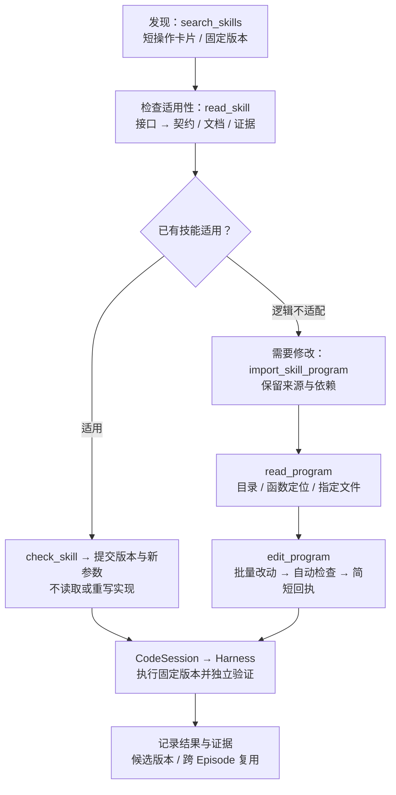

# 代码工具与技能复用更新

2026-11-02。改动作用于工作目录的新运行；已有冻结实验、技能源码、版本和运行证据保持原样。

## RAX 的复用方法，以及我们的对应实现

RAX 的持续学习协议把会话工具说明、当前任务笔记和跨任务技能库分开。技能先出现在简短索引中；需要时读取适用条件，再检查当前场景、调用已有入口。只有不适配时才局部修改。来源：[持续学习协议](https://github.com/robot-agent-exploration/rax/blob/db744f5950582c7c301f249192c0ed3c76517dd8/skills/continual-learning/SKILL.md)、[技能包格式](https://github.com/robot-agent-exploration/rax/blob/db744f5950582c7c301f249192c0ed3c76517dd8/skills/continual-learning/references/library-format.md)。

可复用的单位是有明确进入和退出状态的操作函数。感知、移动、抓取、运输、放置等函数接收同一 `ctx`，通过 Python import 组合；运动依赖当前观测，参数与控制逻辑分离。成功和失败的执行证据分别记录；改变行为后需要重新验证。这不等于把某次成功轨迹的世界坐标保存后直接重放。

我们的代码包、依赖锁定、独立 worker 和参数化调用已经具备这些基础，见 [先前接入](rax-code-policy.md)。这次补齐的是**模型使用它们的工具层**：更短的发现入口、分层读取、统一编辑和自动检查。没有照搬 RAX 的机器人参数，也没有声称获得了相同实验性能。

## 模型看到的组织方式



只有确实缺少操作时才用 `write_skill_package` 创建新包；语义名称表示操作及起始条件，同一操作的修订保留名称。新布局中的相机选择、目标框、观测步或物体位姿应通过已声明的参数传入，不因此增加源码版本。

默认工具目录分为 `discover`、`inspect`、`develop` 三组；执行仍统一通过 `submit_intervention(kind="code", ...)` 交给 Runtime/Harness。旧 `write_program`、`patch_program`、`patch_program_batch`、`patch_skill_package` 的处理器保留兼容，但从默认模型工具菜单移除；`planner_tools(include_legacy=True)` 可显式取得旧菜单。只读审核仍不能写入或编辑程序。

## 读取：索引、契约、实现和证据分开

`read_program` 与 `read_skill` 使用相同视图：

| view | 内容 | 适合什么时候读 |
|---|---|---|
| `interface`，默认 | 身份、入口、文件列表、依赖、参数名称、公开函数静态签名与简短说明 | 判断是否可能适用；默认不带全文或大参数 schema |
| `contract` | 完整参数 schema、参数来源、前置条件、能力要求、已知失败与完成条件 | 准备调用；这些约束不静默截断 |
| `documentation` | 分页的 `SKILL.md` | 理解过程、参数校准和感知检查点 |
| `outline` | 文件哈希、声明名称和行号；可限定文件 | 定位需要修订的函数 |
| `source` | 单个文件，或文件内指定函数/类 | 需要了解或修改具体逻辑 |
| `evidence` | 当前库快照携带的证据与运行摘要，分页返回 | 核对已测范围、成功和失败；完整原始日志仍独立存储 |
| `diff` | 工作区版本差异，分页返回 | 审核改动；只适用于 `read_program` |

传入 `path` 而不指定 view 时，自动选 `source`。源码响应只带版本身份和所选文本，不重复附带文档、参数 schema、其他文件或完整包 manifest。公开函数来自 AST 静态分析，也能解析包内的相对导入重导出；不执行模块，签名并不证明物理前后条件成立。

示例，标识和路径需替换为检索结果中的真实值：

```python
read_skill(skill_id="eef-feedback-control", version="<固定版本>")
read_skill(skill_id="eef-feedback-control", version="<固定版本>", view="contract")

read_program(version="<工作区版本>", view="outline")
read_program(version="<工作区版本>", path="code/example_control/controller.py", symbol="move_to")
```

源码、文档、目录、证据和 diff 按字符 `offset/limit` 分页，默认 24,000，上限 65,536。`next_offset` 非空表示仍有内容，必须继续读取所需部分。跨页读取保持相同版本、路径和 symbol；片段仍携带完整文件哈希，供编辑校验。`contract` 显式请求完整约束，不使用该分页。

`search_skills` 每项只返回一张操作卡片；`list_skill_versions` 默认每页 5 个版本，上限 10。短摘要可能裁剪描述，不能替代调用前的完整契约。候选、模板和 verified 状态保持原值；索引不会把一次成功自动提升成可靠技能。

## 写入：一个批量编辑事务，自动返回检查

首个程序用 `write_skill_package`；已有程序主要用 `edit_program`。后者同时支持多文件包和 legacy `policy.py`，无需为不同代码形态记住多种 patch 工具。

一次编辑最多 16 项，全部相对于同一个不可变 `base_version`：

- `replace`：唯一匹配的 `old_text` → `new_text`；同一文件的多个片段不能重叠。
- `write`：新增模块，或完整替换模块；覆盖已有文件必须提供其 `expected_sha256`。
- `delete`：删除不需要的模块，也必须提供旧哈希；必需入口、文档、命名空间或参数文件不能删除。

整文件写入/删除不能与同文件的片段编辑混用。路径、哈希或任一片段不匹配时，不留下部分版本。无代码或契约变化的编辑会被拒绝，提示复用原版本和新参数。依赖更新需同时保持 `uses` 与 `SKILL.md` 一致。

```python
edit_program(
    base_version="<已读取的版本>",
    edits=[
        {"path": "code/example_control/controller.py", "operation": "replace",
         "old_text": "<唯一匹配的旧代码>", "new_text": "<针对已观察问题的修订>"},
        {"path": "code/example_control/perception.py", "operation": "write",
         "expected_sha256": "<原文件哈希>", "source": "<完整新模块源码>"},
    ],
    hypothesis="对应哪项观察证据，准备检验什么原因",
    expected_effect="修订后应看到什么变化",
)
```

写入、编辑、导入和契约适配自动返回小型回执：版本、来源、改动文件及哈希、契约是否改变、契约读取引用、语法/入口/固定依赖检查结果。源码和大份参数信息不再随回执重发。检查不会 import 生成代码、执行机器人动作或授予成功状态。

`saved=true, checks.ok=false` 表示已保存的候选草稿存在问题，应在返回版本上修复；避免把检查失败误当成写入失败而重复创建。`checks.ok=true` 表示静态检查通过，物理前置条件仍须验证。执行前的宿主检查保留，模型不必为同一个未变化的版本再次发 `check_program`。

参数 schema、原技能前置条件、能力和完成条件在修订中继续继承。接口视图和编辑回执只是减少重复数据，没有移除执行端的契约验证。

## 技能代码应如何分层

通用几何/控制函数保留在共享的语义包，例如现有 `rgbd-surface-geometry`、`eef-feedback-control`。任务包通过固定 `uses` 引用它们，自己的模块只保存该操作特有的感知选择、进入/退出条件与过程。Task Memory 保存“什么情况下优先调用哪个技能”的短规则和引用，不再复制一份源码。

```text
共享几何/控制包
  code/<package>/__init__.py      公开函数与接口说明
  code/<package>/params.py        有单位、范围和校准说明的参数
  code/<package>/...              实现

任务操作包
  SKILL.md                       适用条件、契约、证据、uses
  code/run.py                    组合已声明依赖，main(ctx, **params)
  code/<task_operation>/
    perception.py                新观测 → 场景参数
    controller.py                有检查的任务操作
    params.py                    任务特有的范围和校准参数
```

层次是软件职责，不是强行把每个物理阶段拆成一次 Astra 调用。函数之间共享同一 ctx、控制权和预算；程序可以执行整个子任务。稳定的观察状态适合作为函数边界，接触进行到一半时不应仅为代码模块划分而交还 VLA。

本次没有批量改写历史任务技能，也没有把未验证的抓取逻辑标为通用技能。下一步需要针对实际重复代码提取经过证据支持的公共函数，并验证组合后的行为；目录整理和接口优化本身不能证明这些函数可靠。

## 实测收益与验证

使用原 Waffle 五个 episode 的旧工具响应，逐项重放 395 次带 path 的 `read_program`。每次读取所请求模块的全部分页，拼回源码并逐字比较：

| 项目 | 旧工具 | 新工具 |
|---|---:|---:|
| 对应的模块读取 | 395 | 395 |
| 总响应页数 | 395 | 399 |
| JSON 返回字符总量 | 15,989,578 | 3,562,487 |
| 每个模块平均返回字符，含全部分页 | 40,479.94 | 9,018.95 |
| 请求源码是否完整保留 | 是 | 是，395 项全部一致 |

返回字符减少 **77.72%**。默认分页最初设为 12,000 时会变为 484 页；调整为 24,000 后仅多 4 页，减少额外工具往返。需要较长文件时仍可显式提高 limit，修改小函数时优先 symbol 定位。

这是返回文本体积的离线对照，不是 API token、Astra 用时或机器人成功率提升。新调用流程何时请求契约、是否少读源码，还需要实际模型运行验证。

软件验证覆盖：逐字分页与 Unicode、函数定位、静态公开接口解析、多文件原子编辑、错误哈希/路径/重叠拒绝、旧契约继承、源码未执行、固定依赖自动检查、候选状态不变、只读审核禁止编辑，以及已有包跨 Episode 直接复用。原执行预算与独立整子任务核验保留。

完整测试集 **253 项通过**，相关模块的针对性回归 **41 项通过**，`ruff check src tests scripts` 通过。已有跨 Episode 测试确认：下一 Episode 直接调用保留的包版本，不使用写代码工具，也不创建新技能版本。

另重建了 seed 0 的 3 个历史导入/修改回执：返回字符分别由 9047、5675、8163 降为 3037、2884、2545，包含自动依赖检查，均无动作执行。它们只是具体样例，不代表全部写入的平均收益。见 [写入回执样例](../runs/code-tool-refactor-20261102/write-receipt-examples.json)。

产物与代码：

- [code_tools.py](../src/vla_agent/code_tools.py)：视图、签名、短索引与写入回执。
- [workspace.py](../src/vla_agent/workspace.py)：批量编辑事务、不可变版本和完整差异。
- [toolkit.py](../src/vla_agent/toolkit.py)：工具菜单、参数校验与调度。
- [恢复指南](../src/vla_agent/guides/recovery.md)：提供给 Astra 的当前用法。
- [benchmark_code_reads.py](../scripts/benchmark_code_reads.py)、[配对结果](../runs/code-tool-refactor-20261102/read-benchmark.json)。
- [完整测试结果](../runs/code-tool-refactor-20261102/pytest.txt)、[针对性回归](../runs/code-tool-refactor-20261102/targeted-pytest.txt)。

```bash
cd /home/junwue/code/vla_agent
.venv/bin/python scripts/benchmark_code_reads.py runs/waffle-subtasks-20261102 \
  --output runs/code-tool-refactor-20261102/read-benchmark.json
.venv/bin/pytest -q
.venv/bin/ruff check src tests scripts
```
## 2026-11-03 写入反馈补充

微波炉预算测试中，一次技能包提交仅因契约章节使用一级标题而被拒绝，随后模型重新提交了整包。文档检查现在接受 `#` / `##` 契约章节，以及 `##` / `### Perception checkpoints`；不改写原文件，不放宽所需契约内容、Python 检查或动作权限。真正遗漏的章节会逐项列出，提示只修正文档。原始失败请求已在本地通过静态复验，未重新调用模型或执行机器人：[复验记录](../runs/bounded-comparison-20261103/doc-error-replay.json)。

