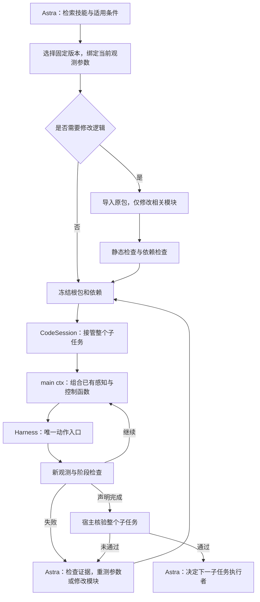

# RAX 风格 Code Policy：可组合技能包

2026-10-31。本次把 Code Policy 从单文件恢复脚本扩展为可导入、可组合的 Python 技能包；已有程序仍兼容。实现与验证记录在 [本次运行目录](../runs/rax-code-policy-20261031/README.md)。

2026-11-02：以下保留包接入时的工具流程记录。当前默认流程已改为接口/契约分层读取、`edit_program` 批量编辑和写入后自动检查，详见 [代码工具更新](code-tools-v2.md)。旧 patch 工具保留兼容，不再放在默认菜单中。

## 参考了什么

RAX 已克隆到 `/home/junwue/code/rax`。`main` 提供持续学习工作流和技能库格式，运行时参考 `libero-pro/native`；同时获取了 `real/franka` 分支供后续查阅。精确提交和参考文件校验值见 [来源记录](rax-package-reference.json)。

| RAX 的具体实现 | 本系统对应实现 |
|---|---|
| `skills/continual-learning/references/library-format.md`：按操作命名、SKILL.md、命名空间模块、params.py、uses、运行证据 | `skill_packages.py` 定义包格式；`SkillLibrary` 保留版本、适用条件和证据 |
| `services/controller/storage.py`：冻结文件集合及 runtime digest，执行前校验 | 执行 bundle 固定根包、全部依赖、文件哈希及 worker 哈希 |
| `auto_research_agent/api/runtime.py`：宿主提供 Context，程序输出与 RPC 协议分离 | `main(ctx, **params)`、`ctx.call`，独立协议文件描述符；动作仍经过 Harness |
| `agent_skills/auto-research/autonomous-control/SKILL.md`：重新测量、分段检查、基于反馈修改代码 | 保留阶段回执、真实轨迹和 CodeSession；修改具体模块，重新验证整个子任务 |

这里采用 RAX 的程序组织和探索方法，适配我们的 VLA 监督链路。没有把 Libero/Franka 的动作实现当成 RoboCasa 控制器，也没有让生成程序直接连接仿真器。RAX 的许可证及声明保存在 [references/rax](references/rax/NOTICE)。

## 执行结构



普通 Python 函数之间的调用不触发 Astra。感知、几何和反馈控制能在同一个隔离进程中循环运行。只有需要新的判断或代码修订时才返回 Astra。这个机制减少重新生成和阅读重复代码的需求；实际墙钟时间仍需新仿真对照测量。

## 包与版本

```text
skills/<操作名称>/<不可变版本>/
  SKILL.md
  code/run.py                         # main(ctx, **params)
  code/<操作名称转下划线>/
    __init__.py                       # 可复用的公开函数
    params.py                         # 有单位的参数、边界及校准说明
    perception.py
    controller.py
  manifest.json                       # 参数契约、来源、全部文件哈希、固定依赖
  policy.py                           # 兼容既有记录工具的入口副本
  runs.jsonl                          # 追加尝试证据
```

`SKILL.md` 包含适用范围、前置条件、过程、接口、检查、感知检查点、失败模式和证据。`uses` 声明依赖的语义名称；工具参数同时指定精确版本。包内正常使用 Python import，例如：

```python
from rgbd_surface_geometry import decode, project, point_patch
from eef_feedback_control import pose, move_bounded
```

一个入口可组织多个阶段和技能函数，各函数共享同一个 `ctx`、动作控制权和预算。不得通过导入依赖重置动作步数、时间或工具调用预算。根包返回：

```python
{"ok": True, "measured": {"observation_step": 1119}, "why": "..."}
```

这只是程序的完成声明。整个被分配子任务的宿主 verifier 通过后才能结束 CodeSession；一个局部动作的成功不能触发 VLA 接管。

包版本由文件集合及依赖声明参与计算。即使 `code/run.py` 相同，修改 controller.py 或绑定另一个依赖版本也形成不同版本。执行日志同时记录入口 `sha256`、完整 `package_sha256` 和传递依赖的 `bundle_sha256`，避免把相同入口、不同控制程序误归为一次成功。

## Astra 的工具流程

1. `search_skills` → `list_skill_versions` → `read_skill`。搜索按操作聚合，`package_variants` 指向对应模块化版本；需要细节时通过 `path` 读取单个模块。
2. 已适用：重新测量 `parameters`，`check_skill`，直接 `submit_intervention(kind="code", skill_id=..., skill_version=..., parameters=...)`。不需要创建源码版本。
3. 需要修订：`import_skill_program` 导入全部文件与契约，`patch_skill_package` 修改指定文件中的唯一匹配片段，可原子添加新模块或更新固定依赖。然后 `check_program`，提交 `program_version`。
4. 缺少过程：`write_skill_package`，明确 `reuse_reason`，组合已有模块。已存在的同名过程必须先导入，不能通过同名新建绕过历史。
5. 执行后查看 `read_recovery_trace`，区分观察事实、原因假设、参数问题和控制逻辑问题。参数问题重新绑定；实际逻辑问题才 patch。

`check_program` 不执行或 import 生成代码。它检查 Python 语法、入口、文件完整性、依赖闭包、机器人型号、能力与 verifier 是否存在。缺失依赖、冲突版本、循环、文件改动及 runtime 不匹配会拒绝运行。**这些检查不证明当前物理前置条件成立**；根程序和被调用函数仍须依据新观测检查自己的进入及退出条件。

Episode 使用启动时固定的库快照，`uses` 只能引用该快照中的版本。本轮新写的辅助函数可放在当前包的命名空间内组合。执行后的包在 accumulate 模式写入候选库，下一 Episode 才能检索；frozen 模式只留下当前运行的工作区和证据，不改变跨 Episode 库。运行中不会自动跟随磁盘上的“最新版”。

只读监督阶段没有写包和修改包权限。独立库版本保持不可变；工具不会将文档里自称 `verified` 的程序自动提升为已验证技能。新包保留 candidate 状态，需要独立重复测试后评审提升。

## 这次真正迁移了哪些代码

从两个历史程序提取完全相同的函数，形成两个公共包；两个关门版本引用相同的公共依赖。没有批量给历史候选换名或重新生成控制策略。

| 包 | 版本 | 内容与范围 |
|---|---|---|
| `rgbd-surface-geometry` | `5aa70d58296eb1b4` | 原始观察解码、投影、局部深度点提取；不执行动作 |
| `eef-feedback-control` | `6be2c1eb747b8105` | 实测 EEF 位姿和受限目标跟随；依赖前一个几何包 |
| `close-toaster-door-from-upright` | `b22b65f09b8cc992` | 从 `6e0569a16adc2f86` 提取；近竖直门的圆弧参考跟踪和压合 |
| `close-toaster-door-from-upright` | `90a28a7feeb1d020` | 从 `2ff9c7e5cdd39598` 提取；同一类操作，顶部区域可独立选择相机 |

后两个是同一技能的两个版本；前两个是共享模块，不是两个新任务。所有新版本都是 draft/candidate。原有 9 个已整理历史版本仍可访问，另外 7 个暂未模块化，149 个未整理历史版本仍保留在归档检索范围。完整目录见 [skills/INDEX.md](../skills/INDEX.md)。

动作参数边界、几何检查及控制分支沿用原代码。输入框和 observation_step 必须来自当前场景。近竖直门的成功不能证明它能从完全放下的门开始，也不能称为通用抓取技能。

## 验证与边界

新增测试覆盖包完整性、依赖锁定、循环与冲突、跨模块执行、共享预算、原子补丁、只读限制、错误返回、原生 stdout 隔离、候选留存与下一 Episode 直接复用。

另用两个历史成功片段的原始观测与 RPC 回执驱动隔离 worker，逐项比较重构前后的工具名和参数。回放不接入仿真器，不执行新物理动作：

| 历史片段 | 对齐的非恒定工具请求 | 动作工具调用 | 原记录执行步数 | 动作参数一致 |
|---|---:|---:|---:|---|
| seed 9 | 899 | 66 | 131 | 是 |
| seed 44 | 117 | 9 | 17 | 是 |

新包最后多一次只读观察，用于结构化返回；它读取原记录最后动作的实际状态。回放支持“这些已执行路径的行为保持一致”，不覆盖未走到的分支，不增加成功样本数，也不证明跨 seed 成功率或耗时已改善。详细回执见 [replay-final/summary.json](../runs/rax-code-policy-20261031/replay-final/summary.json)。

复现软件检查：

```bash
.venv/bin/pytest -q
.venv/bin/ruff check src tests scripts
.venv/bin/python scripts/replay_package_refactor.py --output runs/rax-package-replay-new
```

下一次真实仿真应先固定上述技能版本，在满足各自入口条件的状态上比较直接复用与原单文件执行，再测试新的布局。按 Episode 统计源码修改次数、参数重试次数、Astra 时间、执行时间和成功率；只有这些数据才能支持“积累后探索越来越快”。
