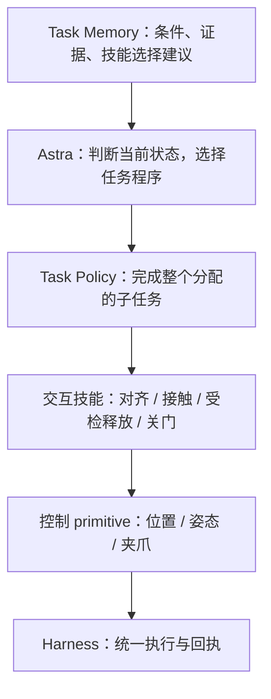

# Task Memory 与控制 primitive 的分层

2026-10-31。Task Memory 已接入运行时；本文的 primitive 命名表是接口设计建议，尚未将全部别名实现为新控制 API。

## 当前已接入的 Task Memory

任务指南与原始 Episode 经验分开保存。指南回答“在什么可观测条件下，优先保留 VLA、补充什么观测、考虑哪个技能、避免哪些已知错误”；Episode 记录提供其证据。

默认路径是 `experience_library` 同级的 `tasks/`，可用 `runtime.task_memory_library` 显式设置。CloseToasterOvenDoor 的首版位于 [profile.json](../memory/close_toaster/tasks/CloseToasterOvenDoor-e4e279cbed61/profile.json)，人工可读说明见 [任务记忆目录](../memory/close_toaster/tasks/README.md)。

每个 profile 包含：

- 精确任务范围：`robot + environment_kind + task_name`，不包含 seed，允许同任务跨 seed 使用。
- 适用条件、阶段建议、未知问题。
- 条件规则：`when → recommendation`，可引用固定 skill ID/version 和现有工具。
- 规则的 `observed_pattern / hypothesis` 区分、禁止误用的情形。
- 历史 Episode ID、日志哈希与证据角色：支持、反例或上下文。

启动时固定 profile 内容与哈希，将其放入 Working Memory，再开始 Astra 初始规划。**加载指南不设置阶段、不改 VLA 语言、不转移控制权。** Astra 必须结合当前场景决定是否采用阶段建议，整任务成功仍由已有 verifier 核验。

`read_task_memory` 返回本 Episode 的完整快照。Codex 同一线程第一次收到完整指南，之后只收到可展开的引用；新线程或上下文压缩后重新发送。不为加载记忆新增模型调用。

`search_experiences` 和 `read_experience` 现在沿用精确任务范围。相似任务名、相似 instruction 或笔记中出现同一关键词，都不会越过 task_name、环境与机器人的边界。技能库仍可按适用条件跨任务复用；task scope 不限制通用技能检索。

## 更新与证据

`propose_task_memory` 保存一条有证据的规则候选，绑定当前 profile 版本。可引用库内历史 Episode 与哈希，或当前已记录事件 ID；只读审核不能引用其快照产生后的事件。候选存入 `runs/<episode>/task_memory_candidates/`，不修改正在使用的指南。

Episode 结束后，离线结合最终结果整合候选，用 `TaskMemoryStore.write_profile(..., expected_version=...)` 发布下个版本。该函数校验历史证据的任务范围及哈希，保留 `versions/<hash>.json`，更新 `profile.json`。它由单一离线写入流程调用，不作为 Astra 在线控制工具开放。旧 Episode 的指南快照及日志不变。

当前没有自动运行额外的总结模型，也没有把所有候选自动合并为事实。观察支持一个局部策略，不等于证明全部场景都适用。缺失证据或技能版本会在读取时明确标为 unavailable。

并行 seed 启动器将指南复制到每个 worker 的 `inputs/tasks`；worker 产生的建议留在其运行记录，不直接合并进其他正在执行的 worker。现有冻结/累积评测模式保留：冻结模式不向长期经验库写入本轮结果。

## 你的六个 primitive 如何划分

按功能分类是合适的；需要区分“位姿命令”“交互过程”和“任务结果”。以下是建议的统一接口语义：

| 类别 | 名称 | 应有的语义与检查 | 当前已有基础 |
|---|---|---|---|
| 位姿控制 | `move_to(position)` | 保持约定姿态，分段移动至目标位置；明确坐标系、米、误差阈值、路径范围和步数预算 | `ctx.move_eef` / `ctx.move_relative`，共享 `move_bounded` |
| 位姿控制 | `move_pose(position, quaternion)` | 同时达到位置和姿态，以实测误差判断；不能仅凭已发命令判定到位 | 实测 OSC 位姿、四元数目标与跟踪回执 |
| 姿态控制 | `rotate_eef(axis, angle, frame)` | 指定旋转轴、弧度、tool/base 参考系和保持位置；由 `move_pose` 组合实现 | `move_relative` 的旋转向量和 `move_eef` |
| 夹爪命令 | `set_gripper(open/closed)` | 发送夹爪目标并观察实际变化；闭合不证明抓稳 | `ctx.set_gripper(closed=bool, steps=...)` |
| 条件交互 | `release(...)` | 验证允许释放的当前条件，打开，再检查物体/门的状态；不确定时返回失败证据 | 当前任务程序里的释放与 clearance 阶段，需要抽取和专门测试 |

`rotate_wrist` 与 `rotate_pitch` 可以作为有明确语义的便捷封装，但不宜成为两个独立控制算法。首先要明确它们表示末端局部轴旋转、基座坐标系旋转，还是某个真实腕关节角。当前使用笛卡尔 OSC 控制，不能把 EEF 姿态变化描述成“指定腕关节转过某角度”。tool/base 的旋转复合顺序也不同。

`move_to` 不能隐含任意三维目标都可达或沿途无碰撞。当前 OSC 接口执行受限的小段控制，没有通用碰撞规划器。距离较大的运动需要程序决定受检的分段路径，或以后接入明确的路径规划能力。底座移动后，旧 `osc_arm_base` 目标可能失效，必须重新观测并变换。

`release` 比 `set_gripper(open)` 高一层。例如放置后的释放要求物体已经有支撑，铰链门解除接触则需要检查门状态、夹爪约束与后续 clearance。它不能硬编码成“先开夹爪再确认有没有掉”。当前只有已注册条件才能调用 `ctx.check`，不得凭名称发明 `object_supported` 等原生 verifier；未提供的判断需要从实际观测中构建、记录并单独验证。

## 推荐调用结构

Astra 选择或修改 Task Policy，程序用 Python 函数组合技能与 primitive。primitive 的反复调用不需要反复请求 Astra；遇到不支持的状态或检查失败，再携带阶段证据交回 Astra。

Task Memory 适合保存“当前门已近竖直且几何检查通过时，考虑某个关门技能”的条件。它不应保存某个 seed 的固定坐标作为下一轮动作，也不应规定每轮都直接走 `move_to → rotate_pitch → set_gripper`。

这次落实的是记忆层和接口设计。已有 worker、控制边界和技能包 SDK 未改动；后续新增 primitive 应先在隔离程序中验证坐标系、到位判断、停止条件和共享预算，再让多个交互技能调用它们。
