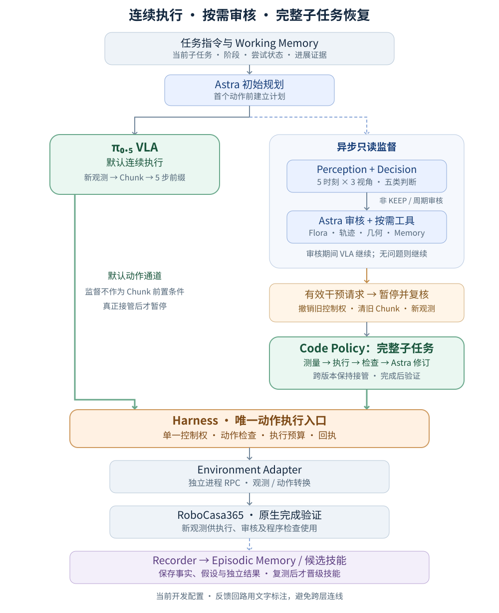

# 架构与实验更新：CloseToasterOvenDoor 闭环恢复（2026-10-30）

本次更新对应 `runs/toaster-iteration-20261029` 的多轮开发记录，以及当前 `configs/close_toaster_explore.yaml` 的实际运行配置。实验集中在 CloseToasterOvenDoor，用于验证监督、代码探索和经验积累的完整链路；尚未进入多任务正式评测。

目前已经得到两次由 RoboCasa 原生成功判据确认的 Code Policy 恢复：一次在总计 1341 步完成，另一次在 1436 步完成。后者在接管前与固定采样的纯 VLA 对照完全一致，而纯 VLA 延长至 2000 步仍未成功。这支持“程序探索可以恢复部分 VLA 卡住的执行状态”，但尚不能证明原生 450 步预算下的成功率超过此前的 48%。

## 一、现在的系统如何工作

系统保留 VLA 默认执行、Decision 筛查、Astra 顶层推理、Code Policy 程序恢复的分工。核心更新是将连续执行和监督审核解耦，并把 Code Policy 的责任范围明确为完整子任务。

### 1. 连续执行循环

环境产生新观测后，π₀.₅ 根据当前有效任务指令生成 Action Chunk，Harness 执行配置允许的前缀，再获取新观测。本轮每次执行 5 步前缀。所有实际动作都经过 Harness，由 Environment Adapter 转换并发送给仿真环境。

首次执行前，Astra 读取原生任务描述并建立计划。进入执行后，Decision 和 Astra 的只读审核不作为每个 Chunk 的前置步骤。观察、查看轨迹和记笔记本身不撤销 VLA 控制权、不清理 Chunk，也不额外要求 VLA 重新推理。

### 2. 异步监督循环

Perception 整理历史 RGB-D、实测状态和动作证据。Decision 根据周期或事件进行检查，保持以下五类输出。

| 输出 | 含义 | 运行时行为 |
|---|---|---|
| KEEP | 当前证据支持继续执行 | VLA 继续 |
| REFINE | 当前指导可能需要调整 | 交给 Astra 只读审核 |
| SWITCH | 当前子任务可能完成 | 交给 Astra 审核；切换前独立验证，不计为失败 |
| REPLAN | 剩余计划可能不再适用 | 交给 Astra 只读审核 |
| ESCALATE | 证据不足、输出异常或需要进一步判断 | 交给 Astra 只读审核 |

非 KEEP 不直接暂停机器人，也不与某种恢复方式绑定。Astra 结合当前阶段、首次尝试或重试状态、历史问题和物体进展证据判断：是合理探索、暂时看不清，还是确实需要干预。Decision 超时或输出无效按 ESCALATE 处理，但不会因此自动接管动作。

当前开发配置另外每 150 步触发一次 Astra 周期审核，用于发现 Decision 未触发的问题。已有 Astra 审核挂起时，不再并发发起新的 Decision 或 Astra 请求。这能控制请求重叠，但也会使实际 Decision 采样间隔变长，需要单独评估。

只有有效、仍然适用的 Astra 干预请求，才由 Harness 暂停 VLA、撤销旧控制权、清理未执行 Chunk，并获取最新观测。随后 Astra 在暂停状态下再次确认，避免根据过期图像干预已经变化的场景。若旧问题已经消失，可以继续 VLA。

回复绑定 Episode、子任务和语言版本、尝试 ID、控制权版本以及观测时刻。过期回复不能改变执行状态；同一任务仍有持续问题时，重新采集快照进行只读复核。低运动规则只提供证据和触发审核，不根据固定步数直接认定失败或切换 Code Policy。

### 3. 完整子任务的代码探索循环

Astra 决定使用 Code Policy 后，系统将当前完整子任务分配给代码执行器。Astra 在工作区检索、生成或修改程序；执行器运行冻结的程序版本，通过工具读取新观测、完成几何计算、分段执行动作并检查结果。

每次失败分别保存观察事实、原因假设、拟议修改和验证结果。下一版从当前实际状态出发，不假设环境回到了上一版的起点。代码可以反复修改，VLA 在版本之间保持暂停。

局部阶段完成或程序自报 RECOVERED 不代表可以立即交还 VLA。只有完整子任务通过独立完成判据后，Astra 才为后续子任务选择执行器；未完成但预算耗尽时，需要重新决策或停止。本轮两次成功恢复均只发生一次 VLA 到代码执行器的接管。

### 4. 模块边界

| 模块 | 当前职责与边界 |
|---|---|
| Runtime | 调度快速执行和监督请求，管理 Episode、回复时效、干预与预算 |
| Perception / Decision | 组织历史观测并给出五类参考判断；不拥有动作控制权 |
| Astra / Toolkit | 初始规划、阶段诊断、审核与工具选择；承担 Code Agent 的生成和修订工作 |
| Code Policy / Workspace | 保存不可变程序版本，执行感知、控制和检查逻辑；跨版本承担完整子任务 |
| Harness | 唯一动作入口，检查控制权、动作范围、预算和执行回执；拒绝旧控制权下的动作 |
| Environment Adapter | 隔离仿真依赖，转换图像、深度、机器人状态和动作，提供原生完成验证 |
| Memory / Skills | 保存当前任务状态和跨 Episode 的可检索经验、候选程序及证据 |
| Recorder | 保存完整原始观测、命令与实测轨迹、模型判断、工具调用、代码版本和独立验证 |

通信按用途分开：π₀.₅ 使用 WebSocket，Decision 和 Flora 使用本地 HTTP，Astra 经 Codex app-server 调用工具，仿真运行在独立 Python 进程中，通过单步 RPC 交互。动作由 VLA 或程序生成，Harness 授权执行，Adapter 推进物理环境。

## 二、相对早期方案的主要变化

### 1. 从频繁暂停检查，改为只读审核后再决定接管

第一次尝试优先保持连续执行。Astra 根据 Memory 和多个时刻的进展判断是否介入，而不是把“还没抓住”“经过一段时间”直接当成失败。首次尝试也不是绝对豁免：有明确的持续无效接触或错误执行证据，仍可以恢复。

新增的 stalled_progress 是 Astra 内部审核状态，要求多个不同观测时刻支持物体进展停滞；它不是第六个 Decision 类别。

### 2. 区分可执行子任务和诊断阶段

子任务规划仍由 Astra 负责，但必须尊重实际可用的验证器。当前 RoboCasa 接口只提供整体 task_success，因此 CloseToasterOvenDoor 保留一个可执行子任务，内部可以记录“接近—建立接触—抬门—压合—验证”等诊断阶段。

这些阶段帮助 Astra 定位代码应该修改哪里，不会伪装成已经有独立完成验证的子任务。复合任务后续需要补充真实子任务验证器，再支持可靠的细粒度切换。

### 3. 收紧 REFINE，保持 VLA 的语言分布

VLA 只接收当前有效任务指令，不拼接主任务、Memory、失败解释和精细动作教程。REFINE 只能选择预先注册的任务指令；REPLAN 也不能通过改写计划绕过这一边界。

本次成功轨迹中的有效语言始终是 `Close the toaster oven door.`。恢复收益来自代码执行及其反复测量、修订，没有证据表明收益来自更细的自然语言指导。

### 4. 增加视觉历史，精简重复数值

当前实验中 Decision 和 Astra 都使用最多 5 个历史时刻、每个时刻 left / right / wrist 三视角，即最多 15 张图。Decision 采用多时间尺度采样：距当前约 10、5、2、0.5、0 秒；历史不足时只使用已经发生的观测。

Astra 的数值历史摘要从最多 30 行均匀选取 6 行，并保留三位小数。三个检查样本的 memory 文本从约 2.3–2.4 万字符降到 0.55–0.71 万字符。这里统计的是字符，不是 token；图像没有删减，原始记录和当前控制几何保持精度，可通过工具按需读取。

### 5. 增强深度、grounding 和机器人几何工具

程序可以根据 RGB 中的目标区域读取带物理尺度的深度，转换到机器人控制坐标系，计算相对位置，再在执行后重新测量。缺失、遮挡、混合深度和跨视角不一致需要保留为不确定性，不能直接生成高置信度动作。

本轮发现，机器人末端坐标轴不等于直觉中的夹爪张合轴。现在 Adapter 从机器人运动学计算并提供 jaw_separation_axis_eef，本机 Panda 控制坐标系下约为 [-1, 0, 0]。该接口经过零动作真实初始化检查，不读取目标物真值；它是在相关成功运行启动后补入的，不能把已有成功归因于这个新增接口。

当前工具包括观测与轨迹读取、图像查看、grounding、几何查询、Flora 评估、经验检索、程序编写与检查、执行反馈等。IK 和路径规划能力尚未实现。

### 6. 短期状态、长期经验和技能证据分开保存

Working Memory 保存当前任务的计划、有效语言、尝试状态、阶段证据、审核结果、代码版本和控制来源。Episodic Memory 保存跨 Episode 的问题现象、方法、结果与适用条件，供 Astra 判断类似问题值得调用哪些工具。

技能库保存代码及其前置条件、版本和实际运行证据。所有执行过的程序，包括失败程序，都会留下候选记录。单次成功只增加成功证据，不自动晋级为 verified；候选需要显式检索，同等文本匹配时才用成功运行证据辅助排序。

Episode 开始时冻结技能快照，避免运行中隐式改变可用技能。当前的持续改进发生在程序、参数、检索和经验库层面，没有训练 Code Agent、Decision 或 VLA，也没有让 Astra 在线任意修改 Harness、验证器和执行边界。

## 三、实验设置与比较口径

| 项目 | 本轮设置 |
|---|---|
| 任务 / 机器人 | CloseToasterOvenDoor；atomic_seen / target；PandaOmron |
| VLA | OmniSF π₀.₅，checkpoint 59999，quantile normalization；模型权重未修改 |
| 动作执行 | 20 Hz 仿真控制时间，每轮执行 5 步 Chunk 前缀 |
| Decision | 本地 vllm-sr/d3-flash；五类输出；周期 50 步并结合事件触发 |
| Astra | gpt-6-astra / xhigh，经 Codex；只读审核与代码生成、修订 |
| Flora | 本地 nvidia/Flora-Rewarder，实验使用 int8 变体，按需给出轨迹评价及理由 |
| 原生预算 | 450 步；保留纯 VLA 原生预算试验 |
| 开发预算 | 关闭原生 horizon 和 Episode 墙钟限时；总步数按轮次为 2000 或 4000 |
| 代码预算 | 单程序最多 200 步 / 180 秒；会话最多 12 次执行、2400 步 / 5400 秒；最多保存 64 个源码版本 |
| 剩余限时 | 模型请求、RPC、单程序及代码会话仍有 deadline，并非完全无界运行 |

第 1—7 轮使用服务原有共享采样流，相同场景 seed 不保证相同 VLA 轨迹；不能把跨轮差异直接归因于 Agent。第 6、7 轮还包含失败动作前缀的物理重放，是开发复现工况。

第 8—10 轮增加请求级固定采样，使用 scene seed 0、policy seed 42。真实 A/B/A 检查确认，同一采样 seed 输出完全一致，不同 seed 的动作最大差异约 0.273。仿真源码和 checkpoint 均未修改。

## 四、逐轮结果与修改

| 轮次 | 设置或修改 | 实际结果 | 解释 |
|---|---|---|---|
| 0 | 接入取消原生 horizon | 三条记录均在 0 步启动失败 | ignore_done 重复传参；修复本进程实例配置，不计策略试验 |
| 1 | 纯 VLA，原生 450 步，seed 0/1/7 | seed 0 失败；seed 1、7 在 278、216 步成功 | 原生预算开发基线 |
| 2 | 扩展预算、异步审核、增加恢复预算 | seed 0 在 585 步成功，全部由 VLA 执行 | 无代码动作，不能记为 Code Policy 恢复收益 |
| 3 | 纯 VLA，2000 步 | seed 0 到 2000 步仍失败 | 采样流与第 2 轮不同，不构成严格配对 |
| 4 | 原生预算，补充 seed 2/3/4 | 在 330、207、307 步成功 | 第 1、4 轮合计 5/6，只是小规模开发样本 |
| 5 | Flora int8、数值摘要压缩、调整审核时效、多版代码 | seed 2 在 231 步由 VLA 成功；seed 0 在 1341 步成功，其中 1025 VLA + 316 Code | seed 0 执行 10 个代码版本，17 Astra turns、1 次 Flora；约 48.8 分钟 |
| 6 | 重放失败前 800 步，加入 stalled_progress 审核 | 1715 步接管，执行 5 版、230 个代码动作；1945 步仍未完成 | 随后 Astra serverOverloaded，属于恢复未完成加服务故障 |
| 7 | 过期审核重新取证，明确程序预算和测量笔记 | 1169 步暂停，首版程序写出但未执行 | Codex turn 超过 600 秒；旧日志误记为总墙钟限时，已修复分类 |
| 8 | 固定采样，纯 VLA，450 步 | scene 0 / policy 42 失败 | 与第 9 轮前 450 步状态一致 |
| 9 | 同一固定采样，完整 Agent，预设上限 4000 步 | 1436 步成功：650 VLA + 786 Code | 13 版源码、12 次执行，18 Astra turns、2 次 Flora；约 92.2 分钟 |
| 10 | 同一固定采样，纯 VLA，2000 步 | 到 2000 步仍失败，约 804 秒 | 与第 9 轮接管前的动作和状态逐步一致 |

共保留 18 条 Episode 记录，其中包含第 0 轮 3 条启动失败；生成 30 个源码版本，实际执行 27 次。27 份执行候选和 6 份 Episode 经验已保存到项目长期目录，目前 verified 技能仍为 0。

第 9、10 轮对照额外核对了接管前全部 650 条控制命令、651 个实测状态，以及每 5 步采样的三视角 RGB，差异均为 0。这使接管前状态具有明确可比性。但 Agent 预设上限为 4000 步，基线为 2000 步，尚不是预设预算完全一致的正式评测；Agent 在共同的前 2000 步范围内成功，也不等于在原生 450 步下成功。

## 五、代码探索实际学到了什么

### 案例 A：接近闭合状态下，十版程序完成最后压合

第 5 轮 seed 0 在第 1025 步移交 Code Policy。早期版本尝试改变接触、撤回重定位和从中央接近，多次因目标遮挡、混合深度或参考点不可靠而停止。后续版本调整观测区域、接触高度和推进方式，最终在第 10 版的 6 个动作后通过原生 task_success。

| 版本 | 执行步数 | 修改和反馈 |
|---|---:|---|
| v1 | 35 | 改变夹爪接触并短程推进，未产生稳定物体进展 |
| v2 | 15 | 放开撤回，目标外观变化超过跟踪边界 |
| v3 | 150 | 撤回、重新定向和接近，目标跟踪失败 |
| v4–v5 | 8、26 | 改选可见把手区域，仍遇到遮挡和混合深度 |
| v6–v7 | 8、2 | 短程压合并调整参考点，右侧参考仍不可靠 |
| v8 | 16 | 使用无遮挡炉顶参考，手部高度超出接触范围 |
| v9 | 50 | 向外清空、降低接触高度，下降被阻挡 |
| v10 | 6 | 根据当前接触跳过已完成步骤，短程压合成功 |

最后一版依赖前九版留下的状态，并含有起始步数和图像区域限制。它是“在该状态下有效的恢复片段”，还不是能从任意初始布局调用的完整关门技能。

### 案例 B：从固定失败轨迹接管，纠正接触几何后完成任务

第 9 轮在第 650 步接管。初版闭合夹爪后抬升，末端移动约 4.3 cm，门边缘没有随之上升，说明末端运动不能作为成功抓取证据。后续探索经历接近受阻、横向漂移、指尖跟踪失效、门边缘跟踪跳变和多视角角度不一致。

第 6 版重新张开手指进行观测，发现此前对夹爪张合方向的假设有误；后续修订接近姿态，并持续检查门本身的运动。第 9 版源码因候选区域有效深度不足，在执行前就被修改；因此总计 13 个源码版本、12 次实际执行。最终第 13 版通过清开手指接触并按当前观测压合，在 110 个动作后完成任务。

两次代码修订发生模型超时，恢复规划后继续同一个代码子任务，没有在中间交还 VLA。该运行开始时的技能快照没有包含后来第 5 轮得到的成功程序，所以这不是成功技能复用的消融证据。

## 六、实验发现与当前瓶颈

### 1. 延长 VLA 执行有时已经足够，干预收益必须单独识别

第 2 轮在 585 步由 VLA 自行成功，说明部分原生预算失败可能只是没有在期限内完成。监督不能把所有长轨迹都解释为缺少技能。需要分别衡量延长预算、监督判断、代码恢复和经验复用各自的贡献。

### 2. 最主要的恢复困难在接触和可测几何

两条成功恢复中，很多版本停在目标遮挡、混合深度、接触不成立、夹爪干涉或参考点不稳定。增加文字描述无法直接解决这些问题。更有价值的是提供可信的机器人几何、按当前观测重算目标、在接触前后检查物体实际运动，并为遮挡保留重新观测路径。

### 3. Decision、Flora 和完成验证器承担不同角色

Decision 决定是否值得进入更强的审核；Flora 给出轨迹评价和解释线索；环境验证器决定任务是否完成。Flora 曾在任务仍未通过原生验证时给出较高评分，其理由也可能包含图像尚不能证实的抓取推断。因此评分和文字原因只能作为待核验意见。

补充的 12 个历史窗口测试得到 8 KEEP、2 ESCALATE、2 SWITCH，平均约 0.45 秒。但终止窗口包含环境终止信息，且没有独立人工标注，不能当作视觉判断准确率或漏判率。

第 5 轮成功运行中，Decision 在观测步 50、100、257、444 的四次输出均为 KEEP；实际问题由周期 Astra 审核发现。这验证了审核与恢复链路，没有证明 Decision 已经可靠发现失败，也不能把它未看到的第 1025 步状态算作漏判。

单张 H100 上，BF16 Flora CPU 卸载并与其他服务共存时，两个离线请求超过 60 秒；int8 变体的两个带理由评估约为 13.45、10.27 秒。这只是特定负载下的小样本，尚未验证量化后的质量等价性或稳定延迟。

### 4. 已有恢复能力，但调用和时间成本仍然高

第 5 轮成功运行的 17 Astra turns 包含 1 次初始化、6 次只读审核、10 次代码规划或修订；第 9 轮为 18 turns。一次 turn 可以包含多个模型和工具请求，不能直接当作 API 请求次数。

第 9 轮超时后重建了 Codex 会话，旧版 token 字段可能只保留最后一个会话，不能用于计算整轮费用。当前实现已改为按 thread 累计并记录用量，旧结果保留原始值并注明限制。

20 Hz 是仿真控制时间，不是当前墙钟运行速度。OSMesa 下纯 VLA 的 2000 步约耗时 804 秒；部分实验还共享模型服务，因此不能据此报告独立推理延迟，也尚未验证真实机器人 20 Hz 下的监督时效。

### 5. 保存成功代码不等于已经形成可复用技能

代码探索证明了局部恢复的可行性，但成功程序仍依赖当时布局、观测区域和前序探索留下的状态。下一阶段需要把这些逻辑提炼成参数化程序，并在相同失败状态和不同布局中重复验证。

导出的动作候选也保持这一边界：第 5 轮只选取最后独立验证版本的 6 个动作，第 9 轮选取最后一版的 110 个动作，均标记 training_ready=false。之前的探索动作保留为原始记录，不因最终成功自动成为正向训练数据。

## 七、当前完成状态与下一步

当前已接通真实 RoboCasa、OmniSF π₀.₅、本地 Decision、Flora 和 Codex/Astra，完成只读审核、有效接管、完整子任务代码迭代、独立验证、候选归档与轨迹回放。最终软件检查记录为 159 项测试通过，Ruff 通过；这属于软件正确性检查，不是机器人成功率评测。

下一步按以下顺序推进：

1. 提炼参数化的关门恢复技能。把目标定位、接触建立、遮挡处理、门运动测量和最终压合分成可复用阶段，替换固定像素区域和起始步数依赖。
2. 在可恢复失败状态上做回归。固定初始状态、采样 seed、预算和技能版本，先复测已发现问题，再测试未参与修改的布局；候选通过重复验证后才晋级。
3. 校准监督触发与成本。在人工标注的历史窗口上评估 Decision；针对长审核导致的采样空档、周期 Astra 审核和重复上下文开销做消融。
4. 验证 Flora 的可靠性。比较量化前后评分与解释质量，区分“运动看起来合理”和“完整子任务已经成功”，保持独立验证器的最终责任。
5. 进行一致预算的正式对照。分别报告原生 450 步与扩展预算结果；固定模型和技能库，与跨 Episode 积累实验分开。之后再扩展到 Composite-Seen / Composite-Unseen。
6. 将系统策略修改保持为受限、可回归的离线流程。可以探索审核频率、检索和程序策略的候选版本，但暂不把在线修改 Harness、成功判据或执行边界作为已经实现的 RSI 能力。

## 八、最后一次完整 Agent 运行的调用、耗时和复用核对

最后一次完整 Agent 运行是第 9 轮；第 10 轮是纯 VLA 对照。第 9 轮实际发起 130 次 VLA Chunk 推理，执行 650 个 VLA 动作；Decision 调用 3 次，观测步为 50、100、296，全部输出 KEEP。代码生成 13 个源码版本，执行 12 次、共 786 个动作；Astra 直接局部动作执行为 0。Astra 共 18 turns，包括初始化 1 次、只读审核 3 次、代码规划或修订 14 次，后者含 2 次超时。Flora 调用 2 次。

本次恢复由 Astra 周期审核及重新取证触发，并非 Decision 的非 KEEP 输出触发。实际 VLA 接管仅 1 次。日志中 interventions=4 包含初始化和恢复重新决策，不能解读为四次物理接管；astra_local 控制权记录也不能等同于真的执行了局部动作。

Episode 耗时没有呈现逐轮下降。第 5 轮成功恢复用时约 48.8 分钟，第 9 轮约 92.2 分钟；第 6、7 轮虽然分别只有 38.4、18.8 分钟，但均因服务故障或超时而未完成，不能作为加速证据。不同轮的接管状态、采样和并发负载也不同。

按事件区间统计，第 9 轮 12 次程序运行共约 5.8 分钟，已完成的代码规划与修订 turns 共约 60.9 分钟，另有两次修订等待至 600 秒 deadline，合计约 20 分钟。主要时间消耗在 Astra 的调查、工具调用、生成修订与超时等待。这里的 turn 时间包含工具耗时，不是纯模型推理时间；只读审核与 VLA 执行重叠，不能把所有组件时间直接相加。

第 9 轮进行了 14 次 search_skills 和 6 次 read_skill，实际读取两个不同的候选程序，二者已有记录均为 UNRESOLVED；旧程序确实进入了 Astra 的上下文，但直接技能执行记录为 0。尚无复用已成功技能后的成功率或耗时对照，不能据此认为技能积累已经缩短了探索。当前归档主要是烤箱门接触、提拉和压合的恢复程序，通用抓取能力仍需另外验证。

上述核对保存在 runs/toaster-iteration-20261029/latest-call-and-timing-audit.json；本次只分析已有日志，没有新增仿真实验。

## 九、证据与复现入口

以下为服务器本地路径，项目根目录是 `/home/junwue/code/vla_agent`。

| 内容 | 路径 |
|---|---|
| 完整报告与逐轮结果 | runs/toaster-iteration-20261029/README.md；results.md；all-results.json；rounds.json |
| 当前开发配置 | configs/close_toaster_explore.yaml |
| 架构与启动说明 | docs/architecture.md；docs/framework-v2.md；docs/iterative-development.md |
| 严格前缀核对 | runs/toaster-iteration-20261029/paired-extended-prefix-check.json |
| 判断时刻与有效指令核对 | runs/toaster-iteration-20261029/decision-observation-times.json；successful-run-audit.json |
| 采样与夹爪几何核对 | runs/toaster-iteration-20261029/sampling-check/result.json；robot-calibration-check/measurement.json |
| 程序、经验与发布记录 | runs/toaster-iteration-20261029/skills/；experiences/；published-artifacts.json；项目 skills/ 与 memory/close_toaster/experiences/ |
| 两次成功恢复回放 | runs/toaster-iteration-20261029/videos/code-success-overview/index.html；videos/seeded-code-success/index.html |

原始失败记录、源码版本和修改前后源码归档均保留。上述实验已结束，相关仿真和模型服务已停止。
